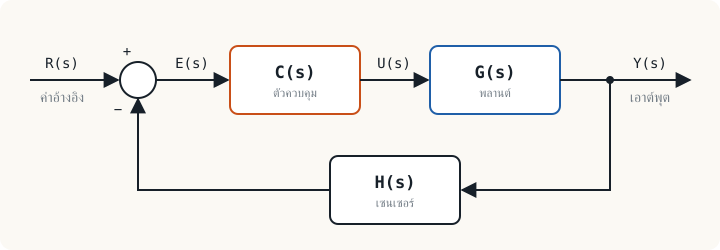

## ระบบควบคุมคือการทำให้ปริมาณหนึ่งเป็นไปตามที่สั่ง {#what}

ตู้เย็นรักษาอุณหภูมิ อินเวอร์เตอร์รักษาความเร็วมอเตอร์ เครื่องบินรักษาระดับความสูง ทุกระบบทำเรื่องเดียวกัน

คือทำให้ปริมาณหนึ่งมีค่าตามที่ต้องการ แม้มีสิ่งรบกวน และแม้ระบบเองไม่เป็นไปตามที่คำนวณไว้เป๊ะ

วิชานี้ตอบสามคำถามเรียงกัน

1. ระบบทำงานอย่างไร ตอบด้วยแบบจำลองทางคณิตศาสตร์
2. ระบบตอบสนองอย่างไรตามเวลา ตอบด้วยการวิเคราะห์ผลตอบสนอง
3. ออกแบบตัวควบคุมอย่างไรให้ได้ตามสเปก ตอบด้วยการออกแบบ

หน่วยนี้วางรากให้ทั้งสามข้อ ด้วยแนวคิดเดียวคือ **การป้อนกลับ**

## ศัพท์พื้นฐาน {#terms}

| คำ | สัญลักษณ์ | ความหมาย |
|---|---|---|
| พลานต์ (plant) | $G(s)$ | สิ่งที่ถูกควบคุม |
| ตัวควบคุม (controller) | $C(s)$ | ตัดสินใจว่าจะสั่งเท่าใด |
| เซนเซอร์ (sensor) | $H(s)$ | วัดเอาต์พุตแล้วส่งกลับ |
| ค่าอ้างอิง (reference) | $R(s)$ | ค่าที่ต้องการ |
| เอาต์พุต (output) | $Y(s)$ | ปริมาณที่ถูกควบคุม |
| ค่าผิดพลาด (error) | $E(s)$ | ผลต่างระหว่างค่าอ้างอิงกับค่าที่วัดได้ |
| การรบกวน (disturbance) | $D(s)$ | สิ่งที่เปลี่ยนเอาต์พุตโดยเราไม่ได้สั่ง |

คำว่า **ระบบ (system)** กว้างกว่าพลานต์ คือชุดส่วนประกอบที่ทำงานร่วมกันเพื่อวัตถุประสงค์อย่างหนึ่ง

คำว่า **กระบวนการ (process)** คือการดำเนินงานที่ต่อเนื่องและมีผลลัพธ์ เช่น กระบวนการให้ความร้อน ในงานควบคุม มักใช้แทนพลานต์ได้

## วงเปิดกับวงปิด {#open-closed}

**วงเปิด (open loop)** คำนวณคำสั่งล่วงหน้าแล้วสั่งเลย ไม่ตรวจว่าผลเป็นอย่างไร

**วงปิด (closed loop)** วัดเอาต์พุตจริง เทียบกับค่าอ้างอิง แล้วใช้ค่าผิดพลาดปรับคำสั่งตลอดเวลา

ในแผนภาพนี้มีสองส่วนที่ต้องจำ

- **เส้นทางไปข้างหน้า (forward path)** คือ $C(s)G(s)$
- **เส้นทางป้อนกลับ (feedback path)** คือ $H(s)$

ผลคูณรอบวงทั้งหมด $L(s) = C(s)G(s)H(s)$ เรียกว่า **ฟังก์ชันถ่ายโอนวงเปิด (open-loop transfer function)** หรือเกนวง ตัวนี้จะปรากฏตลอดทั้งวิชา

:::note ทำไมไม่ใช้วงเปิดทุกที่
วงเปิดถูก ง่ายและเสถียรเสมอ ถ้าแบบจำลองแม่นและไม่มีการรบกวน เช่น เครื่องปิ้งขนมปังตั้งเวลา

วงปิดคุ้มเมื่อพลานต์เปลี่ยนตามอายุหรืออุณหภูมิ หรือมีการรบกวนที่ทำนายไม่ได้ เช่น โหลดของมอเตอร์
:::

## ฟังก์ชันถ่ายโอนวงปิด {#closed-loop}

เขียนสมการของแต่ละจุดในแผนภาพ โดยมีการรบกวน $D$ บวกเข้าที่เอาต์พุตของพลานต์

$$E = R - HY$$

$$Y = CG\,E + D$$

แทน $E$ ลงไปแล้วแก้หา $Y$

$$Y = CG\,(R - HY) + D$$

$$(1 + CGH)\,Y = CG\,R + D$$

$$Y(s) = \underbrace{\frac{CG}{1 + CGH}}_{T_r(s)}\,R(s) + \underbrace{\frac{1}{1 + CGH}}_{S(s)}\,D(s)$$

เพราะระบบเป็นเชิงเส้น เราใช้หลักการซ้อนทับ (superposition) รวมผลของอินพุตสองตัวได้ตรงๆ

ตัวส่วน $1 + L(s)$ เหมือนกันทั้งสองเทอม ถ้าตัวส่วนเป็นศูนย์ที่ค่า $s$ ใด ระบบจะมีโหมดที่ไม่ถูกกดไว้ ภาคที่ 3 ของวิชาเป็นเรื่องนี้ทั้งหมด

:::key สมการที่ต้องจำ
$$1 + L(s) = 0 \quad\text{คือสมการลักษณะเฉพาะ (characteristic equation)}$$

รากของสมการนี้คือขั้ววงปิด ซึ่งกำหนดทั้งรูปร่างผลตอบสนองและเสถียรภาพ
:::

ฟังก์ชัน $S(s) = \dfrac{1}{1 + L(s)}$ เรียกว่า **ฟังก์ชันความไว (sensitivity function)**

ส่วน $T(s) = \dfrac{L(s)}{1 + L(s)}$ เรียกว่า **ฟังก์ชันผลเสริม (complementary sensitivity)** เมื่อ $H=1$ จะได้ $T = T_r$

ทั้งสองมีความสัมพันธ์ที่ง่ายแต่สำคัญ

$$S(s) + T(s) = 1$$

เราจะเห็นผลของความสัมพันธ์นี้ในหน่วยออกแบบทุกหน่วย เพราะลด $S$ (ต้านการรบกวน) กับลด $T$ (ต้านสัญญาณรบกวนจากเซนเซอร์) ทำพร้อมกันที่ความถี่เดียวกันไม่ได้

## การป้อนกลับลดความไวต่อการเปลี่ยนแปลงของพลานต์ {#sensitivity}

พลานต์จริงไม่เคยตรงกับแบบจำลอง ความต้านทานเปลี่ยนตามอุณหภูมิ มอเตอร์สึก ของไหลหนืดขึ้น

เราวัด **ความไว** ของฟังก์ชันถ่ายโอนวงปิด $T_r$ ต่อ $G$ ด้วยอัตราส่วนการเปลี่ยนแปลงสัมพัทธ์

$$S_G^{T_r} = \frac{\partial T_r / T_r}{\partial G / G} = \frac{G}{T_r}\frac{\partial T_r}{\partial G}$$

สำหรับ $T_r = \dfrac{CG}{1 + CGH}$ ได้

$$\frac{\partial T_r}{\partial G} = \frac{C(1 + CGH) - CG\cdot CH}{(1 + CGH)^2} = \frac{C}{(1 + CGH)^2}$$

$$S_G^{T_r} = \frac{G}{T_r}\cdot\frac{C}{(1+CGH)^2} = \frac{1}{1 + CGH} = S(s)$$

ความหมายคือ ถ้า $\lvert 1 + L \rvert$ มีขนาด 10 พลานต์เปลี่ยน 10% จะทำให้ผลตอบสนองวงปิดเปลี่ยนประมาณ 1% เท่านั้น

ส่วนวงเปิด $T_{ol} = CG$ มีความไวเท่ากับ 1 พอดี พลานต์เปลี่ยน 10% เอาต์พุตก็เปลี่ยน 10%

## ตัวอย่างที่ 1: มอเตอร์ควบคุมความเร็ว {#example-speed}

:::example ตัวอย่างที่ 1.1
ความเร็วของมอเตอร์ตอบสนองต่อแรงดันสั่งด้วย $G(s) = \dfrac{2}{s + 1}$ (เกน 2 ค่าคงตัวเวลา 1 s) ตัวควบคุมสัดส่วน $C = 4$ เซนเซอร์ $H = 1$ หา (ก) ฟังก์ชันถ่ายโอนวงปิด (ข) ผลถ้าเกนพลานต์เพิ่ม 10% (ค) ผลของการรบกวนขนาด 0.3 ที่เอาต์พุต

**(ก)** เกนวง $L = \dfrac{8}{s+1}$ ดังนั้น

$$T_r = \frac{8/(s+1)}{1 + 8/(s+1)} = \frac{8}{s + 9}$$

เกน DC คือ $8/9 = 0.889$ และค่าคงตัวเวลาวงปิดคือ $1/9 = 0.111$ s เร็วกว่าวงเปิดเก้าเท่า

**(ข)** เกนพลานต์ 2 เป็น 2.2 ทำให้ $K = 4 \times 2.2 = 8.8$

$$T_r(0) = \frac{8.8}{9.8} = 0.898$$

เปลี่ยนจาก 0.889 เป็น 0.898 คือเพิ่ม 1.02% ค่านี้ใกล้ค่าประมาณจากความไว $S(0) = 1/9$ ที่ให้ $10\% \times 1/9 = 1.11\%$

วงเปิดที่ตั้งค่าไว้ให้เอาต์พุตเป็น 1 พอดีจะเปลี่ยนเต็ม 10%

**(ค)** การรบกวนขนาด $d$ ที่เอาต์พุตมีผลสถานะอยู่ตัว $S(0)\,d = d/9$

$$y_{ss} = \frac{0.3}{9} = 0.033$$

วงเปิดรับการรบกวนเต็มๆ คือ 0.3 ลดลงเก้าเท่า
:::

ข้อสังเกตที่ควรจดไว้ ในวงปิดนี้เอาต์พุตสุดท้ายคือ 0.889 ไม่ใช่ 1 ตัวควบคุมสัดส่วนล้วนเหลือค่าคลาดเคลื่อนคงที่ เรื่องนี้เป็นเหตุผลของเทอมอินทิกรัลใน PID ที่จะมาในภาคที่ 6

## แล็บ: เล่นกับป้อนกลับ {#lab}

แล็บนี้ใช้พลานต์ของตัวอย่างที่ 1.1 วงเปิดตั้งค่าตัวป้อนไปข้างหน้าไว้ให้ได้ 1 พอดีเมื่อพลานต์ปกติ

ลองตามลำดับนี้

1. ตั้ง δ = 0 ดูว่าวงเปิดได้ 1 พอดี แต่วงปิดได้น้อยกว่า 1
2. เลื่อน δ ไปที่ +30% ดูว่าวงไหนเปลี่ยนมากกว่า
3. เพิ่มการรบกวน d เป็น 0.5 แล้วเทียบการตกของเอาต์พุตหลัง t = 4 s
4. เพิ่ม Kc ไปที่ 30 สังเกตว่าตารางด้านล่างของวงปิดเปลี่ยนอย่างไร

:::activity
ตอบก่อนเลื่อน: ถ้า Kc = 20 และ δ = +30% ค่าสุดท้ายของวงปิดก่อนการรบกวนจะเป็นเท่าใด

เฉลย: $K = 20 \times 2 \times 1.3 = 52$ ได้ $52/53 = 0.981$ แล้วลองเปรียบเทียบกับแล็บ
:::

## การลดรูปบล็อกไดอะแกรม {#reduction}

ระบบจริงมีหลายลูป ซ้อนกันได้ ต้องลดรูปทีละลูปจากด้านในออกมา

กฎพื้นฐานมีสามข้อ

| รูปแบบ | ผลลัพธ์ |
|---|---|
| อนุกรม $G_1$ ตามด้วย $G_2$ | $G_1 G_2$ |
| ขนาน $G_1$ กับ $G_2$ ที่จุดรวม | $G_1 \pm G_2$ |
| ป้อนกลับลบ $G$ กับ $H$ | $\dfrac{G}{1 + GH}$ |

ป้อนกลับบวกใช้ $\dfrac{G}{1 - GH}$ แทน

:::example ตัวอย่างที่ 1.2: ลูปซ้อน
ระบบมี $G_1 = \dfrac{5}{s+1}$ ตามด้วย $G_2 = \dfrac{2}{s+3}$ โดยมีป้อนกลับ $H_1 = 0.5$ รอบ $G_2$ เท่านั้น (ลูปใน) และป้อนกลับ $H_2 = 1$ รอบทั้งสองบล็อก (ลูปนอก) หา $Y/R$

**ลูปใน**

$$G_{in} = \frac{G_2}{1 + G_2 H_1} = \frac{2/(s+3)}{1 + 1/(s+3)} = \frac{2}{s + 4}$$

**ลูปนอก** ใช้ $G_1 G_{in}$ เป็นเส้นทางไปข้างหน้า

$$G_1 G_{in} = \frac{10}{(s+1)(s+4)}$$

$$\frac{Y}{R} = \frac{G_1 G_{in}}{1 + G_1 G_{in}} = \frac{10}{(s+1)(s+4) + 10} = \frac{10}{s^2 + 5s + 14}$$

ขั้ววงปิดอยู่ที่ $s = -2.5 \pm j\,2.78$ ซึ่งยังอยู่ทางซ้าย ระบบเสถียร และเกน DC เท่ากับ $10/14 = 0.714$
:::

## ข้อแลกเปลี่ยน: เกนวงสูงเพิ่มแบนด์วิดท์แต่ลดเกน DC {#tradeoff}

เอาพลานต์อันดับหนึ่ง $L(s) = \dfrac{K}{\tau s + 1}$ และ $H = 1$

$$T(s) = \frac{L}{1 + L} = \frac{K}{\tau s + 1 + K} = \frac{K}{1+K}\cdot\frac{1}{\dfrac{\tau}{1+K}\,s + 1}$$

อ่านค่าจากรูปนี้ได้สามอย่าง

- เกน DC ลดเหลือ $\dfrac{K}{1+K}$ (ยังไม่ถึง 1)
- ค่าคงตัวเวลาลดลงเป็น $\dfrac{\tau}{1+K}$ ระบบเร็วขึ้น $(1+K)$ เท่า
- แบนด์วิดท์ (ความถี่ตัดที่ −3 dB) เพิ่มจาก $1/\tau$ เป็น $(1+K)/\tau$

ผลคูณเกน DC กับแบนด์วิดท์เท่ากับ $\dfrac{K}{\tau}$ พอดี ไม่ว่า $K$ จะเป็นเท่าใด เราแลกเกนกับความเร็วได้ แต่ไม่ได้ผลิตเพิ่ม

:::warn ไม่มีอาหารฟรี
ป้อนกลับให้ความเร็วและความไวต่ำ แต่แลกด้วยเสถียรภาพ

พลานต์จริงมีอันดับสูงกว่านี้ มีดีเลย์และขั้วที่ถูกละไว้ เมื่อเพิ่ม $K$ มากเกินไป ขั้ววงปิดเคลื่อนไปทางขวาจนระบบแกว่งหรือไม่เสถียร

ภาคที่ 3–5 ใช้เวลาทั้งภาคกับคำถามเดียวกัน คือเพิ่มเกนได้เท่าใดก่อนจะเสียเสถียรภาพ
:::

## ป้อนกลับบวกและความเสี่ยงที่ซ่อนอยู่ {#positive}

ถ้าเซนเซอร์ต่อกลับขั้ว หรือคำนวณเครื่องหมายผิด ป้อนกลับลบจะกลายเป็นป้อนกลับบวก

:::example ตัวอย่างที่ 1.3
พลานต์ $G = \dfrac{2}{s+1}$ ต่อกับป้อนกลับ **บวก** แบบหนึ่งต่อหนึ่ง

$$\frac{Y}{R} = \frac{G}{1 - G} = \frac{2/(s+1)}{1 - 2/(s+1)} = \frac{2}{s - 1}$$

ขั้วอยู่ที่ $s = +1$ ผลตอบสนองมี $e^{t}$ โตขึ้นเรื่อยๆ ระบบไม่เสถียร ทั้งที่พลานต์เองเสถียร (ขั้วที่ $s=-1$)
:::

ป้อนกลับสามารถทำให้ระบบที่เสถียรกลายเป็นไม่เสถียรได้ และสามารถทำให้ระบบที่ไม่เสถียรกลายเป็นเสถียรได้เช่นกัน (เช่น การทรงตัวของหุ่นยนต์สองล้อ) นี่คือเหตุที่เราต้องมีเครื่องมือวิเคราะห์เสถียรภาพที่เป็นระบบ

## การจำแนกระบบ {#classification}

| ชนิด | ตัวอย่างที่ใช่ | ตัวอย่างที่ไม่ใช่ |
|---|---|---|
| เชิงเส้น (linear) | $\dot y + 3y = u$ | $\dot y + y^2 = u$ |
| ไม่แปรตามเวลา (LTI) | $\dot y + 3y = u$ | $\dot y + t\,y = u$ |
| ต่อเนื่อง (continuous) | วงจร RC | ตัวควบคุมบนไมโครคอนโทรลเลอร์ |
| SISO | มอเตอร์หนึ่งตัว | แขนกลหลายข้อต่อ (MIMO) |

วิชานี้เริ่มจากระบบเชิงเส้นไม่แปรตามเวลา (LTI) แบบ SISO เพราะมีทฤษฎีครบและใช้ฟังก์ชันถ่ายโอนได้ ระบบไม่เชิงเส้นจะถูกทำให้เป็นเชิงเส้นรอบจุดทำงานในหน่วยที่ 10

ในแง่เป้าหมาย ระบบควบคุมแบ่งเป็นสองแบบ

- **ตัวควบคุมรักษาค่า (regulator)** ทำให้เอาต์พุตคงที่แม้มีการรบกวน เช่น รักษาแรงดันเอาต์พุตของแหล่งจ่าย
- **ตัวควบคุมติดตาม (servo, tracking)** ทำให้เอาต์พุตตามค่าอ้างอิงที่เปลี่ยนไป เช่น ตำแหน่งของแขนกล

## สเปกที่ใช้ตัดสินว่าระบบดี {#specs}

ตลอดวิชา เราตัดสินระบบวงปิดด้วยสี่หมวด

- **เสถียรภาพ** ต้องเสถียรก่อนเสมอ
- **ผลตอบสนองชั่วครู่** เร็วแค่ไหน พุ่งเกินเท่าไร (ภาคที่ 3)
- **ความแม่นยำสถานะอยู่ตัว** ค่าสุดท้ายห่างเป้าเท่าไร (ภาคที่ 3)
- **ความทนทาน (robustness)** ทนต่อพลานต์ที่คลาดเคลื่อนและสัญญาณรบกวนเพียงใด

หน่วยนี้แตะหมวดสุดท้ายผ่านฟังก์ชันความไวแล้ว หน่วยถัดไปเริ่มสร้างเครื่องมือทางคณิตศาสตร์ที่จำเป็น

## แบบฝึกหัด {#exercises}

:::exercise แบบฝึกหัด 1.1 ความแม่นยำกับค่าคงตัวเวลา
พลานต์เตาอบ $G(s) = \dfrac{3}{10s + 1}$ ต่อกับตัวควบคุมสัดส่วน $K$ และป้อนกลับหนึ่งต่อหนึ่ง ต้องการค่าผิดพลาดสถานะอยู่ตัวต่อขั้นบันไดหนึ่งหน่วยไม่เกิน 5% หา $K$ ที่น้อยที่สุด และค่าคงตัวเวลาวงปิดที่ได้

:::answer ดูเฉลย
ค่าผิดพลาดสถานะอยู่ตัว $e_{ss} = \dfrac{1}{1 + 3K} \le 0.05$ ได้ $3K \ge 19$ จึง $K \ge 6.33$

ที่ $K = 19/3$ วงปิดคือ $\dfrac{3K}{10s + 1 + 3K} = \dfrac{19}{10s + 20}$ ค่าคงตัวเวลาวงปิด $= 10/20 = 0.5$ s เร็วขึ้นจาก 10 s ยี่สิบเท่า
:::
:::

:::exercise แบบฝึกหัด 1.2 ความไว
วงปิดหนึ่งต่อหนึ่งมีเกนวง $K = 9$ ที่ DC (คือ $T = K/(1+K) = 0.9$) ถ้าเกนพลานต์ลดลง 20% คำนวณ $T$ ใหม่ และเปรียบเทียบกับค่าประมาณจากความไว $S = 1/(1+K)$

:::answer ดูเฉลย
เกนวงใหม่ $K' = 0.8 \times 9 = 7.2$ ได้ $T' = 7.2/8.2 = 0.878$ ลดลงจาก 0.9 เท่ากับ −2.44%

ค่าประมาณ $S \times (-20\%) = 0.1 \times (-20\%) = -2\%$ ใกล้กัน ความต่างมาจากการประมาณเชิงอนุพันธ์ที่ใช้ได้ดีเมื่อการเปลี่ยนแปลงเล็ก

วงเปิดที่ปรับให้ได้ 0.9 พอดีจะเปลี่ยน −20% เต็มๆ
:::
:::

:::exercise แบบฝึกหัด 1.3 ลดรูปบล็อกไดอะแกรม
$G_1 = \dfrac{4}{s+2}$ ต่ออนุกรมกับ $G_2 = \dfrac{1}{s+1}$ มีป้อนกลับ $H = 2$ รอบทั้งสองบล็อก หา $Y/R$ และตำแหน่งขั้ว

:::answer ดูเฉลย
เส้นทางไปข้างหน้า $G_1 G_2 = \dfrac{4}{(s+2)(s+1)}$

$$\frac{Y}{R} = \frac{4}{(s+2)(s+1) + 8} = \frac{4}{s^2 + 3s + 10}$$

ขั้ว $s = -1.5 \pm j\,2.78$ อยู่ซ้ายทั้งคู่ ระบบเสถียร
:::
:::

:::exercise แบบฝึกหัด 1.4 การรบกวนที่อินพุตของพลานต์
$C = 10$ และ $G = \dfrac{1}{s+1}$ ต่อป้อนกลับหนึ่งต่อหนึ่ง การรบกวน $D$ บวกเข้าที่ **อินพุต** ของพลานต์ หา $Y/D$ และเอาต์พุตสถานะอยู่ตัวเมื่อ $D$ เป็นขั้นบันไดขนาด 1

:::answer ดูเฉลย
เมื่อ $R = 0$ เอาต์พุตมาจากการรบกวนผ่านพลานต์ แล้วถูกป้อนกลับ

$$\frac{Y}{D} = \frac{G}{1 + CG} = \frac{1/(s+1)}{1 + 10/(s+1)} = \frac{1}{s + 11}$$

สถานะอยู่ตัวต่อขั้นบันไดขนาด 1 คือ $1/11 = 0.091$ ถ้าไม่มีป้อนกลับ เอาต์พุตจะเป็น $G(0) = 1$
:::
:::

:::exercise แบบฝึกหัด 1.5 การจำแนก
ระบบต่อไปนี้เป็นเชิงเส้นหรือไม่ และไม่แปรตามเวลาหรือไม่ (ก) $\dot y = -2y + u$ (ข) $\dot y = -t\,y + u$ (ค) $\dot y = -y^3 + u$ (ง) $y(t) = u(t - 2)$

:::answer ดูเฉลย
(ก) เชิงเส้น ไม่แปรตามเวลา

(ข) เชิงเส้น แต่แปรตามเวลา เพราะสัมประสิทธิ์ขึ้นกับ $t$

(ค) ไม่เชิงเส้น เพราะมีพจน์ $y^3$

(ง) เชิงเส้น ไม่แปรตามเวลา (ดีเลย์บริสุทธิ์ ฟังก์ชันถ่ายโอน $e^{-2s}$ ไม่เป็นตรรกยะ)
:::
:::

:::exercise แบบฝึกหัด 1.6 ป้อนกลับบวก (ระดับสูง)
พลานต์ $G = \dfrac{k}{s+1}$ ต่อกับป้อนกลับบวกหนึ่งต่อหนึ่ง หาช่วงของ $k$ ที่วงปิดเสถียร และอธิบายว่าเมื่อ $k$ เข้าใกล้ค่าขีดจำกัดนั้น ค่าคงตัวเวลาวงปิดเป็นอย่างไร

:::answer ดูเฉลย
$$\frac{Y}{R} = \frac{G}{1 - G} = \frac{k}{s + 1 - k}$$

ขั้วอยู่ที่ $s = k - 1$ เสถียรเมื่อ $k < 1$ ที่ $k$ เข้าใกล้ 1 จากด้านล่าง ขั้วเข้าใกล้ 0 ค่าคงตัวเวลา $1/(1-k)$ เพิ่มไปไม่สิ้นสุด และเกน DC $k/(1-k)$ ก็เพิ่มไปไม่สิ้นสุดด้วย ระบบช้าลงมากและไวต่อการรบกวนมากขึ้น ตรงข้ามกับป้อนกลับลบ
:::
:::

## สรุป {#summary}

- ป้อนกลับลบทำให้เอาต์พุตขึ้นกับค่าผิดพลาด ผลคือไวต่อพลานต์น้อยลงและต้านการรบกวนได้
- ฟังก์ชันถ่ายโอนวงปิดคือ $\dfrac{CG}{1 + CGH}$ และสมการลักษณะเฉพาะคือ $1 + L(s) = 0$
- ฟังก์ชันความไว $S = \dfrac{1}{1+L}$ บอกว่าลดผลของพลานต์และการรบกวนได้กี่เท่า
- เกนวงสูงทำให้เร็วและแม่น แต่เสี่ยงต่อเสถียรภาพ
- ตัวควบคุมสัดส่วนล้วนเหลือค่าคลาดเคลื่อนคงที่ ซึ่งนำไปสู่เทอมอินทิกรัล

**หน่วยถัดไป** เราต้องการเครื่องมือจัดการสมการเชิงอนุพันธ์ของพลานต์ให้เป็นพีชคณิต เริ่มจากตัวแปรเชิงซ้อนและระนาบ $s$
