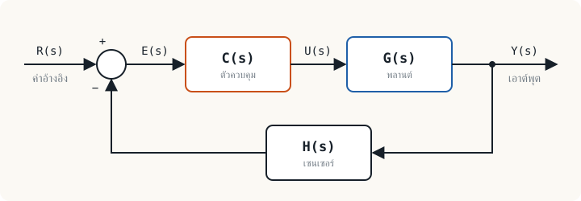

## ระบบควบคุมทำให้ปริมาณหนึ่งเดินตามคำสั่ง {#what}

ตู้เย็นรักษาอุณหภูมิ อินเวอร์เตอร์รักษาความเร็วมอเตอร์ เครื่องบินรักษาระดับความสูง ทั้งสามทำสิ่งเดียวกัน คือ **ทำให้ปริมาณที่สนใจมีค่าตามที่ต้องการ** แม้มีสิ่งรบกวน และแม้ระบบจริงไม่ตรงกับแบบจำลองที่เราคำนวณไว้เป๊ะ

**วิศวกรรมระบบควบคุม (control engineering)** คือศาสตร์ของการสร้างแบบจำลอง วิเคราะห์ และออกแบบตัวควบคุมให้ระบบทำงานตามข้อกำหนด ได้แก่ แม่นยำ เร็ว เสถียร และทนต่อการรบกวน

บทนี้เป็นแผนที่ของทั้งวิชา อ่านจบแล้วจะรู้ว่าแต่ละหน่วยที่จะตามมาไปอยู่ตรงไหนของภาพใหญ่ และความรู้นี้พาไปสู่งานอะไรได้บ้าง

:::note ลำดับของวิชา
ห้องเรียนนี้ค่อย ๆ เพิ่มหน่วยทีละบท บทนี้เป็นหน่วยแรก หน่วยถัดไปจะเริ่มจากตัวแปรเชิงซ้อน ระนาบ s และการแปลงลาปลาซ
:::

## ระบบควบคุมแบบวงเปิด {#open}

**ระบบวงเปิด (open-loop system)** คำนวณคำสั่งล่วงหน้าแล้วส่งออกไป **โดยไม่ตรวจดูผลลัพธ์**

ตัวอย่างคือเครื่องซักผ้าแบบตั้งเวลา มันซักตามเวลาที่ตั้ง ไม่ได้วัดว่าผ้าสะอาดหรือยัง ไฟจราจรแบบตั้งเวลาก็เช่นกัน มันไม่รู้ว่ารถติดอยู่กี่คัน

$$
Y(s) = G(s)\,U(s)
$$

จุดแข็งคือ **ง่าย ถูก และไม่มีปัญหาเสถียรภาพจากการป้อนกลับ** ใช้ได้ดีเมื่อพลานต์รู้จักดี และไม่มีการรบกวนที่มีนัยสำคัญ

จุดอ่อนคือ **ถ้าพลานต์เปลี่ยนไปหรือมีการรบกวน เอาต์พุตก็เพี้ยนทันที** และระบบไม่รู้ตัวเลยว่าเพี้ยน

## ระบบควบคุมแบบวงปิด {#closed}

**ระบบวงปิด (closed-loop system)** หรือ **ระบบควบคุมป้อนกลับ (feedback control system)** วัดเอาต์พุตจริง เทียบกับค่าอ้างอิง แล้วใช้ **ค่าผิดพลาด (error)** ปรับคำสั่งอยู่ตลอดเวลา

ถ้าไม่มีการรบกวน และเซนเซอร์ $H(s)=1$ ฟังก์ชันถ่ายโอนวงปิดคือ

$$
\frac{Y(s)}{R(s)} = \frac{C(s)G(s)}{1 + C(s)G(s)}
$$

ผลที่ได้จากการป้อนกลับ มีสี่เรื่องที่ควรจำ

1. **ลดความไวต่อการเปลี่ยนแปลงของพลานต์** ค่าที่เปลี่ยนไปถูกลดทอนด้วยตัวประกอบ $1/(1+CG)$
2. **ต้านการรบกวนได้** เพราะเอาต์พุตที่เพี้ยนถูกวัดและแก้กลับ
3. **ปรับพฤติกรรมของระบบได้** เช่น ทำให้เร็วขึ้นหรือหน่วงลง
4. **ต้องแลกกับบางอย่าง** ลดเกนรวม ต้องมีเซนเซอร์ที่แม่นและมีสัญญาณรบกวน และถ้าเกนสูงเกินไประบบอาจไม่เสถียร

แล็บด้านล่างให้เทียบวงเปิดกับวงปิดบนพลานต์เดียวกัน ลองเปลี่ยนค่าเกนของพลานต์ แล้วดูว่าวงเปิดเพี้ยนเท่าไร วงปิดเพี้ยนเท่าไร

:::example ตัวอย่างที่ 1.1 วงเปิดกับวงปิดเมื่อเกนพลานต์เปลี่ยน
พลานต์ $G=K_p/(\tau s+1)$ มี $K_p=2$ ต้องการเอาต์พุตสถานะอยู่ตัวเท่ากับ $r=1$
ใช้วงเปิด: ตั้ง $u = r/K_p = 0.5$ ถ้า $K_p$ จริงเพิ่มเป็น $2.4$ (เพิ่ม 20%) จะได้ $y=2.4\times0.5=1.2$ คลาดเคลื่อน 20%
ใช้วงปิด: ตัวควบคุมแบบเกนคงที่ $K_c=20$ ได้ $y_{ss}=\dfrac{K_cK_p}{1+K_cK_p}r$
- $K_p=2$: $y_{ss}=40/41=0.9756$
- $K_p=2.4$: $y_{ss}=48/49=0.9796$

เกนเปลี่ยน 20% เอาต์พุตขยับเพียงประมาณ 0.4% วงปิดจึงทนกว่าวงเปิดราว 50 เท่าในกรณีนี้ แต่วงปิดมีค่าคลาดคงเหลือ 2–2.5% ถ้าต้องการให้เป็นศูนย์ต้องใช้ตัวควบคุมที่มีอินทิเกรเตอร์ ซึ่งจะเรียนในหน่วยต่อ ๆ ไป
:::

## ชนิดของระบบควบคุม {#types}

ระบบเดียวกันจัดได้หลายประเภทพร้อมกัน แต่ละเกณฑ์ตอบคำถามต่างกัน

| เกณฑ์ | ชนิด | ความหมาย | ตัวอย่าง |
|---|---|---|---|
| มีป้อนกลับหรือไม่ | วงเปิด / วงปิด | วัดผลมาปรับคำสั่งหรือไม่ | ไฟจราจรตั้งเวลา / ตู้เย็น |
| ความสัมพันธ์ของระบบ | เชิงเส้น / ไม่เชิงเส้น | ใช้หลักการซ้อนทับได้หรือไม่ | วงจร RC / วาล์วที่อิ่มตัว |
| พารามิเตอร์ตามเวลา | ไม่แปรตามเวลา (LTI) / แปรตามเวลา | ค่าพารามิเตอร์คงที่หรือเปลี่ยนตามเวลา | มอเตอร์ / จรวดที่เชื้อเพลิงลดลง |
| ลักษณะสัญญาณ | ต่อเนื่อง / ดิสครีต (ดิจิทัล) | สัญญาณนิยามทุกเวลา หรือเฉพาะจังหวะสุ่ม | ออปแอมป์ / ไมโครคอนโทรลเลอร์ |
| จำนวนอินพุต–เอาต์พุต | SISO / MIMO | หนึ่งเข้าหนึ่งออก หรือหลายเข้าหลายออก | ควบคุมอุณหภูมิหนึ่งจุด / โดรนสี่ใบพัด |
| ตัวแปรพารามิเตอร์ | แบบก้อน / แบบกระจาย | อธิบายด้วยสมการอนุพันธ์สามัญหรือย่อย | วงจรไฟฟ้า / ความร้อนในแท่งโลหะ |
| ความแน่นอน | กำหนดได้ / สุ่ม | มีความไม่แน่นอนที่ต้องจัดการเชิงสถิติหรือไม่ | เครื่องกลึง / ตลาดการเงิน |
| เป้าหมายค่าอ้างอิง | ควบคุมค่าคงที่ (regulator) / ตามรอย (tracking/servo) | รักษาค่าเดิม หรือเดินตามค่าที่เปลี่ยน | ควบคุมแรงดันแหล่งจ่าย / แขนหุ่นยนต์ |

วิชานี้ส่วนใหญ่เริ่มจากระบบ **เชิงเส้น ไม่แปรตามเวลา แบบก้อน SISO** เพราะมีเครื่องมือครบที่สุด แล้วขยายไปสู่ MIMO ด้วยปริภูมิสถานะ ระบบดิจิทัล และระบบไม่เชิงเส้นในช่วงท้าย

:::key
ระบบจริงเกือบทั้งหมดไม่เชิงเส้น แต่ **ใกล้จุดทำงาน** มักประมาณด้วยระบบเชิงเส้นได้ดี และนั่นคือเหตุผลที่ทฤษฎีเชิงเส้นใช้งานได้จริงในอุตสาหกรรม
:::

## ศัพท์ที่ใช้ในวิศวกรรมระบบควบคุม {#terms}

| ไทย | อังกฤษ | ความหมาย |
|---|---|---|
| พลานต์ / ระบบถูกควบคุม | plant | สิ่งที่ถูกควบคุม เช่น มอเตอร์ ถังน้ำ |
| กระบวนการ | process | การดำเนินงานต่อเนื่องที่ให้ผลลัพธ์ มักใช้ในอุตสาหกรรมเคมี |
| ตัวควบคุม | controller | ตัวตัดสินใจว่าจะสั่งเท่าไร |
| ตัวกระตุ้น / แอกชูเอเตอร์ | actuator | ส่วนที่ลงมือทำ เช่น วาล์ว ฮีตเตอร์ มอเตอร์ |
| เซนเซอร์ / ตัววัด | sensor, transducer | ส่วนที่วัดเอาต์พุตแล้วแปลงเป็นสัญญาณ |
| ค่าอ้างอิง / ค่าเป้าหมาย | reference, set point | ค่าที่ต้องการ |
| เอาต์พุต / ตัวแปรควบคุม | output, controlled variable | ปริมาณที่ต้องการควบคุม |
| ตัวแปรปรับ | manipulated variable | ปริมาณที่ตัวควบคุมสั่ง เช่น แรงดันที่ป้อนมอเตอร์ |
| ค่าผิดพลาด | error | ค่าอ้างอิงลบค่าที่วัดได้ |
| สัญญาณรบกวน (ต่อระบบ) | disturbance | สิ่งที่ดันเอาต์พุตโดยเราไม่ได้สั่ง เช่น โหลดเปลี่ยน |
| สัญญาณรบกวน (ในเซนเซอร์) | sensor noise | ความคลาดเคลื่อนสุ่มของการวัด |
| ป้อนกลับ | feedback | การส่งผลการวัดกลับไปเทียบกับค่าอ้างอิง |
| ฟังก์ชันถ่ายโอน | transfer function | อัตราส่วน $Y(s)/U(s)$ เมื่อเงื่อนไขเริ่มต้นเป็นศูนย์ |
| เสถียรภาพ | stability | ระบบไม่ระเบิดออกเมื่อถูกกระตุ้นจำกัด |
| ผลตอบสนองชั่วครู่ | transient response | พฤติกรรมช่วงเปลี่ยนผ่าน เช่น โอเวอร์ชูต เวลาขึ้น |
| ค่าผิดพลาดสถานะอยู่ตัว | steady-state error | ค่าผิดพลาดที่เหลือเมื่อเวลาผ่านไปนาน |
| ตัวชดเชย | compensator | ตัวควบคุมที่ออกแบบมาปรับสมรรถนะ |

:::warn ระวังคำว่า "ระบบ" และ "พลานต์"
**ระบบ (system)** กว้างกว่าพลานต์ มันคือชุดส่วนประกอบที่ทำงานร่วมกันเพื่อเป้าหมายเดียว ส่วน **พลานต์** คือเฉพาะส่วนที่ถูกควบคุม ตำราบางเล่มใช้ปนกันได้ แต่ในการเขียนรายงานให้แยกให้ชัด
:::

## การบูรณาการกับสาขาวิศวกรรมอื่น {#fields}

วิศวกรรมระบบควบคุมไม่ใช่สาขาที่แยกจากใคร แต่เป็น **ภาษากลาง** ที่ทำให้สาขาอื่นคุยกันได้ เพราะทุกสาขามีปริมาณที่ต้องรักษาให้ได้ค่าตามต้องการ และสมการของมันหน้าตาเหมือนกัน

| สาขา | ควบคุมอะไร | ตัวอย่างงาน |
|---|---|---|
| วิศวกรรมไฟฟ้า | แรงดัน กระแส ความเร็วและแรงบิดมอเตอร์ | ไดรฟ์มอเตอร์ คอนเวอร์เตอร์ ระบบไฟฟ้ากำลัง การรักษาความถี่ |
| วิศวกรรมเครื่องกล | ตำแหน่ง แรง การสั่น อุณหภูมิ | ระบบกันสะเทือนแอกทีฟ เครื่องจักร CNC ระบบปรับอากาศ |
| วิศวกรรมเมคคาทรอนิกส์ | ระบบที่รวมกล ไฟฟ้า และซอฟต์แวร์ | ไดรฟ์ฮาร์ดดิสก์ เครื่องพิมพ์ 3 มิติ กล้องกันสั่น |
| วิศวกรรมหุ่นยนต์ | ตำแหน่งข้อต่อ วิถีการเคลื่อนที่ แรงสัมผัส | แขนหุ่นยนต์ หุ่นยนต์เคลื่อนที่ โดรน |
| วิศวกรรมวัดคุม (instrumentation) | การวัดที่เชื่อถือได้ และลูปควบคุมในโรงงาน | ลูป PID ระดับ ความดัน อัตราไหล ระบบ DCS และ SIS |
| วิศวกรรมเคมี | อุณหภูมิ ความดัน ความเข้มข้นในเครื่องปฏิกรณ์ | การควบคุมเครื่องปฏิกรณ์ หอกลั่น |
| วิศวกรรมกระบวนการ | คุณภาพและอัตราผลิตของสายการผลิตต่อเนื่อง | การควบคุมกระบวนการ การปรับจูนลูปทั้งโรงงาน |
| วิศวกรรมการเงิน | มูลค่าพอร์ต ความเสี่ยง สภาพคล่อง | การจัดพอร์ตแบบไดนามิก การป้องกันความเสี่ยง |

เรื่องวิศวกรรมการเงินอาจดูแปลก แต่เป็นเรื่องจริง ปัญหาคลาสสิกของ Merton ที่ถามว่าควรแบ่งทรัพย์สินเท่าไรลงทุนในหุ้นและเท่าไรบริโภคตลอดเวลา เป็น **ปัญหาควบคุมเชิงสุ่ม** ที่แก้ด้วยสมการแฮมิลตัน–จาโคบี–เบลล์แมน (HJB) ซึ่งเป็นเครื่องมือเดียวกับการควบคุมเชิงเหมาะสมที่สุดในวิศวกรรม (แหล่งอ้างอิง: [Merton's portfolio problem, Wikipedia](https://en.wikipedia.org/wiki/Merton%27s_portfolio_problem) และ [บทความสำรวจใน Frontiers in Applied Mathematics and Statistics, 2020](https://doi.org/10.3389/fams.2020.00004))

:::note ประเด็นสำคัญ
สาขาเหล่านี้ต่างกันที่ **ฟิสิกส์** ของพลานต์ แต่เหมือนกันที่ **โครงสร้างของลูป** คือ วัด เทียบ ตัดสินใจ ลงมือ แล้ววัดใหม่ เมื่อเข้าใจโครงสร้างนี้ครั้งเดียว ก็ย้ายสาขาได้
:::

## สายงานที่ใช้ความรู้นี้ และค่าตอบแทน {#careers}

ตารางนี้รวมตัวเลขจากแหล่งที่ตรวจสอบได้ ณ เดือนพฤศจิกายน 2569 ตัวเลขทั้งหมดเป็น **ค่าที่ประกาศ** หรือ **ค่าสำรวจ** ไม่ใช่ค่าที่รับประกันว่าจะได้

**ประเทศไทย (ต่อเดือน ก่อนหักภาษี)**

| ตำแหน่ง | ช่วงที่ประกาศ | แหล่งและเวลา |
|---|---|---|
| วิศวกรไฟฟ้าและควบคุม (PLC, Siemens) | 40,000–50,000 บาท | [JobThai, ก.ย. 2569](https://www.jobthai.com/en/job/1923077) |
| วิศวกรเครื่องมือวัดและอัตโนมัติ (บำรุงรักษา ประสบการณ์ 3 ปีขึ้นไป) | 30,000–50,000 บาท | [JAC Recruitment, พ.ค. 2569](https://www.jac-recruitment.co.th/job/instrument-engineer-automation-5898663) |
| วิศวกรหุ่นยนต์ (กรุงเทพฯ) | 30,000–55,000 บาท | [RGF, พ.ค. 2569](https://www.rgf-hragent.asia/en/thailand/robot-engineer-SDG-130844) |
| วิศวกรเครื่องมือวัดอาวุโส (น้ำมันและก๊าซ ประสบการณ์ 6 ปีขึ้นไป) | 50,000–75,000 บาท | [RGF Thailand](https://rgf-hragent.asia/en/thailand/senior-instrumentation-engineer-SDG-110392) |
| Senior Application Engineer ระบบวิชันและอัตโนมัติ | 80,000–100,000 บาท | [Michael Page Thailand](https://www.michaelpage.co.th/jobs/engineering-manufacturing/automation-mechatronics-robotics) |
| วิศวกรวัดคุมและระบบควบคุม ประสบการณ์ 10 ปี (โรงงานหนัก ระยอง) | 120,000–150,000 บาท | [JobsDB Thailand](https://th.jobsdb.com/noise-control-jobs-in-engineering) |
| Principal Engineer ระบบอัตโนมัติ (เซมิคอนดักเตอร์ ประสบการณ์ 7 ปีขึ้นไป) | สูงสุด 150,000 บาท | [Evantis Talent Solutions](https://www.careers-page.com/evantistalentsolutions/job/Y66R39V9) |
| นักวิเคราะห์เชิงปริมาณ (Quantitative Analyst) ค่าเฉลี่ย | ราว 970,000 บาทต่อปี (ประมาณ 81,000 บาทต่อเดือน) | [ERI SalaryExpert, มิ.ย. 2569](https://www.erieri.com/salary/job/quantitative-analyst/thailand) |

**สหรัฐอเมริกา (ค่ามัธยฐานต่อปี)**

| อาชีพ | ค่ามัธยฐาน | แหล่ง |
|---|---|---|
| วิศวกรไฟฟ้า | 120,630 ดอลลาร์ | [BLS, พ.ค. 2025](https://www.bls.gov/ooh/architecture-and-engineering/electrical-and-electronics-engineers.htm) |
| วิศวกรอิเล็กทรอนิกส์ (ไม่รวมคอมพิวเตอร์) | 130,220 ดอลลาร์ | [BLS, พ.ค. 2025](https://www.bls.gov/ooh/architecture-and-engineering/electrical-and-electronics-engineers.htm) |
| วิศวกรเครื่องกล | 104,110 ดอลลาร์ | [BLS, พ.ค. 2025](https://www.bls.gov/ooh/architecture-and-engineering/mechanical-engineers.htm) |
| วิศวกรเคมี | 125,040 ดอลลาร์ | [BLS, พ.ค. 2025](https://www.bls.gov/ooh/architecture-and-engineering/chemical-engineers.htm) |
| Quantitative Researcher (ทุกบริษัท) | ราว 200,000 ดอลลาร์ (รวมโบนัสและหุ้น) | [Levels.fyi](https://www.levels.fyi/t/data-scientist/title/quantitative-researcher) |

:::warn อ่านตัวเลขเงินเดือนอย่างระวัง
1. **ช่วงที่ประกาศในประกาศงานคือข้อเสนอของนายจ้าง** ไม่ใช่ค่าเฉลี่ยของคนทำงานจริง และตำแหน่งที่ประกาศเงินเดือนสูงมักต้องการประสบการณ์สิบปี
2. **แหล่งสำรวจต่างกันมาก** เว็บเงินเดือนบางแห่งรายงานค่าเฉลี่ยของวิศวกรอัตโนมัติในไทยต่ำกว่าประกาศงานอาวุโสมาก ซึ่งอาจสะท้อนระดับตำแหน่งและวิธีเก็บข้อมูลที่ต่างกัน
3. **ตัวเลขสหรัฐไม่ใช่ตัวเลขไทย** ค่าครองชีพ ภาษี และตลาดแรงงานต่างกัน อย่านำไปเทียบตรง ๆ
4. **ตัวเลขของ Quant** มาจากข้อมูลที่ผู้ใช้รายงานเอง อาจเอียงไปทางคนที่ได้ค่าตอบแทนสูง และบริษัทชั้นนำจ่ายรวมโบนัสได้สูงกว่าค่ากลางมาก
:::

**เส้นทางที่ค่าตอบแทนมักไปได้สูง** จากข้อมูลข้างต้น มีรูปแบบที่ซ้ำกัน

- **ลึกในอุตสาหกรรมเฉพาะ** เช่น น้ำมันและก๊าซ ปิโตรเคมี เซมิคอนดักเตอร์ ที่ความผิดพลาดของระบบควบคุมมีมูลค่าสูง
- **ข้ามสาขา** เช่น วิชันบวกอัตโนมัติ หรือควบคุมบวกซอฟต์แวร์ ซึ่งคนทำได้ทั้งสองด้านมีน้อย
- **สายเชิงปริมาณ** ที่ใช้คณิตศาสตร์เดียวกัน ได้แก่ สถิติ การเหมาะสมที่สุด และระบบสุ่ม ไปใช้กับการเงิน
- **ขยับขึ้นเป็นผู้นำทางเทคนิคหรือผู้จัดการโครงการ** หลังสะสมประสบการณ์

ข้อสังเกต: ตัวเลขที่สูงที่สุดในตารางมาจาก **ประสบการณ์สิบปีขึ้นไป** และ **ทักษะที่ผสมหลายด้าน** ไม่ได้มาจากชื่อสาขาอย่างเดียว

## แบบฝึกหัด {#exercises}

:::exercise 1.1 จัดประเภทระบบ
จัดประเภทระบบต่อไปนี้เป็นวงเปิดหรือวงปิด พร้อมเหตุผลหนึ่งประโยค
(ก) เครื่องปิ้งขนมปังที่ตั้งเวลา (ข) เตารีดที่มีเทอร์โมสตัท (ค) คนขับรถรักษาเลนบนถนน (ง) เครื่องซักผ้าที่ตั้งเวลาซักไว้ 30 นาที

:::answer
(ก) วงเปิด ไม่วัดว่าขนมปังสุกหรือยัง
(ข) วงปิด เทอร์โมสตัทวัดอุณหภูมิและตัดต่อฮีตเตอร์
(ค) วงปิด ดวงตาเป็นเซนเซอร์ สมองเป็นตัวควบคุม
(ง) วงเปิด ซักตามเวลา ไม่ได้วัดความสะอาด
:::
:::

:::exercise 1.2 เกนที่เปลี่ยน
จากตัวอย่างที่ 1.1 ถ้า $K_p$ จริงลดลง 20% จาก 2 เหลือ 1.6 จงหาเอาต์พุตสถานะอยู่ตัวของวงเปิด (ตั้ง $u=0.5$) และวงปิด ($K_c=20$) แล้วเทียบการคลาดเคลื่อน

:::answer
วงเปิด: $y=1.6\times0.5=0.8$ คลาดเคลื่อน 20%
วงปิด: $y_{ss}=\dfrac{20\times1.6}{1+20\times1.6}=\dfrac{32}{33}=0.9697$ คลาดเคลื่อนประมาณ 3.0%
วงปิดคลาดน้อยกว่าวงเปิดราว 6.6 เท่าในกรณีนี้ ($0.20/0.0303$) และคลาดเคลื่อนต่างกันเพียง 0.9697 เทียบกับ 0.9756 เมื่อเกนเปลี่ยนจาก 2 เป็น 1.6
:::
:::

:::exercise 1.3 ระบุส่วนประกอบ
ระบบควบคุมอุณหภูมิห้องด้วยเครื่องปรับอากาศอินเวอร์เตอร์ จงระบุ plant, sensor, actuator, controller, reference, output และ disturbance อย่างน้อยหนึ่งตัวอย่าง

:::answer
plant: ห้องและอากาศในห้อง; sensor: เทอร์มิสเตอร์วัดอุณหภูมิ; actuator: คอมเพรสเซอร์ความเร็วปรับได้และพัดลม; controller: บอร์ดควบคุมในเครื่อง; reference: อุณหภูมิที่ตั้งจากรีโมต; output: อุณหภูมิห้อง; disturbance: ความร้อนจากแสงแดด คนเข้าห้อง ประตูเปิด
:::
:::

:::exercise 1.4 จัดประเภทหลายเกณฑ์
โดรนสี่ใบพัดที่ลอยนิ่งอยู่กลางอากาศ ใช้ไมโครคอนโทรลเลอร์ จัดประเภทตาม 4 เกณฑ์ในตารางชนิดของระบบ

:::answer
วงปิด (มี IMU เป็นเซนเซอร์) ไม่เชิงเส้นโดยธรรมชาติแต่ประมาณเชิงเส้นได้ใกล้จุดลอยนิ่ง ดิสครีตเพราะตัวควบคุมเป็นดิจิทัล และ MIMO เพราะควบคุมหลายตัวแปรพร้อมกัน เช่น ความสูง โรล พิตช์ ยอว์ นอกจากนี้ยังเป็น regulator เมื่อลอยนิ่ง
:::
:::

:::exercise 1.5 อ่านเงินเดือนอย่างวิพากษ์
ประกาศงานหนึ่งเสนอเงินเดือน 120,000–150,000 บาทต่อเดือน อีกเว็บเงินเดือนรายงานค่าเฉลี่ยของวิศวกรอัตโนมัติในไทยที่ประมาณ 750,000 บาทต่อปี จงอธิบายว่าสองตัวเลขนี้ขัดแย้งกันหรือไม่ และต้องถามอะไรเพิ่ม

:::answer
ไม่จำเป็นต้องขัดแย้ง ตัวเลขแรกเป็นตำแหน่งอาวุโสที่ต้องการประสบการณ์ประมาณ 10 ปีในโรงงานหนัก (ราว 1.4–1.8 ล้านบาทต่อปี) ตัวเลขที่สองคือค่าเฉลี่ยของคนทั้งช่วง ซึ่งรวมตำแหน่งหลายระดับ (ราว 62,000 บาทต่อเดือน) ต้องถามเพิ่มว่า ตำแหน่งต้องการประสบการณ์กี่ปี ข้อมูลมาจากข้อเสนอหรือจากเงินเดือนจริง รวมโบนัสหรือไม่ และตัวอย่างมีขนาดเท่าไร
:::
:::

## สรุป {#summary}

- วงเปิดส่งคำสั่งโดยไม่วัดผล วงปิดวัดผลแล้วป้อนกลับ จึงทนต่อการรบกวนและความไม่แน่นอนของพลานต์
- ระบบหนึ่งจัดได้หลายประเภทพร้อมกัน และวิชานี้เริ่มที่ระบบเชิงเส้น ไม่แปรตามเวลา SISO ก่อน
- ศัพท์พื้นฐานคือภาษากลางของทุกสาขาวิศวกรรมที่มีลูปควบคุม
- ความรู้เดียวกันนำไปสู่งานได้ทั้งในโรงงาน หุ่นยนต์ พลังงาน เคมี และการเงินเชิงปริมาณ ค่าตอบแทนสูงมักมาจากประสบการณ์และทักษะข้ามสาขา

หน่วยถัดไปจะปูเครื่องมือทางคณิตศาสตร์ ได้แก่ ตัวแปรเชิงซ้อน ระนาบ s และการแปลงลาปลาซ ซึ่งทำให้เราเขียนระบบเป็นฟังก์ชันถ่ายโอนได้

## ถามบ่อย {#faq}

**ระบบควบคุมแบบวงเปิดกับวงปิดต่างกันอย่างไร**
วงเปิดส่งคำสั่งออกไปโดยไม่วัดผลลัพธ์ จึงแก้ความคลาดเคลื่อนหรือการรบกวนเองไม่ได้ ส่วนวงปิดวัดเอาต์พุตแล้วป้อนกลับมาเทียบกับค่าอ้างอิง ใช้ค่าผิดพลาดปรับคำสั่งตลอดเวลา จึงต้านการรบกวนได้ แต่ต้องมีเซนเซอร์และอาจไม่เสถียรถ้าออกแบบไม่ดี

**ตัวอย่างระบบวงเปิดและวงปิดในชีวิตประจำวันมีอะไรบ้าง**
วงเปิด เช่น เครื่องซักผ้าที่ตั้งเวลาซักแล้วหยุดเอง ไฟจราจรแบบตั้งเวลา วงปิด เช่น ตู้เย็นที่วัดอุณหภูมิแล้วสลับคอมเพรสเซอร์ เครื่องปรับอากาศอินเวอร์เตอร์ และระบบควบคุมความเร็วรถยนต์

**เรียนวิศวกรรมระบบควบคุมแล้วทำงานสายไหนได้บ้าง**
ทำได้ทั้งงานอัตโนมัติโรงงานและ PLC งานวัดคุมในโรงกลั่นและโรงไฟฟ้า งานหุ่นยนต์ งานเมคคาทรอนิกส์ งานควบคุมกระบวนการเคมี งานควบคุมมอเตอร์และอิเล็กทรอนิกส์กำลัง และงานเชิงปริมาณในการเงินที่ใช้ทฤษฎีควบคุมเชิงสุ่ม

**ต้องเก่งคณิตศาสตร์แค่ไหนจึงเรียนวิชาควบคุมได้**
พื้นฐานแคลคูลัส สมการเชิงอนุพันธ์สามัญ และพีชคณิตเชิงเส้นเบื้องต้นก็เริ่มได้ ห้องเรียนนี้ปูตัวแปรเชิงซ้อนและการแปลงลาปลาซให้ในหน่วยถัดไป
