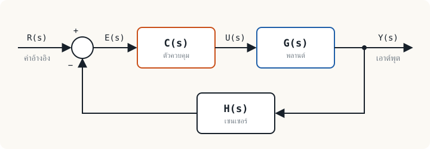

## ระบบควบคุมอยู่รอบตัวเรา {#everyday}

เครื่องปรับอากาศที่รักษาอุณหภูมิห้อง ระบบครูซคอนโทรลที่รักษาความเร็วรถ อินเวอร์เตอร์ที่รักษาความเร็วมอเตอร์ และหม้อหุงข้าวที่ตัดไฟเมื่อข้าวสุก ล้วนทำสิ่งเดียวกัน คือ**ทำให้ปริมาณหนึ่งมีค่าตามที่ต้องการโดยไม่ต้องมีคนคอยปรับ**

วิศวกรรมระบบควบคุม (control engineering) คือวิชาที่ตอบคำถามสามข้อ

1. ระบบที่จะควบคุมมีพฤติกรรมอย่างไร ตอบด้วย**แบบจำลองทางคณิตศาสตร์**
2. เมื่อสั่งงานแล้วเอาต์พุตจะเปลี่ยนอย่างไรตามเวลา ตอบด้วย**ผลตอบสนอง**
3. จะออกแบบตัวควบคุมอย่างไรให้ได้ผลตามต้องการและไม่แกว่งจนพัง ตอบด้วย**การวิเคราะห์เสถียรภาพและการออกแบบ**

ทั้งรายวิชาคือการตอบสามข้อนี้ให้ลึกขึ้นทีละหน่วย

## ศัพท์ที่ต้องใช้ตลอดวิชา {#terms}

| คำ | สัญลักษณ์ | ความหมาย |
|---|---|---|
| พลานต์ (plant) | $G(s)$ | สิ่งที่ถูกควบคุม เช่น มอเตอร์ เตาอบ ถังน้ำ |
| ค่าอ้างอิง (reference, setpoint) | $R(s)$ | ค่าที่ต้องการให้เอาต์พุตเป็น |
| เอาต์พุต (controlled output) | $Y(s)$ | ปริมาณที่ถูกควบคุม เช่น ความเร็ว อุณหภูมิ |
| ค่าผิดพลาด (error) | $E(s)$ | ผลต่างระหว่างค่าอ้างอิงกับค่าที่วัดได้ |
| ตัวควบคุม (controller) | $C(s)$ | ส่วนที่ตัดสินใจจากค่าผิดพลาดว่าจะสั่งพลานต์เท่าใด |
| เซนเซอร์ (sensor) | $H(s)$ | ส่วนที่วัดเอาต์พุตแล้วป้อนกลับ |
| การรบกวน (disturbance) | $D(s)$ | สิ่งที่เปลี่ยนเอาต์พุตโดยเราไม่ได้สั่ง เช่น โหลดของมอเตอร์ |

## วงเปิดกับวงปิด {#open-closed}

**ระบบควบคุมวงเปิด (open-loop)** คำนวณสัญญาณสั่งล่วงหน้าแล้วสั่งไปเลย ไม่ตรวจว่าผลเป็นอย่างที่หวังหรือไม่ เครื่องปิ้งขนมปังตั้งเวลาเป็นตัวอย่างที่ชัด ตั้งสองนาทีก็ปิ้งสองนาที ขนมปังจะไหม้หรือยังไม่กรอบ เครื่องไม่รับรู้

**ระบบควบคุมวงปิด (closed-loop)** วัดเอาต์พุตจริง เทียบกับค่าอ้างอิง แล้วใช้ค่าผิดพลาดแก้สัญญาณสั่งอยู่ตลอดเวลา การนำเอาต์พุตกลับมาเทียบนี้เรียกว่า**การป้อนกลับ (feedback)**

| | วงเปิด | วงปิด |
|---|---|---|
| ใช้เซนเซอร์วัดเอาต์พุต | ไม่ใช้ | ใช้ |
| เมื่อพลานต์เปลี่ยนหรือมีการรบกวน | เอาต์พุตผิดไปเต็ม ๆ | ตัวควบคุมแก้ให้ |
| ความเสี่ยงเรื่องเสถียรภาพ | ไม่เพิ่มขึ้น | ออกแบบผิดอาจแกว่งหรือไม่เสถียร |
| ราคาและความซับซ้อน | ต่ำ | สูงกว่า |

## ฟังก์ชันถ่ายโอนวงปิด {#closed-loop-tf}

จากบล็อกไดอะแกรมด้านบน เขียนความสัมพันธ์ได้สองสมการ

$$E(s) = R(s) - H(s)\,Y(s), \qquad Y(s) = C(s)\,G(s)\,E(s)$$

แทนสมการแรกลงในสมการที่สอง แล้วย้ายพจน์ที่มี $Y(s)$ มารวมกัน

$$Y(s)\,\bigl[1 + C(s)G(s)H(s)\bigr] = C(s)G(s)\,R(s)$$

จึงได้**ฟังก์ชันถ่ายโอนวงปิด**

$$T(s) = \frac{Y(s)}{R(s)} = \frac{C(s)\,G(s)}{1 + C(s)\,G(s)\,H(s)}$$

ผลคูณรอบวง $L(s) = C(s)G(s)H(s)$ เรียกว่า**ฟังก์ชันถ่ายโอนของลูป (loop transfer function)** และสมการ $1 + L(s) = 0$ เรียกว่า**สมการลักษณะเฉพาะ (characteristic equation)** รากของสมการนี้เป็นตัวกำหนดว่าระบบวงปิดเสถียรหรือไม่ ซึ่งเป็นเรื่องของหน่วยที่ 8

:::key จำเป็นรูปนี้
ฟังก์ชันถ่ายโอนวงปิด = ทางตรง ÷ (1 + ผลคูณรอบวง) เมื่อป้อนกลับแบบลบ
:::

## ตัวอย่าง: การป้อนกลับช่วยได้กี่เท่า {#example}

:::example ตัวอย่างที่ 1.1 ควบคุมความเร็วมอเตอร์
มอเตอร์ตัวหนึ่งเมื่ออยู่ในสถานะอยู่ตัวให้ความเร็ว 10 rpm ต่อแรงดัน 1 V นั่นคือ $G = 10$ ต้องการความเร็ว 100 rpm ต่อมามอเตอร์ร้อนขึ้นจนเกนลดลง 20 % เหลือ $G = 8$ จงเทียบความเร็วที่ได้ระหว่างวงเปิดกับวงปิดที่ใช้ตัวควบคุมเกน $K = 10$ และเซนเซอร์ $H = 1$

**วงเปิด** ตั้งแรงดันไว้ $u = 100/10 = 10$ V

- เกนปกติ: $y = 10 \times 10 = 100$ rpm
- เกนลดลง: $y = 8 \times 10 = 80$ rpm ผิดไป 20 % เท่ากับที่พลานต์เปลี่ยน

**วงปิด** ใช้ $T = \dfrac{KG}{1 + KG}$ กับค่าอ้างอิง 100 rpm

- เกนปกติ: $T = \dfrac{100}{101} = 0.9901$ ได้ $y = 99.01$ rpm
- เกนลดลง: $T = \dfrac{80}{81} = 0.9877$ ได้ $y = 98.77$ rpm

ความเร็วเปลี่ยนจาก 99.01 เป็น 98.77 rpm คือลดลงเพียง 0.25 % ทั้งที่พลานต์เปลี่ยนไป 20 %
:::

ตัวเลขนี้ไม่ใช่เรื่องบังเอิญ อัตราส่วนระหว่างการเปลี่ยนแปลงสัมพัทธ์ของ $T$ กับของ $G$ เรียกว่า**ความไว (sensitivity)**

$$S = \frac{dT/T}{dG/G} = \frac{1}{1 + L}$$

ในตัวอย่างนี้ $L = KG = 100$ จึงได้ $S = 1/101 \approx 0.01$ การป้อนกลับทำให้ผลของความคลาดเคลื่อนในพลานต์เหลือประมาณหนึ่งในร้อย ยิ่งลูปเกนสูง ระบบยิ่งทนต่อการเปลี่ยนแปลง

:::warn ของฟรีไม่มีในระบบควบคุม
สังเกตว่าวงปิดในตัวอย่างให้ 99.01 rpm ไม่ใช่ 100 rpm พอดี ส่วนที่ขาดไปคือ**ค่าผิดพลาดในสถานะอยู่ตัว** (หน่วยที่ 7) และถ้าเพิ่มเกน $K$ ไปเรื่อย ๆ เพื่อให้ค่าผิดพลาดเล็กลง ระบบจริงที่มีพลวัตจะเริ่มแกว่งและอาจไม่เสถียร (หน่วยที่ 8) การออกแบบระบบควบคุมคือการหาจุดสมดุลของเรื่องเหล่านี้
:::

## ระบบควบคุมในงานวิศวกรรมไฟฟ้า {#electrical}

ผู้ที่เรียนไฟฟ้ากำลังเจอระบบควบคุมอยู่แล้วทุกวัน เพียงแต่ยังไม่ได้เรียกชื่อส่วนต่าง ๆ ด้วยศัพท์ของวิชานี้ ตารางนี้จับคู่อุปกรณ์ที่คุ้นเคยกับบล็อกไดอะแกรมด้านบน

| ระบบ | ชนิด | ตัวควบคุม $C$ | พลานต์ $G$ | เซนเซอร์ $H$ |
|---|---|---|---|---|
| สตาร์ตมอเตอร์ด้วยแมกเนติกคอนแทคเตอร์ สตาร์-เดลตาตั้งเวลา | วงเปิด | ไทเมอร์รีเลย์ | มอเตอร์เหนี่ยวนำ | ไม่มี (เวลาเป็นตัวตัดสิน) |
| ปั๊มน้ำกับสวิตช์ความดัน หรือเทอร์โมสแตต | วงปิดแบบเปิด-ปิด (on-off) | สวิตช์ที่มีฮิสเทอรีซิส + คอนแทคเตอร์ | ปั๊มและถัง ฮีตเตอร์ | สวิตช์ความดัน ไบเมทัล |
| PLC ควบคุมอุณหภูมิเตาด้วยบล็อก PID | วงปิดต่อเนื่อง | PLC (คำนวณทุกรอบสแกน) | ฮีตเตอร์ + SSR | เทอร์โมคัปเปิล RTD |
| อินเวอร์เตอร์ (VFD) ควบคุมความเร็ว | วงปิด | ตัวควบคุม PI ในไดรฟ์ | อินเวอร์เตอร์ + มอเตอร์ | เอ็นโคเดอร์ |
| AVR ของเครื่องกำเนิดไฟฟ้า | วงปิด | AVR | เอกไซเตอร์ + เครื่องกำเนิด | หม้อแปลงแรงดัน (PT) |
| กัฟเวอร์เนอร์ควบคุมความถี่ระบบไฟฟ้า | วงปิด | กัฟเวอร์เนอร์ | กังหัน + ความเฉื่อยของระบบ | ตัววัดความเร็วรอบ |
| แหล่งจ่ายไฟสวิตชิง (บักคอนเวอร์เตอร์) | วงปิด | ตัวชดเชยด้วยออปแอมป์ + PWM | สวิตช์ + ตัวกรอง LC | ตัวแบ่งแรงดัน |
| DCS ในโรงไฟฟ้าหรือโรงงานกระบวนการ | วงปิดหลายร้อยลูป | ตัวควบคุมกระจายตามหน่วยผลิต | วาล์ว ปั๊ม หม้อไอน้ำ | ทรานสมิตเตอร์ 4–20 mA |

:::note รีเลย์ป้องกันเป็นระบบควบคุมหรือไม่
รีเลย์กระแสเกินวัดกระแส เทียบกับค่าที่ตั้ง แล้วสั่งเบรกเกอร์ตัดวงจร มีทั้งเซนเซอร์ (CT) การเปรียบเทียบ และตัวกระทำ (เบรกเกอร์) แต่หน้าที่ของมันคือ**ตัดสินใจครั้งเดียวเพื่อแยกส่วนที่ผิดปกติออก** ไม่ได้ปรับค่าต่อเนื่องให้เอาต์พุตตามค่าอ้างอิง จึงจัดเป็นระบบป้องกัน (protection) ซึ่งทำงานเป็นตรรกะเหนือระบบควบคุมอีกชั้นหนึ่ง
:::

:::example ตัวอย่างที่ 1.2 ออปแอมป์คือระบบป้อนกลับ
วงจรขยายแบบไม่กลับเฟส (non-inverting amplifier) ใช้ออปแอมป์ที่มีเกนวงเปิด $A = 10^5$ ป้อนกลับผ่านตัวแบ่งแรงดัน $\beta = \dfrac{R_1}{R_1 + R_2} = 0.1$ จงหาเกนของวงจร และหาเกนใหม่เมื่อ $A$ ลดลงครึ่งหนึ่งเพราะอุณหภูมิ

เทียบกับบล็อกไดอะแกรม: ทางตรงคือ $A$ ทางป้อนกลับคือ $\beta$ จึงใช้สูตรเดิมได้ทันที

$$\frac{v_o}{v_i} = \frac{A}{1 + A\beta} = \frac{10^5}{1 + 10^4} = 9.9990$$

เมื่อ $A = 5 \times 10^4$ ได้ $\dfrac{5 \times 10^4}{1 + 5 \times 10^3} = 9.9980$

เกนวงเปิดเปลี่ยน 50 % แต่เกนของวงจรเปลี่ยนเพียง 0.01 % และมีค่าใกล้ $1/\beta = 10$ ซึ่งกำหนดด้วยตัวต้านทานสองตัวเท่านั้น นี่คือเหตุผลที่วงจรออปแอมป์ทุกวงจรใช้การป้อนกลับแบบลบ
:::

## กิจกรรมและแบบฝึกหัด {#exercises}

:::activity ลองคิดในห้อง 5 นาที
จับคู่กับเพื่อน เลือกอุปกรณ์ในบ้านมาหนึ่งอย่าง แล้วระบุให้ได้ว่าอะไรคือพลานต์ ค่าอ้างอิง เอาต์พุต เซนเซอร์ และการรบกวน ถ้าอุปกรณ์นั้นเป็นวงเปิด ให้เสนอว่าจะเพิ่มเซนเซอร์อะไรเพื่อทำให้เป็นวงปิด
:::

:::exercise แบบฝึกหัด 1.1
ระบบป้อนกลับมี $C(s) = 5$, $G(s) = \dfrac{2}{s + 1}$ และ $H(s) = 1$ จงหาฟังก์ชันถ่ายโอนวงปิด $T(s)$ และค่าของ $T$ ในสถานะอยู่ตัว (แทน $s = 0$)

:::answer ดูเฉลย
$$T(s) = \frac{\dfrac{10}{s+1}}{1 + \dfrac{10}{s+1}} = \frac{10}{s + 11}$$

ในสถานะอยู่ตัว $T(0) = \dfrac{10}{11} \approx 0.909$ เอาต์พุตจึงไปถึงประมาณ 90.9 % ของค่าอ้างอิง สังเกตด้วยว่าขั้วย้ายจาก $s = -1$ ไปที่ $s = -11$ ระบบวงปิดจึงตอบสนองเร็วขึ้น 11 เท่า
:::
:::

:::exercise แบบฝึกหัด 1.2
จากตัวอย่างที่ 1.1 ถ้าต้องการให้ความเร็วเปลี่ยนไม่เกิน 0.1 % เมื่อเกนของมอเตอร์ลดจาก 10 เหลือ 8 ต้องใช้เกนตัวควบคุม $K$ อย่างน้อยประมาณเท่าใด

:::answer ดูเฉลย
ให้ $T_1 = \dfrac{10K}{1 + 10K}$ และ $T_2 = \dfrac{8K}{1 + 8K}$ จะได้

$$\frac{T_1 - T_2}{T_1} = \frac{0.2}{1 + 8K}$$

ต้องการไม่เกิน 0.001 จึงได้ $1 + 8K \ge 200$ หรือ $K \ge 24.9$ เลือก $K = 25$ ตรวจคำตอบ: $T_1 = 250/251 = 0.99602$, $T_2 = 200/201 = 0.99502$ เปลี่ยนไป 0.100 %
:::
:::

## สรุปหน่วยที่ 1 {#summary}

- ระบบควบคุมวงปิดวัดเอาต์พุตแล้วใช้ค่าผิดพลาดแก้สัญญาณสั่ง ส่วนวงเปิดสั่งอย่างเดียว
- $T(s) = \dfrac{C G}{1 + C G H}$ และสมการลักษณะเฉพาะคือ $1 + L(s) = 0$
- การป้อนกลับลดผลของการเปลี่ยนแปลงในพลานต์ลง $1 + L$ เท่า แลกกับค่าใช้จ่ายของเซนเซอร์และความเสี่ยงเรื่องเสถียรภาพ

หน่วยถัดไปจะตอบคำถามว่า $G(s)$ มาจากไหน โดยสร้างฟังก์ชันถ่ายโอนจากสมการเชิงอนุพันธ์ของระบบจริง
