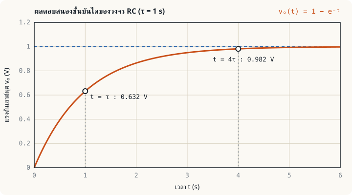
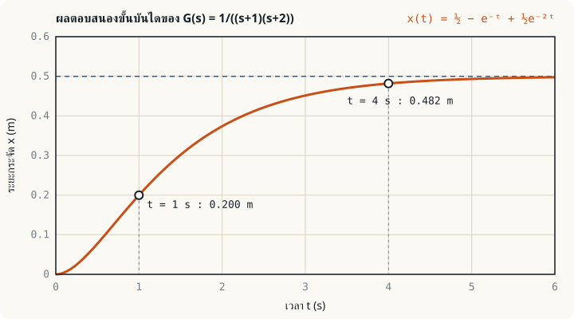

## จากระบบจริงสู่สมการ {#model}

ในหน่วยที่ 1 เราเขียนพลานต์เป็นกล่อง $G(s)$ โดยยังไม่ได้ถามว่าข้างในคืออะไร หน่วยนี้จะสร้าง $G(s)$ ขึ้นมาเองจากกฎทางฟิสิกส์ ขั้นตอนเหมือนกันทุกระบบ

1. เขียน**สมการเชิงอนุพันธ์**จากกฎของระบบ เช่น กฎของเคอร์ชอฟฟ์ หรือกฎข้อที่สองของนิวตัน
2. **แปลงลาปลาซ**ทั้งสมการ โดยให้เงื่อนไขเริ่มต้นเป็นศูนย์
3. จัดรูปเป็นอัตราส่วน**เอาต์พุตต่ออินพุต**

ผลลัพธ์ของขั้นที่ 3 คือฟังก์ชันถ่ายโอน

:::key นิยาม
**ฟังก์ชันถ่ายโอน (transfer function)** ของระบบเชิงเส้นไม่แปรตามเวลา คืออัตราส่วนของการแปลงลาปลาซของเอาต์พุตต่อการแปลงลาปลาซของอินพุต เมื่อเงื่อนไขเริ่มต้นทั้งหมดเป็นศูนย์

$$G(s) = \frac{Y(s)}{U(s)}$$
:::

สมบัติของการแปลงลาปลาซที่ใช้ในหน่วยนี้มีเพียงข้อเดียว คืออนุพันธ์ในโดเมนเวลากลายเป็นการคูณด้วย $s$ เมื่อเงื่อนไขเริ่มต้นเป็นศูนย์

$$\mathcal{L}\left\{\frac{dy}{dt}\right\} = sY(s), \qquad \mathcal{L}\left\{\frac{d^2y}{dt^2}\right\} = s^2Y(s)$$

## ระบบอันดับหนึ่ง: วงจร RC {#rc}

วงจร RC อนุกรม มีแรงดันอินพุต $v_i(t)$ และวัดเอาต์พุต $v_o(t)$ คร่อมตัวเก็บประจุ กระแสในวงคือ $i = C\,\dfrac{dv_o}{dt}$ และจากกฎแรงดันของเคอร์ชอฟฟ์ $v_i = Ri + v_o$ จึงได้

$$RC\,\frac{dv_o}{dt} + v_o = v_i$$

แปลงลาปลาซ: $RCs\,V_o(s) + V_o(s) = V_i(s)$ ดังนั้น

$$G(s) = \frac{V_o(s)}{V_i(s)} = \frac{1}{RCs + 1} = \frac{1}{\tau s + 1}, \qquad \tau = RC$$

ค่า $\tau$ เรียกว่า**ค่าคงตัวเวลา (time constant)** ระบบนี้มี**ขั้ว (pole)** หนึ่งตัวที่ $s = -1/\tau$ และมี**เกน DC** เท่ากับ $G(0) = 1$

:::example ตัวอย่างที่ 2.1 ผลตอบสนองขั้นบันไดของวงจร RC
ให้ $R = 10\ \text{k}\Omega$ และ $C = 100\ \mu\text{F}$ ป้อนแรงดันขั้นบันได 1 V ที่ $t = 0$ จงหา $v_o(t)$

**ขั้นที่ 1** หาค่าคงตัวเวลา $\tau = RC = (10 \times 10^{3})(100 \times 10^{-6}) = 1$ s จึงได้ $G(s) = \dfrac{1}{s + 1}$

**ขั้นที่ 2** อินพุตขั้นบันไดคือ $V_i(s) = \dfrac{1}{s}$ ดังนั้น

$$V_o(s) = \frac{1}{s(s + 1)} = \frac{1}{s} - \frac{1}{s + 1}$$

**ขั้นที่ 3** แปลงลาปลาซผกผัน

$$v_o(t) = 1 - e^{-t} \quad \text{V}, \qquad t \ge 0$$

**ขั้นที่ 4** อ่านค่าสำคัญ: ที่ $t = \tau = 1$ s ได้ $v_o = 1 - e^{-1} = 0.632$ V หรือ 63.2 % ของค่าสุดท้าย และเข้าสู่ช่วง 2 % ของค่าสุดท้ายเมื่อ $t \approx 4\tau = 4$ s (ที่ $t = 4$ s ได้ 0.982 V)
:::

กราฟนี้คือรูปร่างของระบบอันดับหนึ่งทุกระบบ ไม่ว่าจะเป็นอุณหภูมิของเตา ระดับน้ำในถัง หรือความเร็วของมอเตอร์ที่ไม่คิดค่าความเหนี่ยวนำ ต่างกันเพียงค่า $\tau$ และเกน ลองเปลี่ยนค่าแล้วดูกราฟได้ที่[แล็บระบบอันดับหนึ่ง](/learn/first-order-system/)

## ระบบอันดับสอง: มวล-สปริง-ตัวหน่วง {#msd}

มวล $m$ ยึดกับผนังด้วยสปริงค่าคงตัว $k$ และตัวหน่วงค่า $b$ มีแรงภายนอก $f(t)$ กระทำ ให้ $x(t)$ เป็นระยะกระจัด จากกฎข้อที่สองของนิวตัน

$$m\,\frac{d^2x}{dt^2} + b\,\frac{dx}{dt} + kx = f(t)$$

แปลงลาปลาซแล้วจัดรูป

$$G(s) = \frac{X(s)}{F(s)} = \frac{1}{ms^2 + bs + k}$$

ตัวส่วนเป็นพหุนามกำลังสอง ระบบจึงมีขั้วสองตัว และมีเกน DC เท่ากับ $G(0) = 1/k$ ซึ่งตรงกับกฎของฮุก เมื่อระบบหยุดนิ่งแล้ว ระยะยืดเท่ากับแรงหารด้วยค่าคงตัวสปริง

:::example ตัวอย่างที่ 2.2 ผลตอบสนองขั้นบันไดเมื่อขั้วเป็นจำนวนจริง
ให้ $m = 1$ kg, $b = 3$ N·s/m, $k = 2$ N/m ออกแรงคงที่ 1 N ตั้งแต่ $t = 0$ จงหา $x(t)$

**ขั้นที่ 1** ฟังก์ชันถ่ายโอนและขั้ว

$$G(s) = \frac{1}{s^2 + 3s + 2} = \frac{1}{(s + 1)(s + 2)}$$

ขั้วอยู่ที่ $s = -1$ และ $s = -2$ เป็นจำนวนจริงลบทั้งคู่ ผลตอบสนองจึงไม่แกว่ง

**ขั้นที่ 2** คูณด้วยอินพุตขั้นบันได $F(s) = 1/s$ แล้วแยกเศษส่วนย่อย

$$X(s) = \frac{1}{s(s + 1)(s + 2)} = \frac{A}{s} + \frac{B}{s + 1} + \frac{C}{s + 2}$$

ใช้วิธีปิดพจน์ (cover-up) ได้

$$A = \frac{1}{(1)(2)} = \frac{1}{2}, \qquad B = \frac{1}{(-1)(1)} = -1, \qquad C = \frac{1}{(-2)(-1)} = \frac{1}{2}$$

**ขั้นที่ 3** แปลงลาปลาซผกผัน

$$x(t) = \frac{1}{2} - e^{-t} + \frac{1}{2}e^{-2t} \quad \text{m}, \qquad t \ge 0$$

**ขั้นที่ 4** ตรวจคำตอบ: ที่ $t = 0$ ได้ $x = \tfrac12 - 1 + \tfrac12 = 0$ ถูกต้องตามเงื่อนไขเริ่มต้น และเมื่อ $t \to \infty$ ได้ $x = 0.5$ m เท่ากับเกน DC $1/k$
:::

เทียบกับกราฟของวงจร RC จะเห็นความต่างที่จุดเริ่มต้น ระบบอันดับสองออกตัวด้วย**ความชันเป็นศูนย์** เพราะมวลมีความเฉื่อย ส่วนระบบอันดับหนึ่งออกตัวด้วยความชันสูงสุดทันที

:::note ขั้วบอกรูปร่างของผลตอบสนอง
ขั้วแต่ละตัวที่ $s = -p$ ให้พจน์ $e^{-pt}$ ในผลตอบสนอง ขั้วที่อยู่ใกล้แกนจินตภาพกว่า (ในตัวอย่างคือ $s = -1$) สลายช้ากว่า จึงเป็นตัวกำหนดว่าระบบจะเข้าที่เร็วหรือช้า เรียกว่า**ขั้วเด่น (dominant pole)** ถ้าขั้วเป็นจำนวนเชิงซ้อน ผลตอบสนองจะแกว่ง ซึ่งเป็นเรื่องของหน่วยที่ 6
:::

## รูปแบบเดียวกันในงานไฟฟ้า {#electrical-forms}

สมการสองรูปในหน่วยนี้ปรากฏซ้ำในอุปกรณ์ไฟฟ้าแทบทุกชนิด เมื่อจำรูปได้ ก็อ่านพฤติกรรมของอุปกรณ์ใหม่ได้ทันทีโดยไม่ต้องแก้สมการใหม่

| อุปกรณ์ | อินพุต → เอาต์พุต | ฟังก์ชันถ่ายโอน | ค่าคงตัวเวลาหรือความถี่ธรรมชาติ |
|---|---|---|---|
| วงจร RC (ตัวกรองความถี่ต่ำ วงจรหน่วงเวลา) | $v_i \to v_C$ | $\dfrac{1}{RCs + 1}$ | $\tau = RC$ |
| วงจร RL (คอยล์คอนแทคเตอร์ ขดลวดสนามของมอเตอร์) | $v \to i$ | $\dfrac{1/R}{(L/R)s + 1}$ | $\tau = L/R$ |
| เซนเซอร์อุณหภูมิ (เทอร์โมคัปเปิล RTD) | อุณหภูมิจริง → ค่าที่อ่านได้ | $\dfrac{1}{\tau s + 1}$ | $\tau$ ของหัววัด |
| วงจร RLC อนุกรม (ตัวกรอง LC ของคอนเวอร์เตอร์) | $v_i \to v_C$ | $\dfrac{1}{LCs^2 + RCs + 1}$ | $\omega_n = 1/\sqrt{LC}$ |
| มอเตอร์กระแสตรง | แรงดันอาร์เมเจอร์ → ความเร็ว | $\dfrac{K_m}{\tau_m s + 1}$ (โดยประมาณ) | $\tau_m$ ทางกล |

หน่วยที่ 3 จะสร้างฟังก์ชันถ่ายโอนเหล่านี้ทีละตัว

## แบบฝึกหัด {#exercises}

:::exercise แบบฝึกหัด 2.1
วงจร RC มี $R = 4.7\ \text{k}\Omega$ และ $C = 10\ \mu\text{F}$ จงหาฟังก์ชันถ่ายโอน ตำแหน่งขั้ว และเวลาที่เอาต์พุตขึ้นถึง 63.2 % ของค่าสุดท้ายเมื่อป้อนสัญญาณขั้นบันได

:::answer ดูเฉลย
$\tau = RC = (4.7 \times 10^{3})(10 \times 10^{-6}) = 0.047$ s ดังนั้น

$$G(s) = \frac{1}{0.047s + 1}$$

ขั้วอยู่ที่ $s = -1/0.047 = -21.3$ rad/s และเอาต์พุตถึง 63.2 % ที่ $t = \tau = 47$ ms
:::
:::

:::exercise แบบฝึกหัด 2.2
ระบบมวล-สปริง-ตัวหน่วงมี $m = 1$ kg, $b = 5$ N·s/m, $k = 4$ N/m ออกแรงคงที่ 2 N ตั้งแต่ $t = 0$ จงหา $x(t)$ และค่าสุดท้าย

:::answer ดูเฉลย
$$G(s) = \frac{1}{s^2 + 5s + 4} = \frac{1}{(s + 1)(s + 4)}, \qquad X(s) = \frac{2}{s(s + 1)(s + 4)}$$

แยกเศษส่วนย่อย: $A = \dfrac{2}{(1)(4)} = \dfrac12$, $B = \dfrac{2}{(-1)(3)} = -\dfrac23$, $C = \dfrac{2}{(-4)(-3)} = \dfrac16$

$$x(t) = \frac12 - \frac23 e^{-t} + \frac16 e^{-4t} \quad \text{m}$$

ค่าสุดท้ายคือ 0.5 m ตรงกับ $F/k = 2/4$ และที่ $t = 0$ ได้ $\tfrac12 - \tfrac23 + \tfrac16 = 0$
:::
:::

## สรุปหน่วยที่ 2 {#summary}

- แบบจำลองของระบบเริ่มจากสมการเชิงอนุพันธ์ แล้วแปลงลาปลาซโดยให้เงื่อนไขเริ่มต้นเป็นศูนย์ จะได้ $G(s) = Y(s)/U(s)$
- วงจร RC: $G(s) = \dfrac{1}{\tau s + 1}$ ผลตอบสนองขั้นบันไดคือ $1 - e^{-t/\tau}$ ถึง 63.2 % ที่ $t = \tau$
- มวล-สปริง-ตัวหน่วง: $G(s) = \dfrac{1}{ms^2 + bs + k}$ เกน DC เท่ากับ $1/k$
- ขั้วของ $G(s)$ กำหนดรูปร่างของผลตอบสนอง ขั้วจริงลบให้พจน์เอกซ์โพเนนเชียลที่สลายตัว

หน่วยถัดไปจะใช้วิธีเดียวกันนี้กับระบบไฟฟ้า ระบบกลแบบหมุน และมอเตอร์กระแสตรง ซึ่งเป็นพลานต์ที่พบมากที่สุดในงานควบคุม
