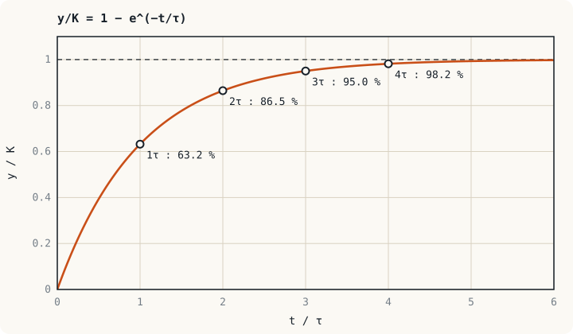

## ภาพในใจก่อนเริ่ม: ยิ่งใกล้เป้า ยิ่งช้าลง {#idea}

เทน้ำร้อนใส่แก้วแล้ววางทิ้งไว้ ช่วงแรกน้ำเย็นลงเร็ว เมื่ออุณหภูมิใกล้อุณหภูมิห้องก็เย็นลงช้ามาก เพราะ**อัตราการเปลี่ยนแปลงแปรตามระยะที่ยังห่างจากค่าสุดท้าย** ระบบใดก็ตามที่มีพฤติกรรมแบบนี้คือ**ระบบอันดับหนึ่ง** ไม่ว่าจะเป็นตัวเก็บประจุที่กำลังชาร์จ กระแสในขดลวด ความเร็วมอเตอร์ หรืออุณหภูมิของขดลวดหม้อแปลง

ทั้งหมดบรรยายได้ด้วยตัวเลขเพียงสองตัว

## รูปมาตรฐาน {#standard-form}

$$G(s) = \frac{K}{\tau s + 1}$$

| พารามิเตอร์ | ชื่อ | บอกอะไร |
|---|---|---|
| $K$ | เกน DC (static gain) | เอาต์พุตสุดท้ายเป็นกี่เท่าของอินพุต |
| $\tau$ | ค่าคงตัวเวลา (time constant) | ระบบเร็วหรือช้า หน่วยเป็นวินาที |

ขั้วอยู่ที่ $s = -1/\tau$ ยิ่ง $\tau$ เล็ก ขั้วยิ่งอยู่ไกลจากจุดกำเนิดไปทางซ้าย และระบบยิ่งเร็ว

:::warn จัดรูปก่อนอ่านค่า
ต้องทำให้พจน์คงที่ในตัวส่วนเป็น 1 ก่อน เช่น $\dfrac{100}{0.1s + 6}$ ยังอ่านค่าไม่ได้ ต้องหารด้วย 6 ให้เป็น $\dfrac{16.67}{0.0167s + 1}$ จึงได้ $K = 16.67$ และ $\tau = 0.0167$ s
:::

## ผลตอบสนองต่อสัญญาณขั้นบันได {#step}

ป้อนอินพุตขั้นบันไดขนาด $A$ คือ $U(s) = A/s$

$$Y(s) = \frac{KA}{s(\tau s + 1)} \quad\Longrightarrow\quad y(t) = KA\left(1 - e^{-t/\tau}\right)$$

| เวลา | $\tau$ | $2\tau$ | $3\tau$ | $4\tau$ | $5\tau$ |
|---|---|---|---|---|---|
| เอาต์พุต (% ของค่าสุดท้าย) | 63.2 | 86.5 | 95.0 | 98.2 | 99.3 |

ข้อกำหนดสมรรถนะที่ใช้บ่อย

| ปริมาณ | นิยาม | สูตร |
|---|---|---|
| เวลาเข้าที่ $t_s$ (เกณฑ์ 2 %) | เวลาที่เอาต์พุตเข้าสู่ช่วง ±2 % ของค่าสุดท้ายและอยู่ในช่วงนั้นตลอด | $t_s \approx 4\tau$ |
| เวลาขึ้น $t_r$ | เวลาจาก 10 % ถึง 90 % ของค่าสุดท้าย | $t_r = \tau\ln 9 \approx 2.2\tau$ |
| ความชันเริ่มต้น | ความชันของกราฟที่ $t = 0$ | $KA/\tau$ |

:::key อ่านกราฟอันดับหนึ่งให้เป็น
1. ระบบอันดับหนึ่ง**ไม่มีการพุ่งเกิน** (overshoot) และไม่แกว่ง
2. เส้นสัมผัสที่จุดเริ่มต้นตัดเส้นค่าสุดท้ายที่ $t = \tau$ พอดี
3. เวลาที่ใช้ถึงสัดส่วน $p$ ของค่าสุดท้ายคือ $t = -\tau\ln(1 - p)$
:::

:::example ตัวอย่างที่ 5.1 คอยล์คอนแทคเตอร์ DC ดูดเมื่อใด
คอยล์คอนแทคเตอร์ 24 V DC มี $R = 48\ \Omega$ และ $L = 2.4$ H หน้าสัมผัสจะดูดเมื่อกระแสถึง 0.3 A จงหาเวลาตั้งแต่จ่ายไฟจนคอนแทคเตอร์เริ่มดูด (ไม่คิดการเปลี่ยนค่า $L$ ขณะแกนเหล็กเคลื่อน)

**ขั้นที่ 1** แบบจำลองวงจร RL จากหน่วยที่ 3

$$\frac{I(s)}{V(s)} = \frac{1/R}{(L/R)s + 1} = \frac{0.0208}{0.05s + 1}$$

จึงได้ $\tau = L/R = 50$ ms และกระแสสุดท้าย $24/48 = 0.5$ A

**ขั้นที่ 2** กระแส 0.3 A คิดเป็น $p = 0.3/0.5 = 0.6$ ของค่าสุดท้าย

$$t = -\tau\ln(1 - 0.6) = -(0.05)\ln(0.4) = 0.0458\ \text{s} \approx 46\ \text{ms}$$

เวลานี้คือส่วนหนึ่งของเวลาหน่วงที่ต้องเผื่อเมื่อออกแบบลำดับการทำงานของวงจรคอนโทรลและโปรแกรม PLC
:::

## หาแบบจำลองจากกราฟทดสอบ {#identify}

ในงานจริงมักไม่รู้ค่า $R$, $L$, $J$ ของอุปกรณ์ แต่ทดสอบได้ วิธีมาตรฐานคือป้อนอินพุตขั้นบันไดแล้วบันทึกเอาต์พุต

1. $K = \dfrac{\text{เอาต์พุตที่เปลี่ยนไปทั้งหมด}}{\text{อินพุตที่เปลี่ยนไป}}$
2. $\tau$ = เวลาที่เอาต์พุตเปลี่ยนไปได้ 63.2 % ของการเปลี่ยนแปลงทั้งหมด

:::example ตัวอย่างที่ 5.2 ค่าคงตัวเวลาของหัววัดอุณหภูมิ
ย้ายหัววัด PT100 จากอากาศ 25 °C ลงในอ่างน้ำมัน 85 °C ค่าที่อ่านได้ถึง 62.9 °C เมื่อเวลาผ่านไป 12 s จงหาค่าคงตัวเวลา และเวลาที่ค่าที่อ่านได้ต่างจากค่าจริงไม่เกิน 2 %

การเปลี่ยนแปลงทั้งหมดคือ $85 - 25 = 60$ °C ระดับ 63.2 % คือ $25 + 0.632 \times 60 = 62.9$ °C ซึ่งตรงกับค่าที่อ่านได้ที่ 12 s ดังนั้น $\tau = 12$ s

เวลาเข้าที่คือ $4\tau = 48$ s ระหว่างนี้ตัวควบคุมได้รับอุณหภูมิที่ต่ำกว่าความจริง ถ้ากระบวนการเปลี่ยนเร็วกว่านี้ ต้องนับ $\dfrac{1}{12s + 1}$ ของเซนเซอร์เป็นส่วนหนึ่งของลูปด้วย
:::

:::note แบบจำลองความร้อนในรีเลย์ป้องกัน
รีเลย์โอเวอร์โหลดและรีเลย์ป้องกันมอเตอร์แบบดิจิทัลคำนวณอุณหภูมิของขดลวดด้วยแบบจำลองอันดับหนึ่ง (thermal replica) ที่มีค่าคงตัวเวลาความร้อนหลายนาทีถึงหลายสิบนาที มอเตอร์จึงทนกระแสเกินช่วงสั้น ๆ ขณะสตาร์ตได้โดยรีเลย์ไม่ตัด นี่คือการใช้แบบจำลองเดียวกับหน่วยนี้ในงานป้องกัน
:::

## ผลตอบสนองต่อสัญญาณแรมป์ {#ramp}

เมื่ออินพุตเพิ่มขึ้นด้วยอัตราคงที่ $u(t) = At$ และ $K = 1$ จะได้

$$y(t) = A\left(t - \tau + \tau e^{-t/\tau}\right)$$

เมื่อเวลาผ่านไปนาน เอาต์พุตวิ่งขนานกับอินพุตแต่**ตามหลังอยู่ $\tau$ วินาที** หรือต่ำกว่าอยู่ $A\tau$ ตัวอย่างเช่น หัววัดในตัวอย่างที่ 5.2 เมื่อวัดอุณหภูมิที่เพิ่มขึ้น 2 °C/s จะอ่านค่าต่ำกว่าจริง $2 \times 12 = 24$ °C ตลอดช่วงที่อุณหภูมิยังเพิ่มอยู่

## แบบฝึกหัด {#exercises}

:::exercise แบบฝึกหัด 5.1
วงจรพรีชาร์จของดีซีลิงก์ในอินเวอร์เตอร์ใช้ตัวต้านทาน $50\ \Omega$ ชาร์จตัวเก็บประจุ $2{,}200\ \mu\text{F}$ จงหาค่าคงตัวเวลา และเวลาที่แรงดันตัวเก็บประจุถึง 95 % ของแรงดันบัส

:::answer ดูเฉลย
$\tau = RC = (50)(2{,}200 \times 10^{-6}) = 0.11$ s

ระดับ 95 % ตรงกับ $3\tau$ (หรือคำนวณ $-\tau\ln 0.05 = 3.0\tau$) จึงได้ $t = 0.33$ s วงจรควบคุมจึงตั้งเวลาปิดคอนแทคเตอร์บายพาสไว้นานกว่านี้
:::
:::

:::exercise แบบฝึกหัด 5.2
ป้อนแรงดันขั้นบันไดจาก 0 เป็น 6 V ให้มอเตอร์ ความเร็วสุดท้ายคือ 1,500 rpm และผ่าน 948 rpm ที่เวลา 80 ms จงหาแบบจำลองอันดับหนึ่ง

:::answer ดูเฉลย
$K = 1{,}500/6 = 250$ rpm/V และ $948/1{,}500 = 0.632$ ดังนั้น $\tau = 80$ ms

$$G(s) = \frac{250}{0.08s + 1}\ \text{rpm/V}$$
:::
:::

:::exercise แบบฝึกหัด 5.3
ระบบอันดับหนึ่งต้องมีเวลาเข้าที่ (เกณฑ์ 2 %) ไม่เกิน 0.2 s ขั้วต้องอยู่ที่ตำแหน่งใด

:::answer ดูเฉลย
$4\tau \le 0.2$ ดังนั้น $\tau \le 0.05$ s ขั้ว $s = -1/\tau$ ต้องอยู่ที่ $-20$ rad/s หรือซ้ายกว่านั้น
:::
:::

## สรุปหน่วยที่ 5 {#summary}

- ระบบอันดับหนึ่งมีรูปมาตรฐาน $\dfrac{K}{\tau s + 1}$ และขั้วที่ $s = -1/\tau$
- ผลตอบสนองขั้นบันไดคือ $KA(1 - e^{-t/\tau})$ ถึง 63.2 % ที่ $\tau$ และเข้าที่ใน $4\tau$ ไม่มีการพุ่งเกิน
- หา $K$ และ $\tau$ ได้จากกราฟทดสอบขั้นบันไดโดยตรง
- เมื่อตามสัญญาณแรมป์ เอาต์พุตตามหลังอินพุต $\tau$ วินาที

หน่วยถัดไปเพิ่มอุปกรณ์สะสมพลังงานอีกหนึ่งตัว ระบบจะเริ่มแกว่งได้
