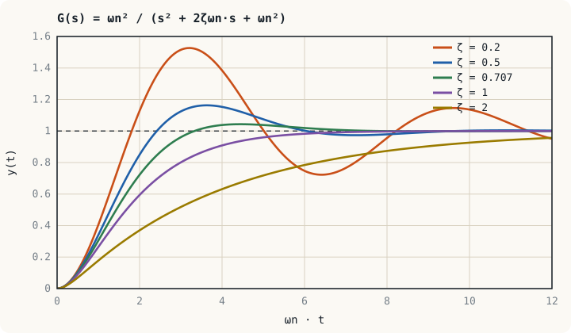

## ภาพในใจก่อนเริ่ม: พลังงานที่ถ่ายไปมา {#idea}

ระบบอันดับหนึ่งมีที่เก็บพลังงานแห่งเดียว พลังงานจึงไหลทางเดียวจนหมด ระบบอันดับสองมี**ที่เก็บพลังงานสองแห่งที่ถ่ายเทให้กันได้** ในวงจร LC พลังงานสลับระหว่างสนามไฟฟ้าของตัวเก็บประจุกับสนามแม่เหล็กของตัวเหนี่ยวนำ ในระบบกล พลังงานสลับระหว่างพลังงานศักย์ของสปริงกับพลังงานจลน์ของมวล การถ่ายไปมานี้คือ**การแกว่ง** ส่วนตัวต้านทานหรือแรงเสียดทานคอยดึงพลังงานออก ทำให้การแกว่งค่อย ๆ หยุด

คำถามของหน่วยนี้จึงมีสองข้อ: แกว่งเร็วแค่ไหน และหยุดแกว่งเร็วแค่ไหน

## รูปมาตรฐาน {#standard-form}

$$G(s) = \frac{\omega_n^2}{s^2 + 2\zeta\omega_n s + \omega_n^2}$$

| พารามิเตอร์ | ชื่อ | ตอบคำถาม |
|---|---|---|
| $\omega_n$ | ความถี่ธรรมชาติ (natural frequency) หน่วย rad/s | ถ้าไม่มีตัวหน่วงเลย ระบบจะแกว่งเร็วแค่ไหน |
| $\zeta$ | อัตราส่วนการหน่วง (damping ratio) ไม่มีหน่วย | การแกว่งถูกหน่วงมากน้อยเพียงใด |

ขั้วของระบบคือรากของตัวส่วน

$$s = -\zeta\omega_n \pm \omega_n\sqrt{\zeta^2 - 1}$$

## ผลตอบสนองสี่แบบ {#cases}

| ค่า $\zeta$ | ชื่อ | ขั้ว | ผลตอบสนองขั้นบันได |
|---|---|---|---|
| $\zeta > 1$ | หน่วงเกิน (overdamped) | จริงลบสองค่าต่างกัน | ไม่แกว่ง เข้าที่ช้า |
| $\zeta = 1$ | หน่วงวิกฤต (critically damped) | จริงลบซ้ำกัน | เร็วที่สุดเท่าที่ไม่พุ่งเกิน |
| $0 < \zeta < 1$ | หน่วงต่ำ (underdamped) | เชิงซ้อนสังยุค | พุ่งเกินแล้วแกว่งเข้าหาค่าสุดท้าย |
| $\zeta = 0$ | ไม่หน่วง (undamped) | บนแกนจินตภาพ | แกว่งไม่หยุดที่ความถี่ $\omega_n$ |

:::key ωn ยืดหดแกนเวลา ส่วน ζ กำหนดรูปร่าง
แกนนอนของกราฟด้านบนคือ $\omega_n t$ ไม่ใช่ $t$ กราฟชุดนี้จึงใช้ได้กับ $\omega_n$ ทุกค่า ถ้า $\omega_n$ เพิ่มเป็นสองเท่า กราฟเดิมจะถูกบีบในแนวเวลาให้เร็วขึ้นสองเท่าโดย**รูปร่างไม่เปลี่ยน** สิ่งที่กำหนดว่าจะพุ่งเกินเท่าใดและแกว่งกี่รอบคือ $\zeta$ เพียงตัวเดียว
:::

## ระบบหน่วงต่ำ {#underdamped}

เมื่อ $0 < \zeta < 1$ ขั้วคือ $s = -\sigma \pm j\omega_d$ โดย

$$\sigma = \zeta\omega_n, \qquad \omega_d = \omega_n\sqrt{1 - \zeta^2}$$

ผลตอบสนองต่อสัญญาณขั้นบันไดหนึ่งหน่วยคือ

$$y(t) = 1 - \frac{e^{-\sigma t}}{\sqrt{1 - \zeta^2}}\sin\!\left(\omega_d t + \phi\right), \qquad \phi = \cos^{-1}\zeta$$

ส่วนจริงของขั้ว $\sigma$ กำหนดว่าขอบของการแกว่งสลายเร็วแค่ไหน ส่วนจินตภาพ $\omega_d$ คือความถี่ที่เห็นจริงบนออสซิลโลสโคป เรียกว่า**ความถี่ธรรมชาติแบบหน่วง (damped natural frequency)**

| ข้อกำหนด | สูตร | ขึ้นกับ |
|---|---|---|
| เวลายอด $t_p$ | $\dfrac{\pi}{\omega_d}$ | ส่วนจินตภาพของขั้ว |
| เปอร์เซ็นต์การพุ่งเกิน %OS | $100\,e^{-\zeta\pi/\sqrt{1 - \zeta^2}}$ | $\zeta$ เท่านั้น |
| เวลาเข้าที่ $t_s$ (เกณฑ์ 2 %) | $\approx \dfrac{4}{\zeta\omega_n}$ | ส่วนจริงของขั้ว |
| เวลาขึ้น $t_r$ (ประมาณ) | $\approx \dfrac{1.8}{\omega_n}$ | $\omega_n$ |

ค่าที่ใช้บ่อยจนควรจำได้

| $\zeta$ | 0.2 | 0.3 | 0.4 | 0.5 | 0.6 | 0.707 | 0.8 |
|---|---|---|---|---|---|---|---|
| %OS | 52.7 | 37.2 | 25.4 | 16.3 | 9.5 | 4.3 | 1.5 |

:::example ตัวอย่างที่ 6.1 วงจร RLC จากหน่วยที่ 3
วงจร RLC ในตัวอย่างที่ 3.1 มี $\omega_n = 1000$ rad/s และ $\zeta = 0.5$ ป้อนแรงดันขั้นบันได 5 V จงหาแรงดันสูงสุดคร่อมตัวเก็บประจุ เวลาที่เกิด และเวลาเข้าที่

**ขั้นที่ 1** $\omega_d = 1000\sqrt{1 - 0.25} = 866$ rad/s และ $\sigma = 500$ s⁻¹

**ขั้นที่ 2** $\%OS = 100\,e^{-0.5\pi/0.866} = 100\,e^{-1.814} = 16.3\ \%$ แรงดันสูงสุดคือ $5 \times 1.163 = 5.82$ V

**ขั้นที่ 3** $t_p = \dfrac{\pi}{866} = 3.63$ ms และ $t_s \approx \dfrac{4}{500} = 8$ ms

ตัวเก็บประจุต้องทนแรงดันอย่างน้อย 5.82 V ไม่ใช่ 5 V การพุ่งเกินจึงเป็นเรื่องของพิกัดอุปกรณ์ด้วย ไม่ใช่เฉพาะความสวยของกราฟ
:::

:::example ตัวอย่างที่ 6.2 ตัวกรอง LC ของบักคอนเวอร์เตอร์
ตัวกรองเอาต์พุตของบักคอนเวอร์เตอร์มี $L = 100\ \mu\text{H}$, $C = 100\ \mu\text{F}$ และโหลด $R = 5\ \Omega$ ขนานกับตัวเก็บประจุ ฟังก์ชันถ่ายโอนจากแรงดันเฉลี่ยที่โหนดสวิตช์ถึงเอาต์พุตคือ

$$G(s) = \frac{1}{LCs^2 + (L/R)s + 1}$$

จงหา $\omega_n$, $\zeta$ และเปอร์เซ็นต์การพุ่งเกินเมื่อทำงานแบบวงเปิด

$\omega_n = \dfrac{1}{\sqrt{LC}} = \dfrac{1}{\sqrt{10^{-8}}} = 10^{4}$ rad/s (1.59 kHz)

เทียบสัมประสิทธิ์: $\dfrac{2\zeta}{\omega_n} = \dfrac{L}{R}$ จึงได้ $\zeta = \dfrac{\omega_n L}{2R} = \dfrac{(10^{4})(10^{-4})}{10} = 0.1$

$\%OS = 100\,e^{-0.1\pi/\sqrt{0.99}} = 72.9\ \%$

แรงดันเอาต์พุตพุ่งเกินเกือบ 73 % เมื่อเปิดเครื่องแบบวงเปิด ซึ่งทำลายโหลดได้ คอนเวอร์เตอร์จริงจึงต้องมีลูปควบคุมแรงดันและวงจร soft-start สังเกตด้วยว่าโหลดยิ่งเบา ($R$ มาก) ค่า $\zeta$ ยิ่งน้อย
:::

## จากข้อกำหนดสู่ตำแหน่งขั้ว {#s-plane}

ข้อกำหนดสมรรถนะแต่ละข้อแปลเป็นเส้นแบ่งบนระนาบ $s$ ได้

| ข้อกำหนด | เงื่อนไข | บริเวณบนระนาบ $s$ |
|---|---|---|
| พุ่งเกินไม่เกินค่าที่กำหนด | $\zeta \ge \zeta_{\min}$ | ภายในกรวยที่ทำมุม $\theta = \cos^{-1}\zeta_{\min}$ กับแกนจริงลบ |
| เวลาเข้าที่ไม่เกิน $t_s$ | $\sigma \ge 4/t_s$ | ทางซ้ายของเส้นตั้ง $s = -4/t_s$ |
| เวลายอดไม่เกิน $t_p$ | $\omega_d \ge \pi/t_p$ | เหนือเส้นนอน $\omega = \pi/t_p$ |

การออกแบบตัวควบคุมในหน่วยที่ 9 และ 10 คือการย้ายขั้ววงปิดให้เข้าไปอยู่ในบริเวณที่ผ่านทุกข้อ

:::example ตัวอย่างที่ 6.3 เลือกเกนของเซอร์โวตำแหน่ง
เซอร์โวมอเตอร์มี $G(s) = \dfrac{K}{s(s + 4)}$ ป้อนกลับหนึ่งหน่วย จงหา $K$ ที่ทำให้พุ่งเกิน 5 %

**ขั้นที่ 1** ฟังก์ชันถ่ายโอนวงปิด $T(s) = \dfrac{K}{s^2 + 4s + K}$ จึงได้ $\omega_n^2 = K$ และ $2\zeta\omega_n = 4$

**ขั้นที่ 2** หา $\zeta$ จาก %OS

$$\zeta = \frac{-\ln(0.05)}{\sqrt{\pi^2 + \ln^2(0.05)}} = \frac{2.996}{\sqrt{9.870 + 8.974}} = 0.690$$

**ขั้นที่ 3** $\omega_n = \dfrac{4}{2(0.690)} = 2.90$ rad/s และ $K = \omega_n^2 = 8.40$

เวลาเข้าที่คือ $4/(\zeta\omega_n) = 4/2 = 2$ s ไม่ว่า $K$ เป็นเท่าใด เพราะส่วนจริงของขั้วถูกตรึงที่ $-2$ ถ้าต้องการให้เร็วกว่านี้ ปรับเกนอย่างเดียวไม่พอ ต้องเพิ่มตัวชดเชย
:::

:::note การแกว่งของโรเตอร์เครื่องกำเนิดไฟฟ้า
สมการสวิงของเครื่องกำเนิดซิงโครนัสที่ต่อกับบัสอนันต์ เมื่อทำให้เป็นเชิงเส้นรอบจุดทำงานจะได้ระบบอันดับสอง

$$\frac{2H}{\omega_s}\frac{d^2\Delta\delta}{dt^2} + D\frac{d\Delta\delta}{dt} + P_s\,\Delta\delta = \Delta P_m, \qquad \omega_n = \sqrt{\frac{\omega_s P_s}{2H}}$$

สำหรับ $H = 5$ s, $P_s = 1.5$ pu ที่ระบบ 50 Hz ($\omega_s = 314$ rad/s) ได้ $\omega_n = \sqrt{47.1} = 6.86$ rad/s หรือประมาณ 1.1 Hz ตรงกับช่วงความถี่ของการแกว่งทางไฟฟ้าเครื่องกล (electromechanical oscillation) ที่พบในระบบจริง ตัวหน่วง $D$ ตามธรรมชาติมีค่าน้อย จึงต้องมี power system stabilizer ช่วยเพิ่มการหน่วง
:::

## แบบฝึกหัด {#exercises}

:::exercise แบบฝึกหัด 6.1
ระบบมี $G(s) = \dfrac{25}{s^2 + 4s + 25}$ จงหา $\omega_n$, $\zeta$, %OS, $t_p$ และ $t_s$

:::answer ดูเฉลย
$\omega_n = 5$ rad/s, $\zeta = 4/(2 \times 5) = 0.4$ จากตาราง %OS = 25.4 %

$\omega_d = 5\sqrt{1 - 0.16} = 4.58$ rad/s, $t_p = \pi/4.58 = 0.686$ s, $t_s \approx 4/(0.4 \times 5) = 2$ s
:::
:::

:::exercise แบบฝึกหัด 6.2
วงจร RLC อนุกรมมี $L = 10$ mH และ $C = 100\ \mu\text{F}$ ต้องใช้ $R$ เท่าใดจึงจะหน่วงวิกฤต

:::answer ดูเฉลย
จาก $\zeta = \dfrac{R}{2}\sqrt{\dfrac{C}{L}} = 1$ ได้ $R = 2\sqrt{\dfrac{L}{C}} = 2\sqrt{100} = 20\ \Omega$
:::
:::

:::exercise แบบฝึกหัด 6.3
ต้องการระบบที่พุ่งเกินไม่เกิน 16.3 % และเวลาเข้าที่ไม่เกิน 1 s ขั้ววงปิดต้องอยู่บริเวณใด และขั้วที่มี $\omega_n$ ต่ำที่สุดอยู่ที่ใด

:::answer ดูเฉลย
ต้องการ $\zeta \ge 0.5$ (มุมไม่เกิน 60° จากแกนจริงลบ) และ $\sigma \ge 4$ ขั้วที่มุมของบริเวณคือ $\sigma = 4$, $\omega_d = 4\tan 60° = 6.93$ นั่นคือ $s = -4 \pm j6.93$ ซึ่งมี $\omega_n = 8$ rad/s
:::
:::

## สรุปหน่วยที่ 6 {#summary}

- รูปมาตรฐานคือ $\dfrac{\omega_n^2}{s^2 + 2\zeta\omega_n s + \omega_n^2}$ โดย $\omega_n$ กำหนดความเร็ว และ $\zeta$ กำหนดรูปร่าง
- $\zeta < 1$ ให้ขั้วเชิงซ้อน $-\zeta\omega_n \pm j\omega_d$ ผลตอบสนองพุ่งเกินและแกว่ง
- %OS ขึ้นกับ $\zeta$ เท่านั้น ส่วน $t_s \approx 4/(\zeta\omega_n)$ และ $t_p = \pi/\omega_d$
- ข้อกำหนดสมรรถนะแปลงเป็นบริเวณของตำแหน่งขั้วบนระนาบ $s$ ได้

หน่วยถัดไปดูอีกด้านหนึ่งของสมรรถนะ คือเมื่อระบบเข้าที่แล้ว เอาต์พุตตรงกับค่าอ้างอิงเพียงใด
