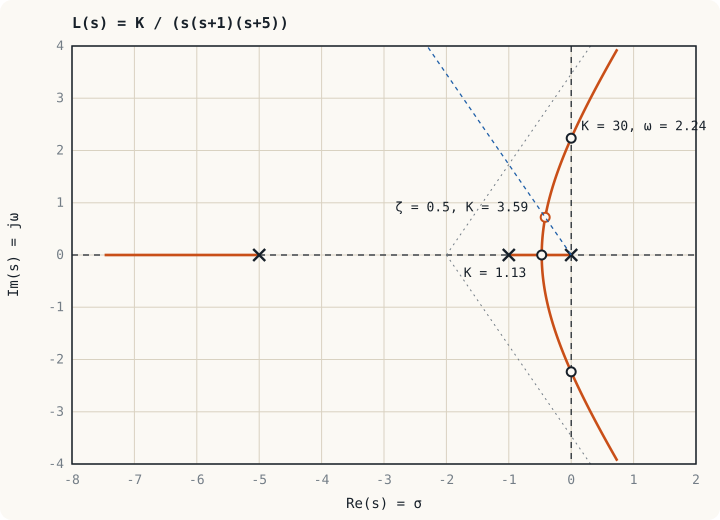

## ภาพในใจก่อนเริ่ม: หมุนปุ่มแล้วดูขั้วเดิน {#idea}

สมมติว่าตัวควบคุมมีปุ่มปรับเกนหนึ่งปุ่ม เมื่อหมุนปุ่ม ขั้วของระบบวงปิดจะย้ายตำแหน่งบนระนาบ $s$ ถ้าลากเส้นตามรอยที่ขั้วเดินตั้งแต่เกนเป็นศูนย์จนถึงอนันต์ เส้นนั้นคือ**รูทโลคัส (root locus)**

หน่วยที่ 6 สอนว่าตำแหน่งขั้วกำหนดการพุ่งเกินและเวลาเข้าที่ หน่วยที่ 8 สอนว่าขั้วข้ามไปครึ่งขวาเมื่อใด รูทโลคัสรวมสองเรื่องไว้ในภาพเดียว เห็นได้ทันทีว่าเกนค่าใดให้ผลตอบสนองแบบใด และถ้าไม่มีเกนค่าใดให้ผลที่ต้องการ ก็เห็นด้วยว่าต้องดัดเส้นทางไปทางไหน

## เงื่อนไขมุมและเงื่อนไขขนาด {#conditions}

เขียนฟังก์ชันถ่ายโอนของลูปเป็น $KL(s)$ โดย $K > 0$ คือเกนที่ปรับได้ ขั้ววงปิดคือรากของ

$$1 + KL(s) = 0 \quad\Longleftrightarrow\quad L(s) = -\frac{1}{K}$$

ด้านขวาเป็นจำนวนจริงลบ สมการเชิงซ้อนนี้จึงแยกได้เป็นสองเงื่อนไข

| เงื่อนไข | สมการ | ใช้ทำอะไร |
|---|---|---|
| เงื่อนไขมุม | $\angle L(s) = \pm 180°(2k + 1)$ | ตัดสินว่าจุด $s$ อยู่บนรูทโลคัสหรือไม่ |
| เงื่อนไขขนาด | $K = \dfrac{1}{\lvert L(s)\rvert}$ | หาเกนที่ทำให้ขั้วมาอยู่ที่จุดนั้น |

มุมของ $L(s)$ ที่จุดทดสอบ คือผลรวมมุมของเวกเตอร์ที่ลากจากศูนย์ทุกตัวมายังจุดนั้น ลบด้วยผลรวมมุมของเวกเตอร์ที่ลากจากขั้วทุกตัว ส่วนขนาดคือ

$$K = \frac{\text{ผลคูณระยะจากขั้วของ } L(s) \text{ ถึงจุดนั้น}}{\text{ผลคูณระยะจากศูนย์ของ } L(s) \text{ ถึงจุดนั้น}}$$

:::key รูปร่างมาจากมุม ตัวเลขมาจากขนาด
รูปร่างของรูทโลคัสขึ้นกับตำแหน่งขั้วและศูนย์ของ**ลูปเปิด**เท่านั้น ไม่ขึ้นกับ $K$ ส่วน $K$ เป็นเพียงตัวบอกว่าขั้วเดินมาถึงตรงไหนของเส้นแล้ว
:::

## กฎการวาดด้วยมือ {#rules}

ให้ $L(s)$ มีขั้ว $n$ ตัวและศูนย์ $m$ ตัว

| ข้อ | กฎ |
|---|---|
| 1 | มี $n$ กิ่ง แต่ละกิ่งเริ่ม ($K = 0$) ที่ขั้วของ $L(s)$ และจบ ($K \to \infty$) ที่ศูนย์ของ $L(s)$ หรือที่อนันต์ รูปสมมาตรรอบแกนจริง |
| 2 | จุดบนแกนจริงอยู่บนรูทโลคัส เมื่อจำนวนขั้วและศูนย์บนแกนจริงที่อยู่**ทางขวา**ของจุดนั้นรวมกันเป็นเลขคี่ |
| 3 | กิ่งที่ไปอนันต์มี $n - m$ กิ่ง วิ่งตามเส้นกำกับที่ออกจากจุดศูนย์ถ่วง $\sigma_a = \dfrac{\sum \text{ขั้ว} - \sum \text{ศูนย์}}{n - m}$ ทำมุม $\theta_a = \dfrac{(2k + 1)180°}{n - m}$ |
| 4 | จุดแยกตัวและจุดรวมตัวบนแกนจริงหาได้จาก $\dfrac{dK}{ds} = 0$ โดย $K = -\dfrac{1}{L(s)}$ |
| 5 | จุดตัดแกนจินตภาพหาได้จากตารางเราท์ (หน่วยที่ 8) |
| 6 | มุมออกจากขั้วเชิงซ้อนหาได้จากเงื่อนไขมุมที่จุดใกล้ขั้วนั้น |

:::example ตัวอย่างที่ 9.1 วาดรูทโลคัสของเซอร์โวอันดับสาม
จงวาดรูทโลคัสของ $KL(s) = \dfrac{K}{s(s + 1)(s + 5)}$ (ระบบเดียวกับตัวอย่างที่ 8.1)

**กฎข้อ 1** ขั้วอยู่ที่ $0, -1, -5$ ไม่มีศูนย์ จึงมี 3 กิ่ง ทุกกิ่งไปอนันต์

**กฎข้อ 2** ส่วนบนแกนจริง: ระหว่าง $0$ กับ $-1$ (มีขั้วทางขวา 1 ตัว) และทางซ้ายของ $-5$ (มีขั้วทางขวา 3 ตัว)

**กฎข้อ 3** เส้นกำกับ 3 เส้น

$$\sigma_a = \frac{0 + (-1) + (-5)}{3} = -2, \qquad \theta_a = 60°,\ 180°,\ 300°$$

**กฎข้อ 4** จุดแยกตัว: $K = -(s^3 + 6s^2 + 5s)$

$$\frac{dK}{ds} = -(3s^2 + 12s + 5) = 0 \quad\Longrightarrow\quad s = -0.472,\ -3.53$$

ค่า $-3.53$ ไม่อยู่บนรูทโลคัส (ตามกฎข้อ 2) จุดแยกตัวจึงอยู่ที่ $s = -0.472$ เกนที่จุดนี้คือผลคูณระยะจากขั้วทั้งสาม: $K = (0.472)(0.528)(4.528) = 1.13$

**กฎข้อ 5** จากตัวอย่างที่ 8.1 รูทโลคัสตัดแกนจินตภาพที่ $s = \pm j2.24$ เมื่อ $K = 30$
:::

อ่านพฤติกรรมของระบบจากภาพได้ทั้งหมด

| ช่วงเกน | ขั้วเด่น | ผลตอบสนองขั้นบันได |
|---|---|---|
| $0 < K < 1.13$ | จริงลบสองตัว | ไม่พุ่งเกิน และช้า |
| $K = 1.13$ | จริงซ้ำที่ $-0.472$ | หน่วงวิกฤต |
| $1.13 < K < 30$ | เชิงซ้อน | พุ่งเกิน ยิ่ง $K$ มากยิ่งแกว่ง |
| $K = 30$ | บนแกนจินตภาพ | แกว่งไม่หยุด |
| $K > 30$ | ครึ่งขวา | ไม่เสถียร |

## เลือกเกนจากรูทโลคัส {#gain}

:::example ตัวอย่างที่ 9.2 เกนที่ให้ ζ = 0.5
จากระบบในตัวอย่างที่ 9.1 จงหา $K$ ที่ทำให้ขั้วเด่นมี $\zeta = 0.5$

**ขั้นที่ 1** เส้น $\zeta = 0.5$ ทำมุม $\cos^{-1}0.5 = 60°$ กับแกนจริงลบ จุดบนเส้นนี้เขียนได้เป็น $s = -a + j\sqrt{3}\,a$

**ขั้นที่ 2** แทนลงในสมการลักษณะเฉพาะ $s^3 + 6s^2 + 5s + K = 0$ ใช้ $s^2 = -2a^2 - j2\sqrt{3}\,a^2$ และ $s^3 = 8a^3$ แล้วแยกส่วนจินตภาพ

$$-12\sqrt{3}\,a^2 + 5\sqrt{3}\,a = 0 \quad\Longrightarrow\quad a = \frac{5}{12} = 0.417$$

ขั้วเด่นคือ $s = -0.417 \pm j0.722$ มี $\omega_n = 2a = 0.833$ rad/s

**ขั้นที่ 3** ส่วนจริง: $8a^3 - 12a^2 - 5a + K = 0$

$$K = 5(0.417) + 12(0.417)^2 - 8(0.417)^3 = 2.083 + 2.083 - 0.579 = 3.59$$

**ขั้นที่ 4** ตรวจขั้วที่สาม: ผลรวมของรากเท่ากับ $-6$ จึงได้ $s_3 = -6 + 2(0.417) = -5.17$ อยู่ไกลจากขั้วเด่นกว่า 12 เท่า การประมาณด้วยระบบอันดับสองจึงใช้ได้ดี คาดว่าพุ่งเกินประมาณ 16 % และ $t_s \approx 4/0.417 = 9.6$ s
:::

ผลลัพธ์นี้เผยข้อจำกัด: ที่ $\zeta = 0.5$ ระบบใช้เวลาเข้าที่เกือบ 10 วินาที ถ้าเพิ่มเกนเพื่อให้เร็วขึ้น ขั้วจะเดินเข้าหาแกนจินตภาพและแกว่งมากขึ้น รูทโลคัสเส้นนี้ไม่ผ่านบริเวณที่ทั้งเร็วและหน่วงดี จึงต้อง**เปลี่ยนรูปร่างของรูทโลคัส**ด้วยตัวชดเชย ซึ่งเป็นเรื่องของหน่วยถัดไป

:::note เทียบกับการปรับจูนไดรฟ์
เมื่อเพิ่มเกนของลูปความเร็วในเซอร์โวไดรฟ์ทีละขั้น เครื่องจักรจะตอบสนองเร็วขึ้น จากนั้นเริ่มสั่น และสุดท้ายส่งเสียงหอน ลำดับเหตุการณ์นี้คือการเดินไปตามรูทโลคัสจากจุดแยกตัวจนถึงแกนจินตภาพนั่นเอง ความถี่ของเสียงหอนคือ $\omega$ ที่จุดตัด
:::

## แบบฝึกหัด {#exercises}

:::exercise แบบฝึกหัด 9.1
สำหรับ $KL(s) = \dfrac{K}{s(s + 2)(s + 4)}$ จงหาเส้นกำกับ จุดแยกตัว และจุดตัดแกนจินตภาพ

:::answer ดูเฉลย
$\sigma_a = \dfrac{0 - 2 - 4}{3} = -2$ มุม $60°, 180°, 300°$

จุดแยกตัว: $3s^2 + 12s + 8 = 0$ ได้ $s = -0.845$ และ $-3.15$ ค่าที่อยู่บนรูทโลคัส (ระหว่าง 0 กับ −2) คือ $s = -0.845$

จุดตัดแกนจินตภาพ (จากแบบฝึกหัด 8.2): $s = \pm j2.83$ ที่ $K = 48$
:::
:::

:::exercise แบบฝึกหัด 9.2
จุด $s = -1 + j1$ อยู่บนรูทโลคัสของ $KL(s) = \dfrac{K}{s(s + 2)}$ หรือไม่ ถ้าอยู่ จงหา $K$

:::answer ดูเฉลย
มุมจากขั้วที่ 0: $135°$ มุมจากขั้วที่ $-2$: $45°$ รวมมุมของ $L(s) = -(135° + 45°) = -180°$ ผ่านเงื่อนไขมุม จึงอยู่บนรูทโลคัส

$K = \lvert s\rvert\,\lvert s + 2\rvert = (\sqrt2)(\sqrt2) = 2$ ตรวจ: $s^2 + 2s + 2 = 0$ มีราก $-1 \pm j1$
:::
:::

:::exercise แบบฝึกหัด 9.3
ถ้าเพิ่มศูนย์ที่ $s = -2$ ให้ระบบในตัวอย่างที่ 9.1 เส้นกำกับเปลี่ยนไปอย่างไร และมีผลต่อเสถียรภาพอย่างไร

:::answer ดูเฉลย
ตอนนี้ $n - m = 2$ จึงเหลือเส้นกำกับ 2 เส้นที่มุม $\pm 90°$ ออกจาก $\sigma_a = \dfrac{(0 - 1 - 5) - (-2)}{2} = -2$

เส้นกำกับเป็นเส้นตั้งที่ $s = -2$ ซึ่งอยู่ในครึ่งซ้าย กิ่งของรูทโลคัสจึงไม่ข้ามไปครึ่งขวา ระบบเสถียรทุกค่า $K > 0$ ศูนย์ดึงรูทโลคัสไปทางซ้าย นี่คือหลักของตัวชดเชยแบบลีดในหน่วยที่ 10
:::
:::

## สรุปหน่วยที่ 9 {#summary}

- รูทโลคัสคือทางเดินของขั้ววงปิดเมื่อเกน $K$ เปลี่ยนจาก 0 ถึง $\infty$
- จุดอยู่บนรูทโลคัสเมื่อ $\angle L(s) = \pm 180°(2k + 1)$ และเกนที่จุดนั้นคือ $1/\lvert L(s)\rvert$
- กิ่งเริ่มที่ขั้วของลูปเปิด จบที่ศูนย์หรืออนันต์ตามเส้นกำกับ
- ขั้วที่เพิ่มในลูปผลักรูทโลคัสไปทางขวา ศูนย์ดึงไปทางซ้าย
