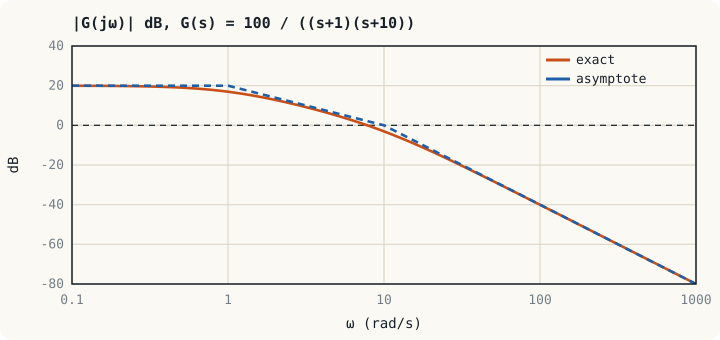
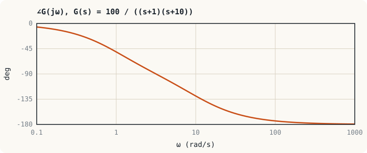

## ภาพในใจก่อนเริ่ม: นักศึกษาไฟฟ้าทำสิ่งนี้อยู่แล้ว {#idea}

ในวิชาวงจรไฟฟ้ากระแสสลับ เราป้อนแรงดันไซน์ให้วงจร แล้วหาแรงดันเอาต์พุตด้วยเฟสเซอร์ คำตอบคือไซน์ความถี่เดิมที่มี**ขนาดเปลี่ยน**และ**เฟสเลื่อน** นั่นคือผลตอบสนองเชิงความถี่ที่ความถี่เดียว หน่วยนี้เพียงทำซ้ำที่ทุกความถี่แล้วพล็อตเป็นกราฟ

เหตุที่ต้องสนใจทุกความถี่: สัญญาณจริงทุกชนิดเขียนเป็นผลรวมของไซน์หลายความถี่ได้ (อนุกรมฟูเรียร์) สัญญาณที่เปลี่ยนเร็วมีองค์ประกอบความถี่สูง สัญญาณรบกวนส่วนใหญ่อยู่ที่ความถี่สูง ระบบที่ส่งผ่านได้เฉพาะความถี่ต่ำจึงตอบสนองช้าแต่กรองสัญญาณรบกวนได้ดี กราฟเดียวบอกได้ทั้งสองเรื่อง

## นิยาม {#definition}

เมื่อป้อน $u(t) = A\sin\omega t$ ให้ระบบเชิงเส้นที่เสถียร และรอจนเข้าสถานะอยู่ตัว เอาต์พุตคือ

$$y(t) = A\,\lvert G(j\omega)\rvert\,\sin\bigl(\omega t + \angle G(j\omega)\bigr)$$

ขนาดและเฟสได้จากการแทน $s = j\omega$ ลงในฟังก์ชันถ่ายโอน เหมือนที่แทน $sL$ ด้วย $j\omega L$ ในวงจรไฟฟ้า

:::example ตัวอย่างที่ 11.1 ตัวกรอง RC ที่ความถี่หักมุม
ตัวกรอง RC มี $G(s) = \dfrac{1}{\tau s + 1}$ จงหาขนาดและเฟสที่ $\omega = 1/\tau$

$$G(j\omega) = \frac{1}{1 + j\omega\tau}, \qquad \lvert G\rvert = \frac{1}{\sqrt{1 + (\omega\tau)^2}}, \qquad \angle G = -\tan^{-1}(\omega\tau)$$

ที่ $\omega\tau = 1$: $\lvert G\rvert = \dfrac{1}{\sqrt2} = 0.707$ และ $\angle G = -45°$

เอาต์พุตมีขนาด 70.7 % ของอินพุต กำลังลดลงครึ่งหนึ่ง จึงเรียกจุดนี้ว่าจุดกำลังครึ่ง หรือจุด −3 dB
:::

## เดซิเบลและแกนลอการิทึม {#decibel}

โบดไดอะแกรมประกอบด้วยกราฟสองรูปที่ใช้แกนความถี่แบบลอการิทึมร่วมกัน

- **กราฟขนาด**: $20\log_{10}\lvert G(j\omega)\rvert$ หน่วยเดซิเบล (dB)
- **กราฟเฟส**: $\angle G(j\omega)$ หน่วยองศา

| อัตราส่วนขนาด | 0.01 | 0.1 | 0.707 | 1 | 2 | 10 | 100 |
|---|---|---|---|---|---|---|---|
| dB | −40 | −20 | −3 | 0 | 6 | 20 | 40 |

:::key เหตุผลที่ใช้ลอการิทึม
ลอการิทึมเปลี่ยนการคูณเป็นการบวก ฟังก์ชันถ่ายโอนเป็นผลคูณของตัวประกอบ กราฟขนาดเป็น dB ของทั้งระบบจึงเป็น**ผลบวก**ของกราฟของแต่ละตัวประกอบ และกราฟเฟสก็เป็นผลบวกของเฟสอยู่แล้ว การวาดโบดจึงเป็นการวาดชิ้นส่วนง่าย ๆ แล้วนำมาบวกกัน
:::

ช่วงความถี่ที่ต่างกัน 10 เท่าเรียกว่า**ดีเคด (decade)** ความชันของกราฟขนาดจึงมีหน่วยเป็น dB/decade

## ตัวประกอบพื้นฐาน {#factors}

| ตัวประกอบ | กราฟขนาด (เส้นกำกับ) | กราฟเฟส |
|---|---|---|
| เกน $K$ | เส้นนอนที่ $20\log K$ | $0°$ |
| อินทิเกรเตอร์ $\dfrac{1}{s}$ | เส้นตรงชัน −20 dB/dec ผ่าน 0 dB ที่ $\omega = 1$ | $-90°$ คงที่ |
| ดิฟเฟอเรนชิเอเตอร์ $s$ | เส้นตรงชัน +20 dB/dec ผ่าน 0 dB ที่ $\omega = 1$ | $+90°$ คงที่ |
| ขั้วจริง $\dfrac{1}{s/\omega_c + 1}$ | 0 dB จนถึง $\omega_c$ แล้วชัน −20 dB/dec | จาก $0°$ ถึง $-90°$ ผ่าน $-45°$ ที่ $\omega_c$ |
| ศูนย์จริง $s/\omega_c + 1$ | 0 dB จนถึง $\omega_c$ แล้วชัน +20 dB/dec | จาก $0°$ ถึง $+90°$ ผ่าน $+45°$ ที่ $\omega_c$ |
| ขั้วเชิงซ้อน $\dfrac{\omega_n^2}{s^2 + 2\zeta\omega_ns + \omega_n^2}$ | 0 dB จนถึง $\omega_n$ แล้วชัน −40 dB/dec มียอดเรโซแนนซ์เมื่อ $\zeta < 0.707$ | จาก $0°$ ถึง $-180°$ ผ่าน $-90°$ ที่ $\omega_n$ |

ความถี่ $\omega_c$ เรียกว่า**ความถี่หักมุม (corner frequency)** สำหรับขั้วจริง กราฟจริงอยู่ต่ำกว่าเส้นกำกับ 3 dB ที่ $\omega_c$ และเฟสเปลี่ยนเกือบทั้งหมดในช่วง $0.1\omega_c$ ถึง $10\omega_c$

## ขั้นตอนการวาด {#procedure}

1. จัดทุกตัวประกอบให้อยู่ในรูป $(s/\omega_c + 1)$ เพื่อแยกเกน DC ออกมา
2. เรียงความถี่หักมุมจากน้อยไปมาก
3. เริ่มกราฟขนาดที่ความถี่ต่ำด้วยเกน DC (หรือด้วยความชัน −20 dB/dec ต่ออินทิเกรเตอร์หนึ่งตัว)
4. ทุกครั้งที่ผ่านความถี่หักมุม เปลี่ยนความชัน: ขั้ว −20 dB/dec ศูนย์ +20 dB/dec
5. วาดกราฟเฟสโดยบวกเฟสของแต่ละตัวประกอบ

:::example ตัวอย่างที่ 11.2 วาดโบดของระบบสองขั้ว
จงวาดโบดไดอะแกรมของ $G(s) = \dfrac{100}{(s + 1)(s + 10)}$

**ขั้นที่ 1** จัดรูป

$$G(s) = \frac{10}{(s + 1)(s/10 + 1)}$$

เกน DC เท่ากับ 10 หรือ 20 dB ความถี่หักมุมอยู่ที่ 1 และ 10 rad/s

**ขั้นที่ 2** เส้นกำกับของกราฟขนาด

| ช่วงความถี่ | ความชัน | ค่าที่ปลายช่วง |
|---|---|---|
| $\omega < 1$ | 0 dB/dec | 20 dB |
| $1 < \omega < 10$ | −20 dB/dec | 0 dB ที่ $\omega = 10$ |
| $\omega > 10$ | −40 dB/dec | −40 dB ที่ $\omega = 100$ |

**ขั้นที่ 3** ตรวจค่าจริงที่ $\omega = 10$

$$\lvert G(j10)\rvert = \frac{100}{\sqrt{1 + 100}\,\sqrt{100 + 100}} = \frac{100}{(10.05)(14.14)} = 0.704 \;\Rightarrow\; -3.05\ \text{dB}$$

ต่ำกว่าเส้นกำกับ (0 dB) อยู่ 3 dB ตามที่คาดสำหรับความถี่หักมุมของขั้วจริง

**ขั้นที่ 4** เฟส: $\angle G = -\tan^{-1}\omega - \tan^{-1}(\omega/10)$

| $\omega$ (rad/s) | 0.1 | 1 | 3.16 | 10 | 100 |
|---|---|---|---|---|---|
| เฟส | $-6.3°$ | $-50.7°$ | $-90.0°$ | $-129.3°$ | $-173.7°$ |
:::

## อ่านโบดไดอะแกรม {#reading}

| สิ่งที่อ่านได้ | อ่านจากไหน | ความหมายในโดเมนเวลา |
|---|---|---|
| เกน DC | ระดับของกราฟขนาดที่ความถี่ต่ำ | ค่าสุดท้ายของผลตอบสนองขั้นบันได |
| ความชันที่ความถี่ต่ำ | 0, −20, −40 dB/dec | ชนิดของระบบ 0, 1, 2 (หน่วยที่ 7) |
| แบนด์วิดท์ $\omega_{BW}$ | ความถี่ที่ขนาดลดลง 3 dB จากค่า DC | ความเร็ว: $t_r \approx 2.2/\omega_{BW}$ สำหรับระบบอันดับหนึ่ง |
| ยอดเรโซแนนซ์ $M_r$ | ความสูงของยอดเหนือระดับ DC | การพุ่งเกิน: ยอดสูงแปลว่า $\zeta$ ต่ำ |
| ความชันที่ความถี่สูง | −20 dB/dec ต่อขั้วส่วนเกินหนึ่งตัว | ความสามารถในการกรองสัญญาณรบกวน |

สำหรับระบบอันดับสอง ยอดเรโซแนนซ์คือ $M_r = \dfrac{1}{2\zeta\sqrt{1 - \zeta^2}}$ เกิดที่ $\omega_r = \omega_n\sqrt{1 - 2\zeta^2}$

:::example ตัวอย่างที่ 11.3 ยอดเรโซแนนซ์ของตัวกรอง LC
ตัวกรอง LC ของบักคอนเวอร์เตอร์ในตัวอย่างที่ 6.2 มี $\omega_n = 10^4$ rad/s และ $\zeta = 0.1$ จงหายอดเรโซแนนซ์

$$M_r = \frac{1}{2(0.1)\sqrt{1 - 0.01}} = 5.03 \;\Rightarrow\; 20\log 5.03 = 14.0\ \text{dB}$$

ที่ความถี่ใกล้ 1.59 kHz ตัวกรองขยายสัญญาณ 5 เท่าแทนที่จะลดทอน และเฟสตกจาก $0°$ เป็น $-180°$ อย่างรวดเร็วรอบความถี่นี้ ลูปควบคุมแรงดันต้องรับมือกับเฟสที่หายไปนี้ ซึ่งเป็นเหตุที่ต้องใช้ตัวชดเชยที่มีศูนย์สองตัว
:::

:::note วัดผลตอบสนองเชิงความถี่จากของจริง
ข้อดีสำคัญของวิธีเชิงความถี่คือ**วัดได้โดยไม่ต้องมีแบบจำลอง** ป้อนสัญญาณไซน์จากเครื่องกำเนิดสัญญาณ วัดอัตราส่วนขนาดและเฟสด้วยออสซิลโลสโคปที่หลายความถี่ แล้วพล็อต เครื่องวิเคราะห์ผลตอบสนองเชิงความถี่ (FRA) ทำขั้นตอนนี้อัตโนมัติ วิศวกรอิเล็กทรอนิกส์กำลังใช้วิธีนี้วัดลูปของแหล่งจ่ายไฟเป็นงานประจำ และจากความชันกับความถี่หักมุมของกราฟที่วัดได้ ก็ประมาณฟังก์ชันถ่ายโอนย้อนกลับได้
:::

## แบบฝึกหัด {#exercises}

:::exercise แบบฝึกหัด 11.1
ตัวกรอง RC ป้องกันเอเลียส (anti-aliasing) หน้า ADC ใช้ $R = 1.6\ \text{k}\Omega$ และ $C = 0.1\ \mu\text{F}$ จงหาความถี่หักมุมเป็น Hz และการลดทอนที่ 10 kHz

:::answer ดูเฉลย
$\omega_c = \dfrac{1}{RC} = \dfrac{1}{1.6 \times 10^{-4}} = 6{,}250$ rad/s หรือ $f_c = \omega_c/(2\pi) = 995$ Hz

ที่ 10 kHz: $f/f_c = 10.05$ ได้ $\lvert G\rvert = \dfrac{1}{\sqrt{1 + 10.05^2}} = 0.099$ หรือ $-20.1$ dB (เส้นกำกับให้ −20 dB)
:::
:::

:::exercise แบบฝึกหัด 11.2
จงหาเกนที่ความถี่ต่ำ ความถี่หักมุม และความชันแต่ละช่วงของ $G(s) = \dfrac{50(s + 2)}{s(s + 10)}$

:::answer ดูเฉลย
จัดรูป: $G(s) = \dfrac{10(s/2 + 1)}{s(s/10 + 1)}$

มีอินทิเกรเตอร์ กราฟเริ่มด้วยความชัน −20 dB/dec และเส้นกำกับช่วงแรกผ่าน $20\log 10 = 20$ dB ที่ $\omega = 1$ ที่ $\omega = 2$ (ศูนย์) ความชันเปลี่ยนเป็น 0 dB/dec ที่ระดับ $20 - 20\log 2 = 14$ dB ที่ $\omega = 10$ (ขั้ว) ความชันกลับเป็น −20 dB/dec
:::
:::

:::exercise แบบฝึกหัด 11.3
ระบบอันดับสองมี $\zeta = 0.5$ และ $\omega_n = 1000$ rad/s (วงจร RLC ในตัวอย่างที่ 6.1) จงหา $M_r$ และ $\omega_r$

:::answer ดูเฉลย
$M_r = \dfrac{1}{2(0.5)\sqrt{0.75}} = 1.155$ หรือ 1.25 dB

$\omega_r = 1000\sqrt{1 - 0.5} = 707$ rad/s ยอดเตี้ยมาก สอดคล้องกับการพุ่งเกินเพียง 16 %
:::
:::

## สรุปหน่วยที่ 11 {#summary}

- ผลตอบสนองเชิงความถี่คือขนาดและเฟสของ $G(j\omega)$ ซึ่งบอกว่าไซน์แต่ละความถี่ถูกขยายและเลื่อนเฟสเท่าใด
- โบดไดอะแกรมใช้ dB และแกนความถี่ลอการิทึม ทำให้กราฟของทั้งระบบเป็นผลบวกของกราฟของตัวประกอบ
- ขั้วจริงหักความชันลง 20 dB/dec และเพิ่มเฟสล้าหลังได้ถึง 90° ศูนย์จริงทำตรงข้าม
- แบนด์วิดท์บอกความเร็ว ยอดเรโซแนนซ์บอกการหน่วง ความชันที่ความถี่ต่ำบอกชนิดของระบบ

หน่วยถัดไปใช้โบดไดอะแกรมของลูปเปิดตัดสินเสถียรภาพของวงปิด และวัดว่าห่างจากขอบเสถียรภาพเท่าใด
