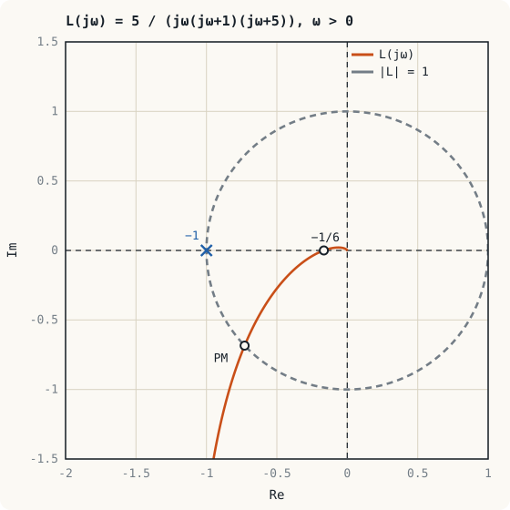
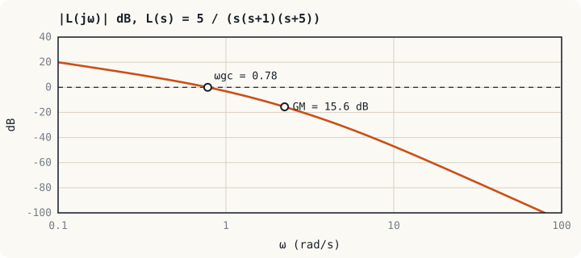
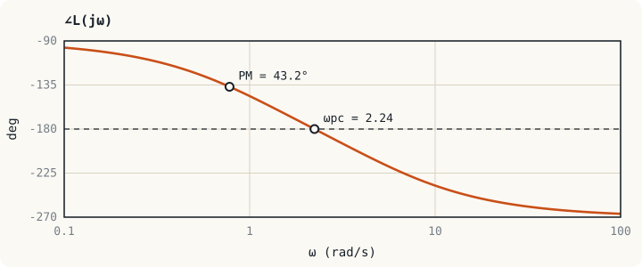

## ภาพในใจก่อนเริ่ม: สัญญาณที่วนกลับมาเสริมตัวเอง {#idea}

ลองตามสัญญาณไซน์หนึ่งรอบลูป มันถูกคูณด้วย $L(j\omega)$ แล้วถูกกลับเครื่องหมายที่จุดรวมสัญญาณ (ป้อนกลับแบบลบ) ถ้าที่ความถี่หนึ่ง ลูปเลื่อนเฟสไป $-180°$ พอดี การกลับเครื่องหมายอีกครั้งจะทำให้สัญญาณกลับมา**ตรงเฟสกับตัวเอง** ถ้าขนาดรอบวงที่ความถี่นั้นเท่ากับ 1 ด้วย สัญญาณจะวนอยู่ได้เองไม่ต้องมีอินพุต ถ้ามากกว่า 1 สัญญาณจะโตขึ้นทุกรอบ

เงื่อนไข "ขนาด 1 และเฟส $-180°$" เขียนเป็นจำนวนเชิงซ้อนคือ $L(j\omega) = -1$ ซึ่งตรงกับสมการลักษณะเฉพาะ $1 + L(s) = 0$ ที่ $s = j\omega$ จุด $-1$ จึงเป็น**จุดวิกฤต** คำถามของหน่วยนี้คือ กราฟของ $L(j\omega)$ อยู่ห่างจากจุดนี้เท่าใด

## เกณฑ์ไนควิสต์ {#nyquist}

**แผนภาพไนควิสต์ (Nyquist plot)** คือกราฟของ $L(j\omega)$ บนระนาบเชิงซ้อนเมื่อ $\omega$ เปลี่ยนจาก $-\infty$ ถึง $+\infty$ ส่วนของความถี่ลบเป็นภาพสะท้อนของส่วนความถี่บวกรอบแกนจริง

:::key เกณฑ์ไนควิสต์
$$Z = N + P$$
- $P$ = จำนวนขั้วของลูปเปิด $L(s)$ ในครึ่งขวาของระนาบ $s$
- $N$ = จำนวนรอบที่แผนภาพไนควิสต์วนรอบจุด $-1$ ตามเข็มนาฬิกา (ทวนเข็มนับเป็นลบ)
- $Z$ = จำนวนขั้วของวงปิดในครึ่งขวา

ระบบวงปิดเสถียรก็ต่อเมื่อ $Z = 0$
:::

พลานต์ส่วนใหญ่ในงานไฟฟ้าเสถียรเมื่อเป็นลูปเปิด ($P = 0$) เกณฑ์จึงลดรูปเป็น: **ระบบวงปิดเสถียรเมื่อแผนภาพไนควิสต์ไม่วนรอบจุด $-1$**

ข้อได้เปรียบเหนือเกณฑ์เราท์มีสามข้อ: ใช้กับข้อมูลที่วัดจากระบบจริงได้โดยไม่ต้องมีสมการ ใช้กับระบบที่มีเวลาหน่วงได้ และบอกได้ว่าเสถียร**มากน้อยเพียงใด**

## เกนมาร์จินและเฟสมาร์จิน {#margins}

ระบบที่เสถียรตามการคำนวณแต่อยู่ใกล้ขอบจะแกว่งมาก และอาจไม่เสถียรจริงเมื่อค่าอุปกรณ์คลาดเคลื่อน จึงต้องวัดระยะห่างจากจุด $-1$ เป็นตัวเลขสองตัว

| ปริมาณ | นิยาม | ความหมาย |
|---|---|---|
| ความถี่ตัดข้ามเฟส $\omega_{pc}$ | ความถี่ที่ $\angle L = -180°$ | |
| เกนมาร์จิน (GM) | $\dfrac{1}{\lvert L(j\omega_{pc})\rvert}$ หรือ $-20\log\lvert L(j\omega_{pc})\rvert$ dB | เพิ่มเกนได้อีกกี่เท่าก่อนไม่เสถียร |
| ความถี่ตัดข้ามเกน $\omega_{gc}$ | ความถี่ที่ $\lvert L\rvert = 1$ (0 dB) | ใกล้เคียงแบนด์วิดท์ของวงปิด |
| เฟสมาร์จิน (PM) | $180° + \angle L(j\omega_{gc})$ | ลูปเสียเฟสได้อีกกี่องศาก่อนไม่เสถียร |

บนโบดไดอะแกรม GM คือระยะที่กราฟขนาดอยู่**ใต้** 0 dB ณ ความถี่ที่เฟสผ่าน $-180°$ และ PM คือระยะที่กราฟเฟสอยู่**เหนือ** $-180°$ ณ ความถี่ที่ขนาดผ่าน 0 dB

:::example ตัวอย่างที่ 12.1 มาร์จินของเซอร์โว
จงหา GM และ PM ของ $L(s) = \dfrac{5}{s(s + 1)(s + 5)}$

**เกนมาร์จิน** จากตัวอย่างที่ 8.1 ระบบถึงขอบเสถียรภาพเมื่อเกนเป็น 30 ที่ $\omega = 2.24$ rad/s เกนปัจจุบันคือ 5

$$\text{GM} = \frac{30}{5} = 6 \;\Rightarrow\; 20\log 6 = 15.6\ \text{dB}, \qquad \omega_{pc} = 2.24\ \text{rad/s}$$

ตรวจโดยตรง: $\lvert L(j2.24)\rvert = \dfrac{5}{(2.24)(2.45)(5.48)} = \dfrac{1}{6}$

**เฟสมาร์จิน** หา $\omega_{gc}$ จาก $\lvert L\rvert = 1$

$$\omega\sqrt{\omega^2 + 1}\sqrt{\omega^2 + 25} = 5$$

ลองค่า: ที่ $\omega = 0.78$ ได้ $(0.78)(1.268)(5.06) = 5.00$ จึงได้ $\omega_{gc} = 0.78$ rad/s

$$\angle L(j0.78) = -90° - \tan^{-1}(0.78) - \tan^{-1}(0.78/5) = -90° - 37.9° - 8.9° = -136.8°$$

$$\text{PM} = 180° - 136.8° = 43.2°$$
:::

## เฟสมาร์จินกับการหน่วง {#pm-zeta}

สำหรับระบบที่มีขั้วเด่นคู่เดียว มีกฎประมาณที่ใช้กันทั่วไป

$$\zeta \approx \frac{\text{PM (องศา)}}{100} \qquad (\text{ใช้ได้เมื่อ PM} < 70°)$$

| PM | $\zeta$ โดยประมาณ | การพุ่งเกินโดยประมาณ | ลักษณะ |
|---|---|---|---|
| $30°$ | 0.3 | 37 % | แกว่งมาก |
| $45°$ | 0.45 | 20 % | ค่าต่ำสุดที่ยอมรับได้ทั่วไป |
| $60°$ | 0.6 | 10 % | ค่าที่นิยมใช้ออกแบบ |

ในตัวอย่างที่ 12.1 PM = 43.2° ทำนายว่า $\zeta \approx 0.43$ และพุ่งเกินประมาณ 22 % การจำลองระบบจริงให้การพุ่งเกิน 25 % (ขั้วเด่นอยู่ที่ $-0.39 \pm j0.90$ มี $\zeta = 0.40$) กฎประมาณนี้จึงใช้ชี้ทิศทางการออกแบบได้ดี

:::note ข้อกำหนดที่พบในงานจริง
ข้อกำหนดทั่วไปสำหรับลูปควบคุมในอุตสาหกรรมคือ GM ไม่ต่ำกว่า 6 dB (เกนเพิ่มได้อีกเท่าตัว) และ PM ไม่ต่ำกว่า 45° แหล่งจ่ายไฟสวิตชิงมักกำหนด PM ไม่ต่ำกว่า 45°–60° ตลอดช่วงโหลดและแรงดันอินพุต เพราะค่า ESR ของตัวเก็บประจุและค่าความเหนี่ยวนำเปลี่ยนตามอุณหภูมิและอายุการใช้งาน
:::

## เวลาหน่วง {#delay}

เวลาหน่วง $T_d$ (dead time) มีฟังก์ชันถ่ายโอน $e^{-sT_d}$ ที่ $s = j\omega$ มีขนาดเท่ากับ 1 ทุกความถี่ แต่เพิ่มเฟสล้าหลัง

$$\angle e^{-j\omega T_d} = -\omega T_d\ \text{rad} = -\omega T_d \times \frac{180°}{\pi}$$

เวลาหน่วงจึง**กินเฟสมาร์จินโดยตรง**โดยไม่เปลี่ยน $\omega_{gc}$ แหล่งของเวลาหน่วงในงานจริงมีมาก: รอบสแกนของ PLC การสื่อสารผ่านเครือข่ายฟีลด์บัส เวลาคำนวณและการอัปเดต PWM ของไมโครคอนโทรลเลอร์ และระยะทางที่ของไหลเดินในท่อจนถึงเซนเซอร์

:::example ตัวอย่างที่ 12.2 รอบสแกนของ PLC กินเฟสมาร์จินเท่าใด
ลูปในตัวอย่างที่ 12.1 ควบคุมด้วย PLC ที่มีเวลาหน่วงรวม (รอบสแกน การกรองอินพุต และการอัปเดตเอาต์พุต) 0.2 s จงหาเฟสมาร์จินใหม่ และเวลาหน่วงสูงสุดก่อนที่ระบบจะไม่เสถียร

เฟสที่เสียไปที่ $\omega_{gc} = 0.78$ rad/s

$$\Delta\phi = 0.78 \times 0.2 \times \frac{180°}{\pi} = 8.9°$$

เฟสมาร์จินเหลือ $43.2° - 8.9° = 34.3°$ ระบบแกว่งมากขึ้นอย่างเห็นได้ชัด

เวลาหน่วงที่ทำให้ PM เป็นศูนย์

$$T_{d,\max} = \frac{\text{PM (rad)}}{\omega_{gc}} = \frac{43.2° \times \pi/180°}{0.78} = 0.97\ \text{s}$$

ลูปที่ช้าขนาดนี้ทนรอบสแกน 10–20 ms ได้สบาย แต่ลูปกระแสของไดรฟ์ที่มี $\omega_{gc}$ ระดับหลายพัน rad/s เวลาหน่วงเพียง 100 µs ก็กินเฟสไปหลายสิบองศา ลูปเร็วจึงต้องคำนวณในไมโครคอนโทรลเลอร์หรือ DSP ไม่ใช่ใน PLC
:::

## แบบฝึกหัด {#exercises}

:::exercise แบบฝึกหัด 12.1
ถ้าเพิ่มเกนของลูปในตัวอย่างที่ 12.1 จาก 5 เป็น 15 เกนมาร์จินจะเป็นเท่าใด และคาดว่าผลตอบสนองเปลี่ยนไปอย่างไร

:::answer ดูเฉลย
$\text{GM} = 30/15 = 2$ หรือ 6 dB อยู่ที่ขอบล่างของค่าที่ยอมรับได้ $\omega_{gc}$ สูงขึ้น ระบบเร็วขึ้น แต่เฟสมาร์จินลดลง (เหลือประมาณ 16°) จึงพุ่งเกินและแกว่งมากขึ้นชัดเจน
:::
:::

:::exercise แบบฝึกหัด 12.2
ลูปหนึ่งมี $L(s) = \dfrac{10}{s(0.1s + 1)}$ จงหา $\omega_{gc}$ และ PM

:::answer ดูเฉลย
$\lvert L\rvert = \dfrac{10}{\omega\sqrt{1 + 0.01\omega^2}} = 1$ ให้ $x = \omega^2$: $x(1 + 0.01x) = 100$ ได้ $0.01x^2 + x - 100 = 0$, $x = 61.8$, $\omega_{gc} = 7.86$ rad/s

$\angle L = -90° - \tan^{-1}(0.786) = -128.2°$ ดังนั้น PM = 51.8°

ระบบนี้มีเฟสไม่ถึง $-180°$ ที่ความถี่ใดเลย GM จึงเป็นอนันต์
:::
:::

:::exercise แบบฝึกหัด 12.3
ลูปควบคุมแรงดันของคอนเวอร์เตอร์มี $\omega_{gc} = 2\pi \times 5$ kHz และ PM = 60° ถ้าการคำนวณแบบดิจิทัลเพิ่มเวลาหน่วง 15 µs เฟสมาร์จินเหลือเท่าใด

:::answer ดูเฉลย
$\omega_{gc} = 31{,}416$ rad/s เฟสที่เสีย $= 31{,}416 \times 15 \times 10^{-6} \times \dfrac{180°}{\pi} = 27°$

PM เหลือ 33° จาก 60° เวลาหน่วงที่ดูเล็กน้อยมีผลมากเมื่อลูปเร็ว
:::
:::

## สรุปหน่วยที่ 12 {#summary}

- จุด $-1$ บนระนาบของ $L(j\omega)$ คือจุดวิกฤต เพราะตรงกับ $1 + L = 0$
- เกณฑ์ไนควิสต์: $Z = N + P$ เมื่อลูปเปิดเสถียร ระบบวงปิดเสถียรเมื่อแผนภาพไม่วนรอบ $-1$
- GM คือเกนที่เพิ่มได้ที่ความถี่ซึ่งเฟสเป็น $-180°$ ส่วน PM คือเฟสที่เหลือที่ความถี่ซึ่งขนาดเป็น 1
- $\zeta \approx \text{PM}/100$ ใช้ประมาณการพุ่งเกินจากเฟสมาร์จิน
- เวลาหน่วง $T_d$ ลดเฟสมาร์จินลง $\omega_{gc}T_d$ เรเดียน

หน่วยถัดไปนำเครื่องมือทั้งหมดมาใช้กับตัวควบคุมที่ใช้มากที่สุดในอุตสาหกรรม คือ PID
