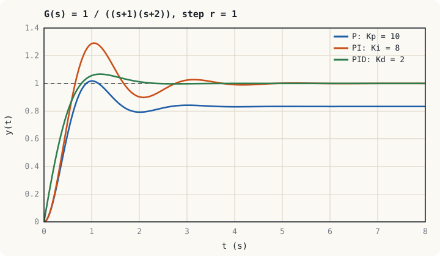

## ภาพในใจก่อนเริ่ม: ปัจจุบัน อดีต และอนาคต {#idea}

คนขับรถที่รักษาความเร็ว 90 km/h ใช้ข้อมูลสามอย่างโดยไม่รู้ตัว

- **ตอนนี้ช้ากว่าเป้าเท่าใด** ยิ่งห่างมากยิ่งเหยียบคันเร่งมาก นี่คือส่วน **P** (proportional) มองปัจจุบัน
- **ช้ากว่าเป้ามานานแค่ไหนแล้ว** ถ้าขึ้นเนินแล้วยังช้าอยู่เรื่อย ๆ ก็ค่อย ๆ เหยียบเพิ่มจนถึงเป้า นี่คือส่วน **I** (integral) สะสมอดีต
- **ความเร็วกำลังเปลี่ยนเร็วแค่ไหน** ถ้าเข็มกำลังพุ่งเข้าหา 90 อย่างเร็วก็ผ่อนคันเร่งล่วงหน้า นี่คือส่วน **D** (derivative) คาดการณ์อนาคต

ตัวควบคุม PID รวมสามส่วนนี้เข้าด้วยกัน และควบคุมลูปในอุตสาหกรรมเป็นส่วนใหญ่ ตั้งแต่อุณหภูมิเตาไปจนถึงกระแสของมอเตอร์

## สมการของ PID {#equation}

รูปแบบขนาน (parallel form)

$$u(t) = K_p\,e(t) + K_i\int_0^t e(\tau)\,d\tau + K_d\,\frac{de(t)}{dt}, \qquad C(s) = K_p + \frac{K_i}{s} + K_ds$$

รูปแบบมาตรฐาน (standard หรือ ISA form) ซึ่งใช้ใน PLC และ DCS ส่วนใหญ่

$$C(s) = K_p\left(1 + \frac{1}{T_is} + T_ds\right), \qquad K_i = \frac{K_p}{T_i}, \quad K_d = K_pT_d$$

$T_i$ คือเวลาอินทิกรัล (integral time หรือ reset time) และ $T_d$ คือเวลาอนุพันธ์ (derivative time) หน่วยเป็นวินาทีหรือนาที

:::warn ตรวจรูปแบบและหน่วยของอุปกรณ์ก่อนป้อนค่า
ผู้ผลิตแต่ละรายใช้รูปแบบต่างกัน บางรายใช้ $K_i$ บางรายใช้ $T_i$ เป็นวินาที บางรายเป็นนาที บางรายใช้แถบสัดส่วน (proportional band) $PB = 100/K_p$ เป็นเปอร์เซ็นต์แทนเกน ค่าที่จูนมาอย่างดีจากรูปแบบหนึ่ง ถ้าป้อนผิดรูปแบบอาจทำให้ลูปไม่เสถียร
:::

## หน้าที่ของแต่ละส่วน {#actions}

| ส่วน | ทำอะไร | ข้อดี | ข้อเสีย |
|---|---|---|---|
| P | สั่งตามขนาดค่าผิดพลาดขณะนั้น | เร็ว เข้าใจง่าย | เหลือค่าผิดพลาดในสถานะอยู่ตัว (หน่วยที่ 7) เกนสูงทำให้แกว่ง |
| I | สะสมค่าผิดพลาดตามเวลา | กำจัดค่าผิดพลาดต่ออินพุตและการรบกวนคงที่ | เพิ่มเฟสล้าหลัง 90° ทำให้พุ่งเกินมากขึ้น เกิดวินด์อัปได้ |
| D | สั่งตามอัตราการเปลี่ยนของค่าผิดพลาด | เติมเฟสนำหน้า ลดการพุ่งเกิน | ขยายสัญญาณรบกวนความถี่สูง |

เทียบกับหน่วยที่ 10: PI คือตัวชดเชยแบบแลกที่มีขั้วอยู่ที่จุดกำเนิดพอดี PD คือตัวชดเชยแบบลีดที่ขั้วอยู่ไกลมาก และ PID คือลีด-แลก

กราฟแสดงลำดับที่พบเสมอ: P อย่างเดียวค้างอยู่ที่ $\dfrac{K_pG(0)}{1 + K_pG(0)} = \dfrac{5}{6} = 0.83$ เมื่อเพิ่ม I ค่าผิดพลาดหมดไปแต่พุ่งเกิน 29 % เมื่อเพิ่ม D การพุ่งเกินลดเหลือ 7 %

## จูนด้วยการหักล้างขั้ว {#cancel}

เมื่อพลานต์เป็นระบบอันดับหนึ่ง $G(s) = \dfrac{K}{\tau s + 1}$ ตัวควบคุม PI เขียนได้เป็น $C(s) = K_p\,\dfrac{T_is + 1}{T_is}$ ถ้าเลือก $T_i = \tau$ ศูนย์ของตัวควบคุมจะหักล้างขั้วของพลานต์

$$L(s) = \frac{K_pK}{\tau s} \quad\Longrightarrow\quad T(s) = \frac{1}{\tau_cs + 1}, \qquad \tau_c = \frac{\tau}{K_pK}$$

วงปิดเป็นระบบอันดับหนึ่งที่ไม่พุ่งเกิน และผู้ออกแบบเลือกความเร็ว $\tau_c$ ได้โดยตรง

:::example ตัวอย่างที่ 13.1 ตัวควบคุม PI ของลูปความเร็วมอเตอร์
มอเตอร์ในตัวอย่างที่ 3.3 มี $G(s) = \dfrac{18.5}{0.074s + 1}$ ต้องการค่าคงตัวเวลาของวงปิด 20 ms และไม่มีค่าผิดพลาดในสถานะอยู่ตัว

**ขั้นที่ 1** เลือก $T_i = \tau = 0.074$ s

**ขั้นที่ 2** จาก $\tau_c = \dfrac{\tau}{K_pK}$

$$K_p = \frac{\tau}{K\tau_c} = \frac{0.074}{(18.5)(0.02)} = 0.20\ \text{V ต่อ rad/s}, \qquad K_i = \frac{K_p}{T_i} = 2.70$$

**ขั้นที่ 3** ตรวจสัญญาณสั่ง: เมื่อสั่งเปลี่ยนความเร็วทันที 100 rad/s ส่วน P สั่งแรงดัน $0.20 \times 100 = 20$ V ในขณะแรก ซึ่งเกินพิกัด 12 V ของแหล่งจ่าย เอาต์พุตของตัวควบคุมจะอิ่มตัว ต้องมีวงจรป้องกันวินด์อัป หรือลดความชันของค่าอ้างอิงด้วยแรมป์ ซึ่งอินเวอร์เตอร์ทุกรุ่นมีให้ตั้งเป็นเวลาเร่งและเวลาหน่วง
:::

วิธีนี้คือพื้นฐานของการจูนลูปกระแสและลูปความเร็วในไดรฟ์ และของวิธีจูนแบบ IMC (lambda tuning) ที่ใช้ในอุตสาหกรรมกระบวนการ

## วิธีซีเกลอร์–นิโคลส์ {#zn}

เมื่อไม่มีแบบจำลอง วิธี**ซีเกลอร์–นิโคลส์แบบเกนวิกฤต**ใช้การทดลองกับระบบจริง

1. ปิดส่วน I และ D เหลือแต่ P
2. เพิ่ม $K_p$ ทีละน้อยจนเอาต์พุตแกว่งด้วยขนาดคงที่ บันทึกเกนวิกฤต $K_u$ และคาบของการแกว่ง $T_u$
3. ตั้งค่าตามตาราง

| ตัวควบคุม | $K_p$ | $T_i$ | $T_d$ |
|---|---|---|---|
| P | $0.5K_u$ | | |
| PI | $0.45K_u$ | $T_u/1.2$ | |
| PID | $0.6K_u$ | $T_u/2$ | $T_u/8$ |

:::example ตัวอย่างที่ 13.2 จูน PID ของเซอร์โวด้วยวิธีซีเกลอร์–นิโคลส์
พลานต์ $G(s) = \dfrac{1}{s(s + 1)(s + 5)}$ จากตัวอย่างที่ 8.1 มี $K_u = 30$ และ $T_u = 2.81$ s จงหาค่า PID

$$K_p = 0.6 \times 30 = 18, \qquad T_i = \frac{2.81}{2} = 1.40\ \text{s}, \qquad T_d = \frac{2.81}{8} = 0.351\ \text{s}$$

ในรูปแบบขนาน: $K_i = 18/1.40 = 12.8$ และ $K_d = 18 \times 0.351 = 6.32$

การจำลองวงปิดด้วยค่าชุดนี้ให้การพุ่งเกินประมาณ 62 % ซึ่งสูงเกินไปสำหรับงานส่วนใหญ่
:::

:::key ซีเกลอร์–นิโคลส์เป็นจุดเริ่ม ไม่ใช่ค่าสุดท้าย
ตารางนี้ออกแบบให้การแกว่งลดลงเหลือหนึ่งในสี่ในแต่ละรอบ (quarter-amplitude decay) เพื่อหักล้างการรบกวนได้เร็ว จึงให้ผลที่แกว่งมาก ในทางปฏิบัติใช้ค่าจากตารางเป็นจุดตั้งต้น แล้วลด $K_p$ ลง 30–50 % และเพิ่ม $T_i$ จนได้การหน่วงที่ต้องการ นอกจากนี้ การทำให้ระบบแกว่งที่ขอบเสถียรภาพไม่ปลอดภัยกับเครื่องจักรหลายชนิด อุปกรณ์รุ่นใหม่จึงใช้การจูนอัตโนมัติด้วยรีเลย์ (relay autotuning) ซึ่งหา $K_u$ และ $T_u$ จากการแกว่งขนาดเล็กที่ควบคุมได้
:::

## ปัญหาในการใช้งานจริง {#practical}

**อินทิกรัลวินด์อัป (integral windup)** ตัวกระทำทุกตัวมีขีดจำกัด: แรงดันของแหล่งจ่าย วาล์วที่เปิดสุด ดิวตี้ไซเคิล 100 % เมื่อเอาต์พุตอิ่มตัว ค่าผิดพลาดยังไม่เป็นศูนย์ อินทิเกรเตอร์จึงสะสมต่อไปจนมีค่ามหาศาล เมื่อเอาต์พุตถึงเป้าแล้ว ต้องรอให้ค่าที่สะสมไว้คลายตัว จึงพุ่งเกินมากและนาน วิธีแก้ (anti-windup) คือหยุดอินทิเกรตเมื่อเอาต์พุตอิ่มตัว (clamping) หรือป้อนผลต่างระหว่างเอาต์พุตที่คำนวณกับเอาต์พุตจริงกลับไปลดอินทิเกรเตอร์ (back-calculation)

**สัญญาณรบกวนในส่วน D** อนุพันธ์ล้วน $K_ds$ มีเกนเพิ่มตามความถี่ไม่จำกัด จึงขยายสัญญาณรบกวนจากเซนเซอร์ อุปกรณ์จริงใส่ตัวกรองอันดับหนึ่งเสมอ

$$D(s) = \frac{K_ds}{\dfrac{T_d}{N}s + 1}, \qquad N \approx 5\text{–}20$$

**การกระตุกจากการเปลี่ยนค่าอ้างอิง (derivative kick)** เมื่อค่าอ้างอิงเปลี่ยนแบบขั้นบันได อนุพันธ์ของค่าผิดพลาดเป็นค่ามหาศาลชั่วขณะ จึงนิยมให้ส่วน D คิดจากค่าที่วัดได้ $-K_d\,dy/dt$ แทนค่าผิดพลาด

## PID ในอุปกรณ์จริง {#hardware}

| อุปกรณ์ | PID อยู่ที่ไหน | ลักษณะเฉพาะ |
|---|---|---|
| วงจรออปแอมป์ | $Z_2 = R_2 + \dfrac{1}{sC_2}$ กับ $Z_1 = R_1$ ให้ PI: $-\dfrac{R_2}{R_1}\left(1 + \dfrac{1}{R_2C_2s}\right)$ | ต่อเนื่อง เร็วมาก ใช้ในแหล่งจ่ายไฟและลูปกระแสแบบแอนะล็อก |
| PLC | บล็อกฟังก์ชัน PID เรียกทำงานเป็นคาบคงที่ | เหมาะกับลูปช้า (อุณหภูมิ ระดับ ความดัน) ต้องเรียกด้วยคาบเวลาคงที่ เอาต์พุตเป็นแอนะล็อก 4–20 mA หรือ PWM แบบแบ่งเวลาไปยัง SSR |
| อินเวอร์เตอร์และเซอร์โวไดรฟ์ | PI ของลูปกระแสและลูปความเร็วในตัวประมวลผลของไดรฟ์ | ลูปซ้อนแบบแคสเคด คาบคำนวณระดับ 50–250 µs มีฟังก์ชัน PID ภายนอกสำหรับควบคุมความดันหรืออัตราไหลของปั๊ม |
| DCS | บล็อก PID หลายร้อยถึงหลายพันลูป ทำงานในตัวควบคุมที่กระจายตามหน่วยผลิต | มีโหมด manual/auto/cascade การสลับโหมดแบบไม่กระตุก (bumpless transfer) และระบบสำรอง |
| ตัวควบคุมอุณหภูมิสำเร็จรูป | PID พร้อมการจูนอัตโนมัติ | ใช้คู่กับเทอร์โมคัปเปิลและ SSR ในตู้ควบคุม |

:::note การควบคุมแบบเปิด-ปิดกับ PID
เทอร์โมสแตตที่สั่งคอนแทคเตอร์เป็นการควบคุมแบบเปิด-ปิด (on-off) มีฮิสเทอรีซิสเพื่อไม่ให้หน้าสัมผัสตัดต่อถี่เกินไป อุณหภูมิจึงแกว่งรอบค่าที่ตั้งตลอดเวลา เมื่อเปลี่ยนเป็น PID ที่ขับ SSR ด้วย PWM กำลังไฟฟ้าเฉลี่ยจะปรับได้ต่อเนื่อง อุณหภูมิจึงนิ่ง ราคาที่จ่ายคือต้องจูน ถ้างานยอมรับการแกว่ง 2–3 °C ได้ การควบคุมแบบเปิด-ปิดยังเป็นทางเลือกที่ถูกและทนทานกว่า
:::

:::note ลูปซ้อนแบบแคสเคด
เมื่อการรบกวนเข้าที่ส่วนในของกระบวนการ ให้ใช้ PID สองตัวซ้อนกัน เอาต์พุตของลูปนอก (เช่น อุณหภูมิ) เป็นค่าอ้างอิงของลูปใน (เช่น อัตราไหลของไอน้ำ) ลูปในหักล้างการรบกวนก่อนที่จะกระทบลูปนอก เงื่อนไขคือลูปในต้องเร็วกว่าลูปนอกอย่างน้อย 3–5 เท่า และต้องจูนลูปในก่อนเสมอ ไดรฟ์มอเตอร์ใช้หลักเดียวกันกับลูปกระแส ความเร็ว และตำแหน่ง
:::

## แบบฝึกหัด {#exercises}

:::exercise แบบฝึกหัด 13.1
ตัวควบคุมอุณหภูมิตั้งค่า $PB = 50\ \%$, $T_i = 2$ นาที, $T_d = 0.5$ นาที จงแปลงเป็น $K_p$, $K_i$ และ $K_d$ ในหน่วยวินาที

:::answer ดูเฉลย
$K_p = 100/50 = 2$, $T_i = 120$ s, $T_d = 30$ s

$K_i = K_p/T_i = 0.0167$ s⁻¹ และ $K_d = K_pT_d = 60$ s
:::
:::

:::exercise แบบฝึกหัด 13.2
กระบวนการให้ความร้อนมี $G(s) = \dfrac{2}{60s + 1}$ (°C ต่อ % กำลัง) จงออกแบบ PI ให้ค่าคงตัวเวลาของวงปิดเป็น 20 s

:::answer ดูเฉลย
$T_i = 60$ s และ $K_p = \dfrac{\tau}{K\tau_c} = \dfrac{60}{(2)(20)} = 1.5$ % ต่อ °C
:::
:::

:::exercise แบบฝึกหัด 13.3
ทดลองกับลูปความดัน พบว่าระบบแกว่งด้วยขนาดคงที่เมื่อ $K_p = 8$ โดยมีคาบ 12 s จงหาค่า PI ตามวิธีซีเกลอร์–นิโคลส์ และเสนอค่าที่จะใช้เริ่มต้นจริง

:::answer ดูเฉลย
$K_p = 0.45 \times 8 = 3.6$ และ $T_i = 12/1.2 = 10$ s

เนื่องจากตารางให้ผลที่แกว่งมาก ควรเริ่มจริงด้วยเกนที่ลดลงประมาณ 30–50 % เช่น $K_p \approx 2$–$2.5$ แล้วปรับจากผลตอบสนองที่สังเกตได้
:::
:::

## สรุปหน่วยที่ 13 {#summary}

- P มองค่าผิดพลาดปัจจุบัน I สะสมอดีตเพื่อกำจัดค่าผิดพลาดในสถานะอยู่ตัว D ดูแนวโน้มเพื่อลดการพุ่งเกิน
- รูปแบบมาตรฐานใช้ $K_p$, $T_i$, $T_d$ โดย $K_i = K_p/T_i$ และ $K_d = K_pT_d$ ต้องตรวจรูปแบบของอุปกรณ์ก่อนป้อนค่า
- พลานต์อันดับหนึ่งจูน PI ได้ด้วย $T_i = \tau$ และ $K_p = \tau/(K\tau_c)$
- ซีเกลอร์–นิโคลส์ใช้ $K_u$ และ $T_u$ จากการทดลอง ให้ค่าตั้งต้นที่ต้องปรับลดต่อ
- อุปกรณ์จริงต้องมี anti-windup และตัวกรองของส่วน D

หน่วยถัดไปเริ่มภาคที่ 4 ด้วยการเขียนแบบจำลองอีกรูปแบบหนึ่ง คือปริภูมิสถานะ
