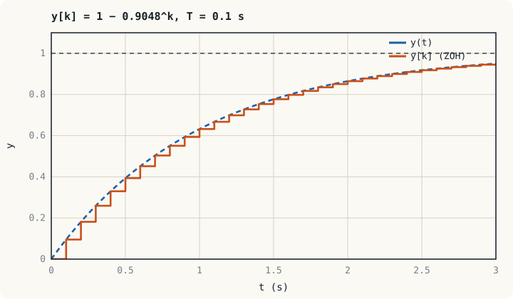

## ภาพในใจก่อนเริ่ม: ควบคุมเป็นจังหวะ {#idea}

ตัวควบคุมออปแอมป์ในหน่วยที่ 10 และ 13 ทำงานต่อเนื่องตลอดเวลา ไมโครคอนโทรลเลอร์ทำเช่นนั้นไม่ได้ มันทำงานเป็นรอบ: **วัด คำนวณ สั่ง แล้วรอ** จากนั้นทำซ้ำ ระหว่างรอบ ตัวควบคุมไม่รับรู้ว่าพลานต์เป็นอย่างไร และสัญญาณสั่งค้างอยู่ที่ค่าเดิม

ถ้ารอบสั้นมากเมื่อเทียบกับความเร็วของพลานต์ ผลลัพธ์แทบไม่ต่างจากตัวควบคุมต่อเนื่อง ถ้ารอบยาวเกินไป ลูปจะแกว่งหรือไม่เสถียร หน่วยนี้ตอบว่า "สั้นพอ" คือเท่าใด และเขียนตัวควบคุมเป็นโปรแกรมอย่างไร

## องค์ประกอบของลูปดิจิทัล {#loop}

| ส่วน | หน้าที่ | สิ่งที่ต้องระวัง |
|---|---|---|
| ตัวกรองป้องกันเอเลียส | ตัวกรองความถี่ต่ำแบบแอนะล็อกหน้า ADC | ต้องตัดความถี่ที่สูงกว่าครึ่งหนึ่งของความถี่ชักตัวอย่าง |
| ADC | แปลงแรงดันเป็นตัวเลขทุกคาบ $T$ | ความละเอียด (จำนวนบิต) และเวลาแปลง |
| ตัวประมวลผล | คำนวณสมการผลต่างของตัวควบคุม | เวลาคำนวณคือเวลาหน่วง (หน่วยที่ 12) |
| DAC หรือ PWM | แปลงตัวเลขกลับเป็นสัญญาณสั่ง และคงค่าไว้ตลอดคาบ | ทำหน้าที่เป็นตัวคงค่าอันดับศูนย์ (zero-order hold, ZOH) |
| ตัวจับเวลา (timer interrupt) | ทำให้คาบ $T$ คงที่ | คาบที่ไม่คงที่ (jitter) ทำให้เกนของส่วน I และ D คลาดเคลื่อน |

:::example ตัวอย่างที่ 15.1 ความละเอียดของ ADC
ADC ขนาด 12 บิต ช่วงอินพุต 0–3.3 V วัดสัญญาณจากเซนเซอร์กระแสที่มีเกน 66 mV/A จงหาขนาดของ 1 LSB เป็นโวลต์และเป็นแอมแปร์

$$1\ \text{LSB} = \frac{3.3}{2^{12}} = \frac{3.3}{4096} = 0.806\ \text{mV} \quad\Rightarrow\quad \frac{0.806}{66} = 12.2\ \text{mA}$$

ตัวควบคุมมองไม่เห็นการเปลี่ยนแปลงของกระแสที่เล็กกว่า 12 mA ถ้าเกนของตัวควบคุมสูง เอาต์พุตจะกระโดดเป็นขั้นตามการเปลี่ยนของ 1 LSB ทำให้เกิดการแกว่งขนาดเล็กที่ไม่หายไป (limit cycle) การใช้ช่วงของ ADC ให้เต็มด้วยวงจรปรับสภาพสัญญาณจึงสำคัญ
:::

## เลือกคาบการชักตัวอย่าง {#sampling}

**ทฤษฎีบทการชักตัวอย่าง**กำหนดขั้นต่ำ: ความถี่ชักตัวอย่าง $f_s = 1/T$ ต้องมากกว่าสองเท่าของความถี่สูงสุดในสัญญาณ มิฉะนั้นองค์ประกอบความถี่สูงจะปรากฏเป็นความถี่ต่ำปลอม เรียกว่า**เอเลียส (aliasing)** และกรองออกทีหลังไม่ได้

สำหรับงานควบคุม ขั้นต่ำนี้ไม่พอ เพราะตัวคงค่าอันดับศูนย์ทำให้สัญญาณสั่งล่าช้าเฉลี่ย $T/2$ ซึ่งกินเฟสมาร์จิน

$$\Delta\phi \approx \omega_{gc}\,\frac{T}{2} \times \frac{180°}{\pi}$$

:::key กฎปฏิบัติ
เลือกความถี่ชักตัวอย่างประมาณ **10–30 เท่าของแบนด์วิดท์วงปิด** ที่ 20 เท่า เฟสที่เสียจาก ZOH คือ $\dfrac{2\pi}{20} \times \dfrac12 \times \dfrac{180°}{\pi} = 9°$ ซึ่งยอมรับได้
:::

| ลูป | แบนด์วิดท์โดยประมาณ | คาบการชักตัวอย่างที่ใช้กัน | อุปกรณ์ |
|---|---|---|---|
| อุณหภูมิ ระดับ | ต่ำกว่า 0.1 Hz | 0.1–1 s | PLC, DCS |
| ความดัน อัตราไหล | 0.1–1 Hz | 10–100 ms | PLC, DCS |
| ความเร็วมอเตอร์ | 10–100 Hz | 0.25–1 ms | ไดรฟ์ ไมโครคอนโทรลเลอร์ |
| กระแสมอเตอร์ แรงดันคอนเวอร์เตอร์ | 0.5–5 kHz | 20–100 µs (มักเท่ากับคาบ PWM) | ไมโครคอนโทรลเลอร์ DSP |

## แบบจำลองเวลาไม่ต่อเนื่อง {#discrete}

สัญญาณที่ถูกชักตัวอย่างเป็นลำดับของตัวเลข $y[k] = y(kT)$ **การแปลง z** ทำหน้าที่แทนการแปลงลาปลาซ โดยตัวแปร $z^{-1}$ หมายถึง**การหน่วงหนึ่งคาบ**

$$\mathcal{Z}\{y[k-1]\} = z^{-1}Y(z)$$

ความสัมพันธ์กับระนาบ $s$ คือ $z = e^{sT}$ ครึ่งซ้ายของระนาบ $s$ ถูกส่งไปยัง**ภายในวงกลมหนึ่งหน่วย**ของระนาบ $z$

| | เวลาต่อเนื่อง | เวลาไม่ต่อเนื่อง |
|---|---|---|
| แบบจำลอง | สมการเชิงอนุพันธ์ $G(s)$ | สมการผลต่าง $G(z)$ |
| เงื่อนไขเสถียรภาพ | ขั้วอยู่ในครึ่งซ้าย | ขั้วอยู่ในวงกลมหนึ่งหน่วย $\lvert z\rvert < 1$ |
| ขั้วที่ให้ค่าคงที่ (อินทิเกรเตอร์) | $s = 0$ | $z = 1$ |
| ขั้วที่ตอบสนองเร็ว | ไกลไปทางซ้าย | ใกล้จุดกำเนิด |

พลานต์อันดับหนึ่ง $G(s) = \dfrac{K}{\tau s + 1}$ ที่ขับผ่านตัวคงค่าอันดับศูนย์ มีแบบจำลองเวลาไม่ต่อเนื่องที่แม่นยำ

$$G(z) = \frac{K(1 - a)}{z - a}, \qquad a = e^{-T/\tau} \quad\Longleftrightarrow\quad y[k+1] = a\,y[k] + K(1 - a)\,u[k]$$



:::example ตัวอย่างที่ 15.2 การชักตัวอย่างทำให้เกนมีขีดจำกัด
พลานต์ $G(s) = \dfrac{1}{s + 1}$ ($K = 1$, $\tau = 1$ s) ควบคุมด้วยตัวควบคุม P แบบดิจิทัลเกน $K_p$ คาบ $T = 0.1$ s ป้อนกลับหนึ่งหน่วย จงหาช่วง $K_p$ ที่เสถียร

**ขั้นที่ 1** $a = e^{-0.1} = 0.9048$ จึงได้ $G(z) = \dfrac{0.0952}{z - 0.9048}$

**ขั้นที่ 2** สมการลักษณะเฉพาะ $1 + K_pG(z) = 0$

$$z - 0.9048 + 0.0952K_p = 0 \quad\Longrightarrow\quad z = 0.9048 - 0.0952K_p$$

**ขั้นที่ 3** ต้องการ $\lvert z\rvert < 1$ ด้านที่จำกัดคือ $z > -1$

$$0.9048 - 0.0952K_p > -1 \quad\Longrightarrow\quad K_p < \frac{1.9048}{0.0952} = 20.0$$

ระบบต่อเนื่องเดียวกันนี้ ($s + 1 + K_p = 0$) เสถียรทุกค่า $K_p > 0$ ขีดจำกัด 20 เกิดจากการชักตัวอย่างล้วน ๆ ถ้าลดคาบเหลือ $T = 0.01$ s ขีดจำกัดจะขยายเป็นประมาณ 200 การชักตัวอย่างให้เร็วขึ้นจึงเปิดทางให้ใช้เกนสูงขึ้น
:::

## PID แบบดิจิทัล {#digital-pid}

แทนปริพันธ์ด้วยผลบวก และแทนอนุพันธ์ด้วยผลต่างย้อนหลัง

$$\int e\,dt \approx T\sum_{i=0}^{k} e[i], \qquad \frac{de}{dt} \approx \frac{e[k] - e[k-1]}{T}$$

จะได้**รูปแบบตำแหน่ง (position form)**

$$u[k] = K_pe[k] + K_iT\sum_{i=0}^{k}e[i] + \frac{K_d}{T}\bigl(e[k] - e[k-1]\bigr)$$

ถ้าลบ $u[k-1]$ ออกจาก $u[k]$ จะได้**รูปแบบความเร็ว (velocity form)** ซึ่งคำนวณเฉพาะส่วนที่เปลี่ยน

$$u[k] = u[k-1] + K_p\bigl(e[k] - e[k-1]\bigr) + K_iT\,e[k] + \frac{K_d}{T}\bigl(e[k] - 2e[k-1] + e[k-2]\bigr)$$

รูปแบบความเร็วนิยมใช้ใน PLC และไดรฟ์ เพราะจำกัดค่า $u[k]$ ได้โดยตรงซึ่งป้องกันวินด์อัปไปในตัว และสลับระหว่างโหมด manual กับ auto ได้โดยเอาต์พุตไม่กระตุก

:::example ตัวอย่างที่ 15.3 PI ของลูปความเร็วมอเตอร์ในไมโครคอนโทรลเลอร์
นำตัวควบคุม PI ในตัวอย่างที่ 13.1 ($K_p = 0.20$, $K_i = 2.70$) ไปเขียนโปรแกรมด้วยคาบ $T = 1$ ms จงหาสัมประสิทธิ์ของรูปแบบความเร็ว และตรวจว่าคาบนี้เหมาะสมหรือไม่

**ขั้นที่ 1** $K_iT = 2.70 \times 0.001 = 0.0027$

$$u[k] = u[k-1] + 0.20\bigl(e[k] - e[k-1]\bigr) + 0.0027\,e[k]$$

**ขั้นที่ 2** ตรวจคาบ: วงปิดมี $\tau_c = 20$ ms แบนด์วิดท์ $1/\tau_c = 50$ rad/s หรือ 8 Hz ความถี่ชักตัวอย่าง 1 kHz สูงกว่า 125 เท่า เกินพอ

**ขั้นที่ 3** โปรแกรมในรูทีนขัดจังหวะของตัวจับเวลา

```c
// เรียกทุก 1 ms จาก timer interrupt
void speed_loop(void) {
    float e = speed_ref - speed_meas;        // rad/s
    u += 0.20f * (e - e_prev) + 0.0027f * e; // รูปแบบความเร็ว
    if (u > 12.0f) u = 12.0f;                // จำกัดค่า = anti-windup
    if (u < 0.0f)  u = 0.0f;
    e_prev = e;
    set_pwm_duty(u / 12.0f);                 // แรงดัน 0–12 V → ดิวตี้ 0–1
}
```

บรรทัดจำกัดค่าทำให้ `u` ไม่สะสมเกินพิกัดของแหล่งจ่าย จึงแก้ปัญหาวินด์อัปที่พบในขั้นที่ 3 ของตัวอย่างที่ 13.1 ได้โดยไม่ต้องเขียนเพิ่ม
:::

:::note PID ใน PLC
บล็อก PID ของ PLC ใช้สมการผลต่างแบบเดียวกัน สิ่งที่ผู้ใช้ต้องรับผิดชอบคือเรียกบล็อกด้วย**คาบคงที่** เช่น วางไว้ในงานแบบวนตามเวลา (cyclic interrupt) ไม่ใช่ในรอบสแกนหลักซึ่งมีเวลาไม่แน่นอน เพราะบล็อกใช้ค่า $T$ ที่ตั้งไว้คูณกับ $K_i$ และหาร $K_d$ ถ้าคาบจริงไม่ตรงกับค่าที่ตั้ง เกนของส่วน I และ D จะผิดไปตามสัดส่วน
:::

## แบบฝึกหัด {#exercises}

:::exercise แบบฝึกหัด 15.1
ลูปควบคุมแรงดันมีแบนด์วิดท์วงปิด 500 Hz จงเสนอความถี่ชักตัวอย่าง และความถี่หักมุมของตัวกรองป้องกันเอเลียส

:::answer ดูเฉลย
ตามกฎ 10–30 เท่า เลือก $f_s$ ประมาณ 10 kHz (20 เท่า) คาบ 100 µs

ตัวกรองต้องลดทอนองค์ประกอบที่สูงกว่า $f_s/2 = 5$ kHz แต่ต้องไม่เพิ่มเฟสล้าหลังมากที่ 500 Hz ความถี่หักมุมราว 2–3 kHz เป็นค่าประนีประนอมที่ใช้กัน
:::
:::

:::exercise แบบฝึกหัด 15.2
พลานต์ $G(s) = \dfrac{2}{0.5s + 1}$ ชักตัวอย่างด้วย $T = 0.05$ s ผ่านตัวคงค่าอันดับศูนย์ จงหา $G(z)$ และสมการผลต่าง

:::answer ดูเฉลย
$a = e^{-0.05/0.5} = e^{-0.1} = 0.9048$ และ $K(1 - a) = 2 \times 0.0952 = 0.1903$

$$G(z) = \frac{0.1903}{z - 0.9048}, \qquad y[k+1] = 0.9048\,y[k] + 0.1903\,u[k]$$

ตรวจเกน DC: แทน $z = 1$ ได้ $0.1903/0.0952 = 2$
:::
:::

:::exercise แบบฝึกหัด 15.3
ADC ขนาด 10 บิต วัดอุณหภูมิช่วง 0–200 °C ความละเอียดเป็นเท่าใด และถ้าต้องการความละเอียด 0.05 °C ต้องใช้อย่างน้อยกี่บิต

:::answer ดูเฉลย
$200/2^{10} = 200/1024 = 0.195$ °C ต่อ LSB

ต้องการ $2^n \ge 200/0.05 = 4000$ จึงได้ $n = 12$ บิต ($2^{12} = 4096$)
:::
:::

## สรุปหน่วยที่ 15 {#summary}

- ลูปดิจิทัลทำงานเป็นคาบ: ชักตัวอย่างด้วย ADC คำนวณ แล้วคงค่าเอาต์พุตด้วย DAC หรือ PWM
- เลือกความถี่ชักตัวอย่าง 10–30 เท่าของแบนด์วิดท์วงปิด และใส่ตัวกรองป้องกันเอเลียสหน้า ADC
- $z^{-1}$ คือการหน่วงหนึ่งคาบ ระบบเสถียรเมื่อขั้วอยู่ในวงกลมหนึ่งหน่วย
- การชักตัวอย่างเพิ่มเวลาหน่วง จึงจำกัดเกนสูงสุดที่ใช้ได้
- PID แบบดิจิทัลรูปแบบความเร็วเขียนได้ในไม่กี่บรรทัด และป้องกันวินด์อัปด้วยการจำกัดค่าเอาต์พุต

ภาคสุดท้ายของรายวิชาจะออกจากกรอบของระบบเชิงเส้นไปสู่การควบคุมที่ใช้กฎของผู้เชี่ยวชาญและข้อมูล
