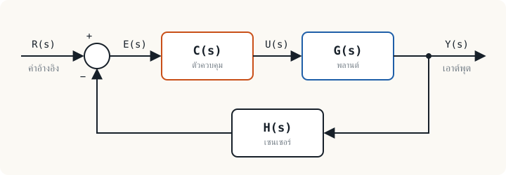

<!-- ไฟล์ที่ชื่อขึ้นต้นด้วย _ จะไม่ถูกนำขึ้นเว็บ คัดลอกไฟล์นี้ไปตั้งชื่อใหม่ เช่น 03-modelling.md แล้วแก้เนื้อหา
     บรรทัด draft: true = ยังไม่เผยแพร่ ลบบรรทัดนี้เมื่อพร้อม
     ใส่วิดีโอ: เพิ่มบรรทัด  youtube: รหัสวิดีโอ11ตัว  และ  video_date: 2026-11-20  ในส่วนหัวด้านบน
     ใส่ไฟล์แจก: เพิ่มในส่วนหัว
       files:
         - สไลด์หน่วยที่ 3 | /files/courses/control-engineering/unit03-slides.pdf
-->

## หัวข้อแรก {#first}

ย่อหน้าธรรมดา พิมพ์ได้เลย **ตัวหนา** *ตัวเอียง* [ลิงก์](/learn/control-systems/)

สมการในบรรทัด $G(s) = \dfrac{1}{s+1}$ และสมการแยกบรรทัด

$$T(s) = \frac{G(s)}{1 + G(s)H(s)}$$

| หัวตาราง 1 | หัวตาราง 2 |
|---|---|
| ข้อมูล | ข้อมูล |

:::note หัวข้อของกล่อง
กล่องหมายเหตุ
:::

:::warn
กล่องข้อควรระวัง
:::

:::key
กล่องใจความสำคัญ
:::

:::example ตัวอย่างที่ 3.1
โจทย์และวิธีทำทีละขั้น
:::

:::activity
กิจกรรมในชั้นเรียน
:::

:::exercise แบบฝึกหัด 3.1
โจทย์

:::answer ดูเฉลย
เฉลย (พับไว้จนกว่าผู้เรียนจะกดเปิด)
:::
:::

<!-- วิดีโอเสริมกลางบทเรียน: พิมพ์บรรทัด  ::youtube รหัสวิดีโอ11ตัว ชื่อคลิป  (ขึ้นต้นบรรทัดด้วย :: ) -->

## สรุป {#summary}

- ข้อสรุป 1
- ข้อสรุป 2
