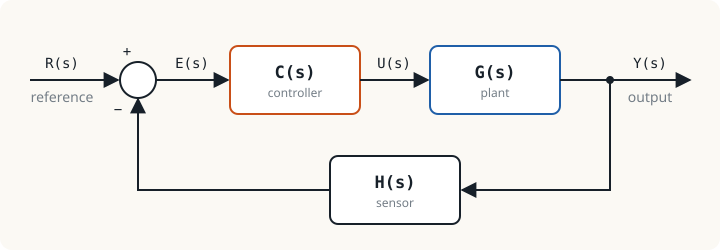

## A control system makes one quantity follow a command {#what}

A refrigerator holds a temperature. An inverter holds a motor speed. An aircraft holds an altitude. All three do the same thing: they **make a quantity of interest take the value we want**, despite disturbances, and even when the real system is not exactly the one we calculated.

**Control engineering** is the discipline of modelling a system, analysing it and designing a controller so that it meets a specification: accurate, fast, stable and tolerant of disturbances.

This unit is a map of the whole course. After it you will know where each later unit sits and where this knowledge can take you.

:::note About the order
This classroom grows one unit at a time. This is the first unit. The next one starts the mathematics: complex variables, the s-plane and the Laplace transform.
:::

## Open-loop control {#open}

An **open-loop system** works out a command in advance and sends it, **without checking the result**.

A timed washing machine is the standard example. It washes for the time you set and does not measure whether the clothes are clean. A timed traffic light is the same: it does not know how many cars are waiting.

$$
Y(s) = G(s)\,U(s)
$$

Its strengths are that it is **simple, cheap and free of feedback-induced instability**. It works well when the plant is well known and disturbances are small.

Its weakness is that **if the plant drifts or a disturbance arrives, the output is wrong immediately**, and nothing in the system knows.

## Closed-loop control {#closed}

A **closed-loop system**, also called a **feedback control system**, measures the real output, compares it with the reference and uses the **error** to adjust the command all the time.

With no disturbance and a unity sensor, $H(s)=1$, the closed-loop transfer function is

$$
\frac{Y(s)}{R(s)} = \frac{C(s)G(s)}{1 + C(s)G(s)}
$$

Four consequences are worth remembering.

1. **Lower sensitivity to plant changes.** A change in the plant is attenuated by the factor $1/(1+CG)$.
2. **Disturbance rejection.** A drifting output is measured and corrected.
3. **Shaping of behaviour.** The system can be made faster or better damped.
4. **A price.** Lower overall gain, a need for an accurate and noisy sensor, and possible instability when the gain is too high.

The lab below compares open loop and closed loop on the same plant. Change the plant gain and watch how far each one drifts.

:::example Example 1.1 Open loop and closed loop when the plant gain changes
A plant $G=K_p/(\tau s+1)$ has $K_p=2$. We want a steady-state output equal to $r=1$.
Open loop: set $u = r/K_p = 0.5$. If the true $K_p$ rises to $2.4$ (up 20%), then $y=2.4\times0.5=1.2$, a 20% error.
Closed loop with a constant-gain controller $K_c=20$: $y_{ss}=\dfrac{K_cK_p}{1+K_cK_p}r$.
- $K_p=2$: $y_{ss}=40/41=0.9756$
- $K_p=2.4$: $y_{ss}=48/49=0.9796$

A 20% change in gain moves the output by only about 0.4%. Here the closed loop is roughly 50 times less sensitive. It does leave a residual error of 2 to 2.5%. Removing it takes a controller with an integrator, which later units cover.
:::

## Types of control systems {#types}

One system falls into several classes at once. Each criterion answers a different question.

| Criterion | Types | Meaning | Examples |
|---|---|---|---|
| Feedback | Open loop / closed loop | Is the result measured and fed back? | Timed traffic light / refrigerator |
| System law | Linear / nonlinear | Does superposition hold? | RC circuit / saturating valve |
| Parameters in time | Time-invariant (LTI) / time-varying | Fixed or changing parameters | Motor / rocket losing fuel |
| Signal type | Continuous-time / discrete-time (digital) | Signals defined for all time or at sample instants | Op-amp circuit / microcontroller |
| Inputs and outputs | SISO / MIMO | One in, one out, or several | One temperature loop / quadcopter |
| Parameter type | Lumped / distributed | Ordinary or partial differential equations | Electric circuit / heat in a rod |
| Certainty | Deterministic / stochastic | Is uncertainty modelled statistically? | Lathe / financial market |
| Reference goal | Regulator / tracking (servo) | Hold a value or follow a changing one | Supply voltage control / robot arm |

Most of this course starts with **linear, time-invariant, lumped SISO** systems because the toolbox is richest there. It then widens to MIMO through state space, to digital systems, and to nonlinear systems near the end.

:::key
Nearly every real system is nonlinear. **Near an operating point**, though, it is usually well approximated by a linear one. That is why linear theory works in industry.
:::

## Control engineering terminology {#terms}

| Term | Meaning |
|---|---|
| plant | The thing being controlled, such as a motor or a tank |
| process | A continuing operation that produces a result, common in chemical industry |
| controller | Decides how much to command |
| actuator | The part that acts: valve, heater, motor |
| sensor, transducer | Measures the output and turns it into a signal |
| reference, set point | The value we want |
| output, controlled variable | The quantity we want to control |
| manipulated variable | What the controller commands, such as the voltage fed to a motor |
| error | Reference minus measured value |
| disturbance | Something that pushes the output without our command, such as a load change |
| sensor noise | Random measurement error |
| feedback | Sending the measurement back to compare with the reference |
| transfer function | The ratio $Y(s)/U(s)$ with zero initial conditions |
| stability | The system does not blow up under bounded excitation |
| transient response | Behaviour during the change, such as overshoot and rise time |
| steady-state error | The error that remains after a long time |
| compensator | A controller designed to shape performance |

:::warn "System" versus "plant"
A **system** is broader than a plant: it is a set of parts working together for one purpose. The **plant** is only the part being controlled. Some books use the words loosely, but keep them apart in your reports.
:::

## Integration with other engineering fields {#fields}

Control engineering is not a field apart. It is a **common language** that lets other fields talk to each other, because every field has a quantity it must hold at a value, and the equations look alike.

| Field | What is controlled | Example work |
|---|---|---|
| Electrical engineering | Voltage, current, motor speed and torque | Motor drives, converters, power-system frequency control |
| Mechanical engineering | Position, force, vibration, temperature | Active suspension, CNC machines, HVAC |
| Mechatronics | Systems that combine mechanics, electronics and software | Hard-disk drives, 3D printers, camera stabilisers |
| Robotics | Joint position, trajectory, contact force | Robot arms, mobile robots, drones |
| Instrumentation | Reliable measurement and plant control loops | Level, pressure and flow PID loops, DCS and safety systems |
| Chemical engineering | Temperature, pressure, concentration in reactors | Reactor control, distillation columns |
| Process engineering | Quality and throughput of continuous production | Process control, plant-wide loop tuning |
| Financial engineering | Portfolio value, risk, liquidity | Dynamic portfolio allocation, hedging |

Financial engineering may sound out of place, but it is real. Merton's classic problem asks how much wealth to put into stocks and how much to consume, continuously. It is a **stochastic control problem** solved with the Hamilton–Jacobi–Bellman (HJB) equation, the same tool as optimal control in engineering. See [Merton's portfolio problem](https://en.wikipedia.org/wiki/Merton%27s_portfolio_problem) and the survey [Continuous-Time Portfolio Selection: A Cursory Survey](https://doi.org/10.3389/fams.2020.00004) (Frontiers in Applied Mathematics and Statistics, 2020).

:::note The point
These fields differ in the **physics** of the plant and agree on the **structure of the loop**: measure, compare, decide, act, measure again. Learn that structure once and you can move between fields.
:::

## Careers that use this knowledge, and what they pay {#careers}

This table collects figures from sources you can check, as of November 2026. Every number is an **advertised range** or a **survey figure**, not a guarantee.

**Thailand (per month, before tax)**

| Role | Range | Source and date |
|---|---|---|
| Electrical and control engineer (PLC, Siemens) | THB 40,000–50,000 | [JobThai, Sep 2026](https://www.jobthai.com/en/job/1923077) |
| Instrument engineer, automation (maintenance, 3+ years) | THB 30,000–50,000 | [JAC Recruitment, May 2026](https://www.jac-recruitment.co.th/job/instrument-engineer-automation-5898663) |
| Robot engineer (Bangkok) | THB 30,000–55,000 | [RGF, May 2026](https://www.rgf-hragent.asia/en/thailand/robot-engineer-SDG-130844) |
| Senior instrumentation engineer (oil and gas, 6+ years) | THB 50,000–75,000 | [RGF Thailand](https://rgf-hragent.asia/en/thailand/senior-instrumentation-engineer-SDG-110392) |
| Senior application engineer, machine vision and automation | THB 80,000–100,000 | [Michael Page Thailand](https://www.michaelpage.co.th/jobs/engineering-manufacturing/automation-mechatronics-robotics) |
| Instrumentation and control, 10 years in heavy manufacturing (Rayong) | THB 120,000–150,000 | [JobsDB Thailand](https://th.jobsdb.com/noise-control-jobs-in-engineering) |
| Principal automation engineer (semiconductor, 7+ years) | Up to THB 150,000 | [Evantis Talent Solutions](https://www.careers-page.com/evantistalentsolutions/job/Y66R39V9) |
| Quantitative analyst, average | About THB 970,000 a year (about THB 81,000 a month) | [ERI SalaryExpert, Jun 2026](https://www.erieri.com/salary/job/quantitative-analyst/thailand) |

**United States (median per year)**

| Occupation | Median | Source |
|---|---|---|
| Electrical engineers | $120,630 | [BLS, May 2025](https://www.bls.gov/ooh/architecture-and-engineering/electrical-and-electronics-engineers.htm) |
| Electronics engineers, except computer | $130,220 | [BLS, May 2025](https://www.bls.gov/ooh/architecture-and-engineering/electrical-and-electronics-engineers.htm) |
| Mechanical engineers | $104,110 | [BLS, May 2025](https://www.bls.gov/ooh/architecture-and-engineering/mechanical-engineers.htm) |
| Chemical engineers | $125,040 | [BLS, May 2025](https://www.bls.gov/ooh/architecture-and-engineering/chemical-engineers.htm) |
| Quantitative researcher (all firms) | About $200,000 (including bonus and stock) | [Levels.fyi](https://www.levels.fyi/t/data-scientist/title/quantitative-researcher) |

:::warn Read salary numbers carefully
1. **A range in a job advert is the employer's offer**, not the average pay of people in the job, and the high ads usually want ten years of experience.
2. **Sources disagree widely.** Some salary sites report an average for automation engineers in Thailand far below senior job ads, which may reflect different seniority mixes and collection methods.
3. **US figures are not Thai figures.** Cost of living, tax and labour markets differ. Do not compare them directly.
4. **Quant figures** are self-reported and skew toward high earners. Top firms can pay far more than the median once bonuses are included.
:::

**Paths where pay tends to run high.** Across the data above, the same patterns repeat.

- **Depth in a demanding industry**, such as oil and gas, petrochemicals or semiconductors, where a control failure is expensive.
- **Crossing fields**, such as vision plus automation or control plus software, where few people are strong on both sides.
- **The quantitative route**, which uses the same mathematics (statistics, optimisation, stochastic systems) in finance.
- **Moving up** to technical lead or project manager after years of experience.

Notice that the highest numbers in the tables come from **ten or more years of experience** and **mixed skills**, not from the name of a degree alone.

## Exercises {#exercises}

:::exercise 1.1 Classify the system
Say whether each is open loop or closed loop, in one sentence each.
(a) A timed toaster (b) An iron with a thermostat (c) A driver keeping a car in its lane (d) A washing machine set to wash for 30 minutes

:::answer
(a) Open loop: it does not check whether the bread is toasted.
(b) Closed loop: the thermostat measures temperature and switches the heater.
(c) Closed loop: the eyes are the sensor and the brain is the controller.
(d) Open loop: it washes by time and does not measure cleanliness.
:::
:::

:::exercise 1.2 A gain that changes
In Example 1.1, suppose the true $K_p$ falls by 20%, from 2 to 1.6. Find the steady-state output of the open loop (with $u=0.5$) and of the closed loop ($K_c=20$), and compare the errors.

:::answer
Open loop: $y=1.6\times0.5=0.8$, a 20% error.
Closed loop: $y_{ss}=\dfrac{20\times1.6}{1+20\times1.6}=\dfrac{32}{33}=0.9697$, an error of about 3.0%.
The closed-loop error is about 6.6 times smaller ($0.20/0.0303$) here.
:::
:::

:::exercise 1.3 Name the parts
An inverter air conditioner controls room temperature. Identify the plant, sensor, actuator, controller, reference, output and at least one disturbance.

:::answer
Plant: the room and its air. Sensor: a thermistor. Actuator: the variable-speed compressor and fan. Controller: the unit's control board. Reference: the temperature set on the remote. Output: room temperature. Disturbance: sunlight, people entering, an open door.
:::
:::

:::exercise 1.4 Several criteria at once
A quadcopter hovering in the air uses a microcontroller. Classify it using four criteria from the types table.

:::answer
Closed loop (an IMU is the sensor). Nonlinear in nature but approximately linear near hover. Discrete-time because the controller is digital. MIMO because several variables are controlled together: height, roll, pitch and yaw. While hovering it also acts as a regulator.
:::
:::

:::exercise 1.5 Read salary data critically
One job ad offers THB 120,000–150,000 a month. A salary site reports an average of about THB 750,000 a year for automation engineers in Thailand. Do the two figures contradict each other? What would you ask next?

:::answer
Not necessarily. The ad is a senior post asking for about 10 years in heavy industry (about THB 1.44–1.8 million a year). The site figure is an average over many levels (about THB 62,000 a month). Ask how many years the post requires, whether the data come from offers or actual pay, whether bonuses are included, and how large the sample is.
:::
:::

## Summary {#summary}

- Open loop sends a command without measuring the result. Closed loop measures and feeds back, so it resists disturbances and plant uncertainty.
- One system belongs to several classes at once. This course starts with linear, time-invariant, lumped SISO systems.
- The basic terms are a shared language across every field with a control loop.
- The same knowledge leads to work in factories, robotics, energy, chemicals and quantitative finance. The highest pay comes from experience and cross-field skills.

The next unit builds the mathematical tools: complex variables, the s-plane and the Laplace transform, which let us write a system as a transfer function.

## Frequently asked questions {#faq}

**What is the difference between open-loop and closed-loop control?**
An open-loop system sends a command without measuring the result, so it cannot correct errors or disturbances. A closed-loop system measures the output, compares it with the reference and uses the error to adjust the command continuously. It resists disturbances, but it needs a sensor and can become unstable if designed badly.

**What are everyday examples of open-loop and closed-loop systems?**
Open loop: a washing machine that runs for a set time, a timed traffic light. Closed loop: a refrigerator that measures temperature and switches its compressor, an inverter air conditioner, and a car's cruise control.

**What jobs can a control engineering background lead to?**
Factory automation and PLC work, instrumentation in refineries and power plants, robotics, mechatronics, chemical process control, motor drives and power electronics, and quantitative finance where stochastic control theory is used.

**How much mathematics do I need to start control engineering?**
Calculus, ordinary differential equations and basic linear algebra are enough to begin. This classroom teaches complex variables and the Laplace transform in the next unit.
