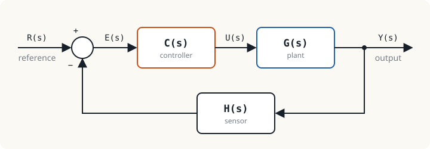

## Control systems are all around us {#everyday}

An air conditioner holding room temperature, cruise control holding a car's speed, an inverter holding a motor's speed and a rice cooker that switches off when the rice is done all do the same thing: they **make a quantity take the value we want without a person adjusting it**.

Control engineering is the subject that answers three questions.

1. How does the system to be controlled behave? Answered by a **mathematical model**.
2. After a command, how does the output change with time? Answered by the **response**.
3. How do we design a controller that gives the result we want without oscillating out of control? Answered by **stability analysis and design**.

The whole course answers these three questions in more depth, unit by unit.

## Vocabulary used throughout the course {#terms}

| Term | Symbol | Meaning |
|---|---|---|
| Plant | $G(s)$ | The thing being controlled: a motor, an oven, a tank |
| Reference (setpoint) | $R(s)$ | The value we want the output to have |
| Controlled output | $Y(s)$ | The quantity being controlled: speed, temperature |
| Error | $E(s)$ | The difference between the reference and the measured value |
| Controller | $C(s)$ | The part that decides, from the error, how hard to drive the plant |
| Sensor | $H(s)$ | The part that measures the output and feeds it back |
| Disturbance | $D(s)$ | Anything that changes the output without our command, such as motor load |

## Open loop and closed loop {#open-closed}

An **open-loop** control system works out the command in advance and applies it, without checking the result. A toaster with a timer is a clear example: set two minutes and it toasts for two minutes. Whether the bread burns or stays pale, the toaster does not know.

A **closed-loop** control system measures the actual output, compares it with the reference and uses the error to correct the command continuously. Bringing the output back for comparison is called **feedback**.

| | Open loop | Closed loop |
|---|---|---|
| Uses a sensor on the output | No | Yes |
| When the plant changes or is disturbed | The output is wrong by the full amount | The controller corrects it |
| Stability risk | Not increased | A poor design can oscillate or go unstable |
| Cost and complexity | Low | Higher |

## The closed-loop transfer function {#closed-loop-tf}

From the block diagram above we can write two equations.

$$E(s) = R(s) - H(s)\,Y(s), \qquad Y(s) = C(s)\,G(s)\,E(s)$$

Substitute the first into the second and collect the terms in $Y(s)$.

$$Y(s)\,\bigl[1 + C(s)G(s)H(s)\bigr] = C(s)G(s)\,R(s)$$

This gives the **closed-loop transfer function**

$$T(s) = \frac{Y(s)}{R(s)} = \frac{C(s)\,G(s)}{1 + C(s)\,G(s)\,H(s)}$$

The product around the loop, $L(s) = C(s)G(s)H(s)$, is called the **loop transfer function**, and $1 + L(s) = 0$ is the **characteristic equation**. Its roots decide whether the closed-loop system is stable, which is the subject of Unit 8.

:::key Remember it in this form
Closed-loop transfer function = forward path ÷ (1 + product around the loop), for negative feedback.
:::

## Example: by what factor does feedback help? {#example}

:::example Example 1.1 Motor speed control
In steady state a motor gives 10 rpm per volt, so $G = 10$. We want 100 rpm. Later the motor warms up and its gain drops by 20 % to $G = 8$. Compare the speed obtained in open loop with closed loop using a controller gain $K = 10$ and a sensor $H = 1$.

**Open loop.** Set the voltage to $u = 100/10 = 10$ V.

- Normal gain: $y = 10 \times 10 = 100$ rpm
- Reduced gain: $y = 8 \times 10 = 80$ rpm, wrong by 20 %, the same as the change in the plant

**Closed loop.** Use $T = \dfrac{KG}{1 + KG}$ with a reference of 100 rpm.

- Normal gain: $T = \dfrac{100}{101} = 0.9901$, so $y = 99.01$ rpm
- Reduced gain: $T = \dfrac{80}{81} = 0.9877$, so $y = 98.77$ rpm

The speed changes from 99.01 to 98.77 rpm, a drop of only 0.25 %, although the plant changed by 20 %.
:::

This number is no accident. The ratio of the relative change in $T$ to the relative change in $G$ is called the **sensitivity**.

$$S = \frac{dT/T}{dG/G} = \frac{1}{1 + L}$$

Here $L = KG = 100$, so $S = 1/101 \approx 0.01$. Feedback cuts the effect of plant errors to about one hundredth. The higher the loop gain, the more the system tolerates change.

:::warn Nothing is free in control
Notice that the closed loop in the example gives 99.01 rpm, not exactly 100. The shortfall is the **steady-state error** (Unit 7). And if we keep raising $K$ to shrink that error, a real system with dynamics starts to oscillate and may become unstable (Unit 8). Control design is the search for a balance between these effects.
:::

## Control systems in electrical engineering {#electrical}

Anyone studying electrical power already meets control systems every day, without yet naming the parts in the vocabulary of this course. The table matches familiar equipment to the block diagram above.

| System | Type | Controller $C$ | Plant $G$ | Sensor $H$ |
|---|---|---|---|---|
| Motor starting with magnetic contactors, timed star-delta | Open loop | Timer relay | Induction motor | None (time decides) |
| Water pump with a pressure switch, or a thermostat | Closed loop, on-off | Switch with hysteresis + contactor | Pump and tank, heater | Pressure switch, bimetal |
| PLC controlling furnace temperature with a PID block | Closed loop, continuous | PLC (computes every scan) | Heater + SSR | Thermocouple, RTD |
| Inverter (VFD) speed control | Closed loop | PI controller in the drive | Inverter + motor | Encoder |
| Generator AVR | Closed loop | AVR | Exciter + generator | Voltage transformer (PT) |
| Governor controlling power system frequency | Closed loop | Governor | Turbine + system inertia | Speed pickup |
| Switching power supply (buck converter) | Closed loop | Op-amp compensator + PWM | Switch + LC filter | Voltage divider |
| DCS in a power plant or process plant | Hundreds of closed loops | Controllers distributed by process unit | Valves, pumps, boilers | 4–20 mA transmitters |

:::note Is a protection relay a control system?
An overcurrent relay measures current, compares it with a setting and trips a breaker. It has a sensor (CT), a comparison and an actuator (the breaker). But its job is to **make a single decision that isolates the faulty part**, not to adjust continuously so that an output follows a reference. It is therefore classed as protection, which works as logic one layer above the control system.
:::

:::example Example 1.2 An op-amp is a feedback system
A non-inverting amplifier uses an op-amp with open-loop gain $A = 10^5$ and feedback through a voltage divider $\beta = \dfrac{R_1}{R_1 + R_2} = 0.1$. Find the gain of the circuit, and the new gain when $A$ falls by half because of temperature.

Compare with the block diagram: the forward path is $A$ and the feedback path is $\beta$, so the same formula applies at once.

$$\frac{v_o}{v_i} = \frac{A}{1 + A\beta} = \frac{10^5}{1 + 10^4} = 9.9990$$

With $A = 5 \times 10^4$: $\dfrac{5 \times 10^4}{1 + 5 \times 10^3} = 9.9980$

The open-loop gain changed by 50 % but the circuit gain changed by only 0.01 %, and it stays close to $1/\beta = 10$, which is set by two resistors alone. This is why every op-amp circuit uses negative feedback.
:::

## Activity and exercises {#exercises}

:::activity Think about it in class for 5 minutes
Pair up, choose one household appliance and identify its plant, reference, output, sensor and disturbance. If it is open loop, suggest which sensor you would add to close the loop.
:::

:::exercise Exercise 1.1
A feedback system has $C(s) = 5$, $G(s) = \dfrac{2}{s + 1}$ and $H(s) = 1$. Find the closed-loop transfer function $T(s)$ and its steady-state value (set $s = 0$).

:::answer Show answer
$$T(s) = \frac{\dfrac{10}{s+1}}{1 + \dfrac{10}{s+1}} = \frac{10}{s + 11}$$

In steady state $T(0) = \dfrac{10}{11} \approx 0.909$, so the output reaches about 90.9 % of the reference. Note also that the pole moves from $s = -1$ to $s = -11$: the closed loop responds 11 times faster.
:::
:::

:::exercise Exercise 1.2
In Example 1.1, if the speed must change by no more than 0.1 % when the motor gain falls from 10 to 8, roughly what controller gain $K$ is needed?

:::answer Show answer
Let $T_1 = \dfrac{10K}{1 + 10K}$ and $T_2 = \dfrac{8K}{1 + 8K}$. Then

$$\frac{T_1 - T_2}{T_1} = \frac{0.2}{1 + 8K}$$

This must not exceed 0.001, so $1 + 8K \ge 200$, or $K \ge 24.9$. Choose $K = 25$. Check: $T_1 = 250/251 = 0.99602$, $T_2 = 200/201 = 0.99502$, a change of 0.100 %.
:::
:::

## Summary of Unit 1 {#summary}

- A closed-loop system measures the output and uses the error to correct the command; an open-loop system only commands.
- $T(s) = \dfrac{C G}{1 + C G H}$, and the characteristic equation is $1 + L(s) = 0$.
- Feedback reduces the effect of plant changes by the factor $1 + L$, at the cost of a sensor and a stability risk.

The next unit answers where $G(s)$ comes from, by building transfer functions from the differential equations of real systems.
