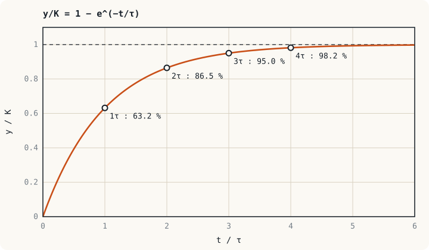

## The picture to keep in mind: the closer to the target, the slower {#idea}

Pour hot water into a cup and leave it. At first it cools quickly; near room temperature it cools very slowly, because **the rate of change is proportional to the distance still to go**. Any system that behaves like this is a **first-order system**: a charging capacitor, the current in a coil, the speed of a motor or the temperature of a transformer winding.

All of them are described by just two numbers.

## Standard form {#standard-form}

$$G(s) = \frac{K}{\tau s + 1}$$

| Parameter | Name | What it tells you |
|---|---|---|
| $K$ | DC gain (static gain) | How many times the input the final output is |
| $\tau$ | Time constant | How fast or slow the system is, in seconds |

The pole is at $s = -1/\tau$. The smaller $\tau$ is, the further left the pole lies and the faster the system.

:::warn Put it in standard form before reading values
The constant term of the denominator must be 1 first. $\dfrac{100}{0.1s + 6}$ cannot be read as it stands. Divide by 6 to get $\dfrac{16.67}{0.0167s + 1}$; then $K = 16.67$ and $\tau = 0.0167$ s.
:::

## Step response {#step}

Apply a step of size $A$, that is $U(s) = A/s$.

$$Y(s) = \frac{KA}{s(\tau s + 1)} \quad\Longrightarrow\quad y(t) = KA\left(1 - e^{-t/\tau}\right)$$

| Time | $\tau$ | $2\tau$ | $3\tau$ | $4\tau$ | $5\tau$ |
|---|---|---|---|---|---|
| Output (% of final value) | 63.2 | 86.5 | 95.0 | 98.2 | 99.3 |

Commonly used specifications:

| Quantity | Definition | Formula |
|---|---|---|
| Settling time $t_s$ (2 % criterion) | Time for the output to enter and stay within ±2 % of the final value | $t_s \approx 4\tau$ |
| Rise time $t_r$ | Time from 10 % to 90 % of the final value | $t_r = \tau\ln 9 \approx 2.2\tau$ |
| Initial slope | Slope of the curve at $t = 0$ | $KA/\tau$ |

:::key How to read a first-order curve
1. A first-order system has **no overshoot** and does not oscillate.
2. The tangent at the start meets the final-value line exactly at $t = \tau$.
3. The time to reach a fraction $p$ of the final value is $t = -\tau\ln(1 - p)$.
:::

:::example Example 5.1 When does a DC contactor coil pull in?
A 24 V DC contactor coil has $R = 48\ \Omega$ and $L = 2.4$ H. The contacts pull in when the current reaches 0.3 A. Find the time from energising until the contactor starts to pull in (ignoring the change of $L$ as the armature moves).

**Step 1.** The RL model from Unit 3.

$$\frac{I(s)}{V(s)} = \frac{1/R}{(L/R)s + 1} = \frac{0.0208}{0.05s + 1}$$

So $\tau = L/R = 50$ ms and the final current is $24/48 = 0.5$ A.

**Step 2.** 0.3 A is the fraction $p = 0.3/0.5 = 0.6$ of the final value.

$$t = -\tau\ln(1 - 0.6) = -(0.05)\ln(0.4) = 0.0458\ \text{s} \approx 46\ \text{ms}$$

This is part of the delay that must be allowed for when designing the sequence of a control circuit or PLC program.
:::

## Finding a model from a test curve {#identify}

In practice the values of $R$, $L$, $J$ are often unknown, but the equipment can be tested. The standard method is to apply a step and record the output.

1. $K = \dfrac{\text{total change in output}}{\text{change in input}}$
2. $\tau$ = the time at which the output has made 63.2 % of its total change

:::example Example 5.2 Time constant of a temperature probe
A PT100 probe is moved from air at 25 °C into an oil bath at 85 °C. The reading reaches 62.9 °C after 12 s. Find the time constant and the time after which the reading is within 2 % of the true value.

The total change is $85 - 25 = 60$ °C. The 63.2 % level is $25 + 0.632 \times 60 = 62.9$ °C, the reading at 12 s, so $\tau = 12$ s.

The settling time is $4\tau = 48$ s. During that time the controller receives a temperature below the truth. If the process changes faster than this, the sensor's $\dfrac{1}{12s + 1}$ must be counted as part of the loop.
:::

:::note The thermal model in protection relays
Overload relays and digital motor protection relays calculate winding temperature with a first-order model (a thermal replica) whose thermal time constant is minutes to tens of minutes. That is why a motor can carry a brief overcurrent during starting without tripping the relay. It is the same model as in this unit, used for protection.
:::

## Ramp response {#ramp}

When the input rises at a constant rate, $u(t) = At$, and $K = 1$,

$$y(t) = A\left(t - \tau + \tau e^{-t/\tau}\right)$$

After a long time the output runs parallel to the input but **lags it by $\tau$ seconds**, or is below it by $A\tau$. For example, the probe of Example 5.2 measuring a temperature rising at 2 °C/s reads $2 \times 12 = 24$ °C low for as long as the temperature keeps rising.

## Exercises {#exercises}

:::exercise Exercise 5.1
The precharge circuit of an inverter DC link charges a $2{,}200\ \mu\text{F}$ capacitor through a $50\ \Omega$ resistor. Find the time constant and the time for the capacitor voltage to reach 95 % of the bus voltage.

:::answer Show answer
$\tau = RC = (50)(2{,}200 \times 10^{-6}) = 0.11$ s

95 % corresponds to $3\tau$ (or compute $-\tau\ln 0.05 = 3.0\tau$), so $t = 0.33$ s. The control circuit therefore sets the bypass contactor delay longer than this.
:::
:::

:::exercise Exercise 5.2
A voltage step from 0 to 6 V is applied to a motor. The final speed is 1,500 rpm and it passes 948 rpm at 80 ms. Find the first-order model.

:::answer Show answer
$K = 1{,}500/6 = 250$ rpm/V and $948/1{,}500 = 0.632$, so $\tau = 80$ ms.

$$G(s) = \frac{250}{0.08s + 1}\ \text{rpm/V}$$
:::
:::

:::exercise Exercise 5.3
A first-order system must settle (2 % criterion) within 0.2 s. Where must the pole be?

:::answer Show answer
$4\tau \le 0.2$, so $\tau \le 0.05$ s. The pole $s = -1/\tau$ must be at $-20$ rad/s or further left.
:::
:::

## Summary of Unit 5 {#summary}

- A first-order system has the standard form $\dfrac{K}{\tau s + 1}$ and a pole at $s = -1/\tau$.
- The step response is $KA(1 - e^{-t/\tau})$: 63.2 % at $\tau$, settled in $4\tau$, no overshoot.
- $K$ and $\tau$ can be read directly from a step test.
- When tracking a ramp, the output lags the input by $\tau$ seconds.

The next unit adds one more energy-storing element, and the system becomes able to oscillate.
