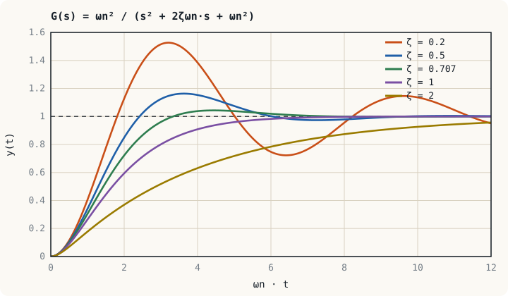

## The picture to keep in mind: energy passed back and forth {#idea}

A first-order system has one energy store, so energy flows one way until it is gone. A second-order system has **two energy stores that can exchange energy**. In an LC circuit energy alternates between the electric field of the capacitor and the magnetic field of the inductor. In a mechanical system it alternates between the potential energy of the spring and the kinetic energy of the mass. That exchange is **oscillation**, and resistance or friction removes energy so the oscillation dies away.

So this unit asks two questions: how fast does it oscillate, and how fast does the oscillation stop?

## Standard form {#standard-form}

$$G(s) = \frac{\omega_n^2}{s^2 + 2\zeta\omega_n s + \omega_n^2}$$

| Parameter | Name | Answers the question |
|---|---|---|
| $\omega_n$ | Natural frequency, rad/s | With no damping at all, how fast would it oscillate? |
| $\zeta$ | Damping ratio, dimensionless | How strongly is the oscillation damped? |

The poles are the roots of the denominator.

$$s = -\zeta\omega_n \pm \omega_n\sqrt{\zeta^2 - 1}$$

## Four kinds of response {#cases}

| $\zeta$ | Name | Poles | Step response |
|---|---|---|---|
| $\zeta > 1$ | Overdamped | Two different negative real | No oscillation, slow to settle |
| $\zeta = 1$ | Critically damped | Repeated negative real | Fastest possible without overshoot |
| $0 < \zeta < 1$ | Underdamped | Complex conjugate | Overshoots, then oscillates into the final value |
| $\zeta = 0$ | Undamped | On the imaginary axis | Oscillates for ever at $\omega_n$ |

:::key ωn stretches the time axis; ζ sets the shape
The horizontal axis above is $\omega_n t$, not $t$, so this one set of curves serves every $\omega_n$. Doubling $\omega_n$ squeezes the same curve to half the time, and **the shape does not change**. How much it overshoots and how many cycles it rings are set by $\zeta$ alone.
:::

## The underdamped system {#underdamped}

For $0 < \zeta < 1$ the poles are $s = -\sigma \pm j\omega_d$ with

$$\sigma = \zeta\omega_n, \qquad \omega_d = \omega_n\sqrt{1 - \zeta^2}$$

The unit step response is

$$y(t) = 1 - \frac{e^{-\sigma t}}{\sqrt{1 - \zeta^2}}\sin\!\left(\omega_d t + \phi\right), \qquad \phi = \cos^{-1}\zeta$$

The real part of the pole, $\sigma$, sets how fast the envelope decays. The imaginary part, $\omega_d$, is the frequency actually seen on an oscilloscope, the **damped natural frequency**.

| Specification | Formula | Depends on |
|---|---|---|
| Peak time $t_p$ | $\dfrac{\pi}{\omega_d}$ | Imaginary part of the pole |
| Percent overshoot %OS | $100\,e^{-\zeta\pi/\sqrt{1 - \zeta^2}}$ | $\zeta$ only |
| Settling time $t_s$ (2 %) | $\approx \dfrac{4}{\zeta\omega_n}$ | Real part of the pole |
| Rise time $t_r$ (approximate) | $\approx \dfrac{1.8}{\omega_n}$ | $\omega_n$ |

Values used often enough to memorise:

| $\zeta$ | 0.2 | 0.3 | 0.4 | 0.5 | 0.6 | 0.707 | 0.8 |
|---|---|---|---|---|---|---|---|
| %OS | 52.7 | 37.2 | 25.4 | 16.3 | 9.5 | 4.3 | 1.5 |

:::example Example 6.1 The RLC circuit of Unit 3
The RLC circuit of Example 3.1 has $\omega_n = 1000$ rad/s and $\zeta = 0.5$. A 5 V step is applied. Find the peak capacitor voltage, when it occurs and the settling time.

**Step 1.** $\omega_d = 1000\sqrt{1 - 0.25} = 866$ rad/s and $\sigma = 500$ s⁻¹

**Step 2.** $\%OS = 100\,e^{-0.5\pi/0.866} = 100\,e^{-1.814} = 16.3\ \%$. The peak voltage is $5 \times 1.163 = 5.82$ V.

**Step 3.** $t_p = \dfrac{\pi}{866} = 3.63$ ms and $t_s \approx \dfrac{4}{500} = 8$ ms

The capacitor must withstand at least 5.82 V, not 5 V. Overshoot is a matter of component ratings, not only of a tidy curve.
:::

:::example Example 6.2 The LC filter of a buck converter
The output filter of a buck converter has $L = 100\ \mu\text{H}$, $C = 100\ \mu\text{F}$ and a load $R = 5\ \Omega$ across the capacitor. The transfer function from the average switch-node voltage to the output is

$$G(s) = \frac{1}{LCs^2 + (L/R)s + 1}$$

Find $\omega_n$, $\zeta$ and the overshoot in open loop.

$\omega_n = \dfrac{1}{\sqrt{LC}} = \dfrac{1}{\sqrt{10^{-8}}} = 10^{4}$ rad/s (1.59 kHz)

Matching coefficients: $\dfrac{2\zeta}{\omega_n} = \dfrac{L}{R}$, so $\zeta = \dfrac{\omega_n L}{2R} = \dfrac{(10^{4})(10^{-4})}{10} = 0.1$

$\%OS = 100\,e^{-0.1\pi/\sqrt{0.99}} = 72.9\ \%$

The output overshoots by almost 73 % at an open-loop start, enough to destroy the load. A real converter therefore needs a voltage loop and a soft-start circuit. Note also that the lighter the load (larger $R$), the smaller $\zeta$ becomes.
:::

## From specifications to pole locations {#s-plane}

Each specification becomes a boundary in the $s$-plane.

| Specification | Condition | Region in the $s$-plane |
|---|---|---|
| Overshoot not above a limit | $\zeta \ge \zeta_{\min}$ | Inside the wedge at angle $\theta = \cos^{-1}\zeta_{\min}$ from the negative real axis |
| Settling time not above $t_s$ | $\sigma \ge 4/t_s$ | Left of the vertical line $s = -4/t_s$ |
| Peak time not above $t_p$ | $\omega_d \ge \pi/t_p$ | Above the horizontal line $\omega = \pi/t_p$ |

Controller design in Units 9 and 10 is the business of moving the closed-loop poles into the region that satisfies them all.

:::example Example 6.3 Choosing the gain of a position servo
A servomotor has $G(s) = \dfrac{K}{s(s + 4)}$ with unity feedback. Find $K$ for 5 % overshoot.

**Step 1.** Closed loop: $T(s) = \dfrac{K}{s^2 + 4s + K}$, so $\omega_n^2 = K$ and $2\zeta\omega_n = 4$.

**Step 2.** $\zeta$ from the overshoot.

$$\zeta = \frac{-\ln(0.05)}{\sqrt{\pi^2 + \ln^2(0.05)}} = \frac{2.996}{\sqrt{9.870 + 8.974}} = 0.690$$

**Step 3.** $\omega_n = \dfrac{4}{2(0.690)} = 2.90$ rad/s and $K = \omega_n^2 = 8.40$

The settling time is $4/(\zeta\omega_n) = 4/2 = 2$ s whatever $K$ is, because the real part of the poles is fixed at $-2$. To go faster, changing the gain is not enough; a compensator must be added.
:::

:::note Rotor swings of a generator
The swing equation of a synchronous generator connected to an infinite bus, linearised about an operating point, is a second-order system.

$$\frac{2H}{\omega_s}\frac{d^2\Delta\delta}{dt^2} + D\frac{d\Delta\delta}{dt} + P_s\,\Delta\delta = \Delta P_m, \qquad \omega_n = \sqrt{\frac{\omega_s P_s}{2H}}$$

For $H = 5$ s and $P_s = 1.5$ pu on a 50 Hz system ($\omega_s = 314$ rad/s), $\omega_n = \sqrt{47.1} = 6.86$ rad/s, about 1.1 Hz, which is in the range of the electromechanical oscillations seen on real systems. The natural damping $D$ is small, so a power system stabiliser is needed to add damping.
:::

## Exercises {#exercises}

:::exercise Exercise 6.1
A system has $G(s) = \dfrac{25}{s^2 + 4s + 25}$. Find $\omega_n$, $\zeta$, %OS, $t_p$ and $t_s$.

:::answer Show answer
$\omega_n = 5$ rad/s, $\zeta = 4/(2 \times 5) = 0.4$; from the table %OS = 25.4 %.

$\omega_d = 5\sqrt{1 - 0.16} = 4.58$ rad/s, $t_p = \pi/4.58 = 0.686$ s, $t_s \approx 4/(0.4 \times 5) = 2$ s
:::
:::

:::exercise Exercise 6.2
A series RLC circuit has $L = 10$ mH and $C = 100\ \mu\text{F}$. What $R$ gives critical damping?

:::answer Show answer
From $\zeta = \dfrac{R}{2}\sqrt{\dfrac{C}{L}} = 1$: $R = 2\sqrt{\dfrac{L}{C}} = 2\sqrt{100} = 20\ \Omega$
:::
:::

:::exercise Exercise 6.3
A system must overshoot by no more than 16.3 % and settle within 1 s. In what region must the closed-loop poles lie, and where is the pole with the lowest $\omega_n$?

:::answer Show answer
We need $\zeta \ge 0.5$ (within 60° of the negative real axis) and $\sigma \ge 4$. The corner of the region is $\sigma = 4$, $\omega_d = 4\tan 60° = 6.93$, that is $s = -4 \pm j6.93$, with $\omega_n = 8$ rad/s.
:::
:::

## Summary of Unit 6 {#summary}

- The standard form is $\dfrac{\omega_n^2}{s^2 + 2\zeta\omega_n s + \omega_n^2}$: $\omega_n$ sets the speed and $\zeta$ sets the shape.
- $\zeta < 1$ gives complex poles $-\zeta\omega_n \pm j\omega_d$ and a response that overshoots and rings.
- %OS depends on $\zeta$ alone; $t_s \approx 4/(\zeta\omega_n)$ and $t_p = \pi/\omega_d$.
- Specifications translate into a region for the poles in the $s$-plane.

The next unit looks at the other side of performance: once the system has settled, how closely does the output match the reference?
